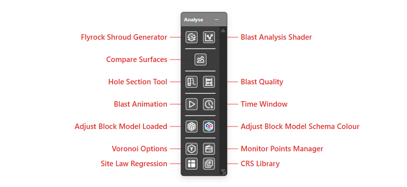
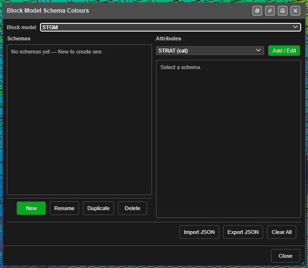

# Analyse Toolbar

The **Analyse** toolbar holds Kirra's analysis tools — flyrock, vibration, timing, block models,
blast quality and the coordinate-system library. It is one of the eight floating toolbars;
open it from its tab on the right edge of the window.

*The Analyse toolbar with its buttons labelled.*

---

## The buttons

Hover over a button to see its name. The buttons sit in six groups, separated by a line,
listed here from the top of the toolbar down.

### Blast models

| Button | What it does | Guide |
|---|---|---|
| **Flyrock Shroud Generator** | Builds a 3D flyrock envelope over the blast, from one of four published models | [Flyrock Modelling](flyrock.md) |
| **Blast Analysis Shader** | Paints a vibration, damage, pressure or powder-factor model over the ground | [Blast Analysis Shader](overview.md) |

### Surfaces

| Button | What it does | Guide |
|---|---|---|
| **Compare Surfaces** | Colours a measured surface by its distance from a design surface | [Compare Surfaces](../surfaces/compare-surfaces.md) |

### Holes as drilled

| Button | What it does | Guide |
|---|---|---|
| **Hole Section Tool** | A section through one hole, showing its burden to the face, with staged edits | [Hole Section View](../reference/section-views.md#hole-section-view) |
| **Blast Quality** | The spread of any hole attribute, and holes filed in the wrong row | [Blast Quality](blast-quality.md) |

### Timing

| Button | What it does | Guide |
|---|---|---|
| **Blast Animation** | Plays the firing sequence back in time | [Blast Animation](blast-animation.md) |
| **Time Window** | Timing and vibration analysis — histograms, intervals, spectrum, waveform synthesis, detune and constrain | [Time Window](time-window.md) |

### Block models

| Button | What it does | Guide |
|---|---|---|
| **Adjust Block Model Loaded** | Changes how the loaded block model is drawn | [Below](#adjust-block-model-loaded) |
| **Adjust Block Model Schema Colour** | Manages the named colour schemas for block-model attributes | [Below](#adjust-block-model-schema-colour) |

### Vibration and libraries

| Button | What it does | Guide |
|---|---|---|
| **Voronoi Options** | Sets up the Voronoi cells — what they show, the area basis, the legend and the PPV modes | [Voronoi Cells](voronoi.md) |
| **Monitor Points Manager** | Adds and edits vibration monitors and the seed waveform library | [Monitor Points & Seed Library](monitor-points.md) |
| **Site Law Regression** | Fits your site law (log-log PPV against scaled distance) from monitoring records and applies it to a monitor | [Site Law Regression](site-law-regression.md) |
| **CRS Library** | Keeps your site's coordinate systems — `.prj`, WKT, Proj4, EPSG — for every import and export dialog | [CRS Library](crs-library.md) |

---

## Which tool for which question

| Question | Tool |
|---|---|
| How far could rock fly from this blast? | [Flyrock Shroud Generator](flyrock.md) |
| Which holes are over- or under-charged for their ground? | [Voronoi Cells](voronoi.md) — **PF - Designed** |
| Will this blast exceed the vibration limit at the neighbours? | [PPV Voronoi Modes](ppv-voronoi-modes.md) — Mode C or F |
| Which hole should I change first to cut vibration? | [PPV Voronoi Modes](ppv-voronoi-modes.md) — Mode B |
| How much charge can each hole take? | [PPV Voronoi Modes](ppv-voronoi-modes.md) — Mode D |
| What are my site's K and B? | [Site Law Regression](site-law-regression.md) |
| How far does damage reach behind the last row? | [Blast Analysis Shader](overview.md) — Holmberg-Persson Damage |
| Do too many holes fire at once? | [Time Window](time-window.md) |
| Does the firing run the way I designed it? | [Blast Animation](blast-animation.md) |
| Are holes in the right rows, and is the drilling consistent? | [Blast Quality](blast-quality.md) |
| How far is the survey from the design surface? | [Compare Surfaces](../surfaces/compare-surfaces.md) |
| My file is on another grid — how do I bring it onto mine? | [CRS Library](crs-library.md), then [Transform Import](../importing/transform-import.md) |

---

## Adjust Block Model Loaded

Opens **Load Block Model** for the first loaded block model, to change how it is drawn — colour,
blocks or points, bench slice, limits. It does not load a model; Kirra says so if none is
loaded. Full guide: [The Load Block Model Dialog](../block-models/load-block-model-dialog.md).

---

## Adjust Block Model Schema Colour

Manages named colour **schemas** — site or project colour standards for block-model attributes. A schema holds one colour definition per attribute (rock type, grade, domain, etc.).

### How to use

1. Click the **Adjust Block Model Schema Colour** button on the Analyse toolbar — the **Block Model Schema Colours** dialog opens
2. In the **Schemas** list, create a schema with **New**, or **Rename**, **Duplicate** or **Delete** an existing one
3. Select a schema, pick an attribute and click **Add / Edit** — choose the **Type** (**Ranges (decimal)**, **Discrete values (integer)** or **Categorical (labels)**), set the colours and click **Save**. **Remove** deletes an attribute's colours
4. Use **Import JSON** / **Export JSON** to share schemas between projects
5. To use a schema, open **Adjust Block Model Loaded** and set **Colour by** to **Schema**

---

## Related

- [Interface Tour](../getting-started/interface-tour.md)
- [Display Options](../working-in-kirra/display-options.md) — the **Voronoi** display button
