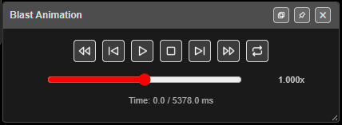

# Blast Animation

Plays the firing sequence back in time. Each hole lights up as it fires, so you can watch the
blast move across the pattern and check the timing reads the way you designed it.

---

## Prerequisites

- A blast with timing — ties, or electronic delays.
- The holes you want to see must be visible. Hidden holes are not played.

---

## How to play a blast

1. Click **Blast Animation** on the **Analyse** toolbar. The **Blast Animation** bar opens.
2. Click **Play**. Holes light up in firing order. Click again (**Pause**) to stop on the
   current time.
3. Drag the speed slider to play slower or faster.
4. Close the bar with **×** in its title bar.

---

## The controls

| Control | What it does |
|---|---|
| **Rewind to start** | Jumps to time 0 |
| **Step -0.5ms** | Steps back half a millisecond |
| **Play** / **Pause** | Starts and pauses playback |
| **Stop** | Stops and returns to time 0 |
| **Step +0.5ms** | Steps forward half a millisecond |
| **Forward to end** | Jumps to the last hole |
| **Loop** | Plays again from the start when it reaches the end. Off when Kirra starts |
| Speed slider | From 0.01× (far left) through 1× (centre) to 10× (far right). The speed is shown beside it, for example **1.000x** |

The time reads *Time: current / total ms*. The total is the fire time of the last **visible**
hole. Playback runs a little past the end before it stops or loops.

---

## What you see

| | While playing | Paused or stepping |
|---|---|---|
| 2D | Fired holes filled orange with a yellow outline | Fired holes green |
| 3D | Fired holes red with a yellow outline | Fired holes green |

Closing the bar stops playback and clears the fired holes.

---

## Warnings

The bar can show a warning above the controls:

- *"⚠ … hole(s) have electronic detonators without baked delays — they fire at their
  programmed time, not your tie times, so playback will not follow the ties."* Bake the
  delays first — **Bake Delay** on the **Connect** toolbar.
- *"⚠ All … visible holes fire at the same time … — there is no sequence to play."* Check
  the ties or the detonator delays.

---

## Troubleshooting

**Nothing happens when I click Play.**
Check the warning line — every visible hole may fire at the same time, or the blast has no
timing.

**Playback ignores my ties.**
The holes have electronic detonators with delays that have not been baked. Use **Bake Delay**
on the **Connect** toolbar.

**Some holes never light up.**
They are hidden. Show them in the [Data Explorer](../working-in-kirra/data-explorer.md).

---

## Related

- [Time Window](time-window.md) — timing analysis
- [Analyse Toolbar](analyse-toolbar.md)
