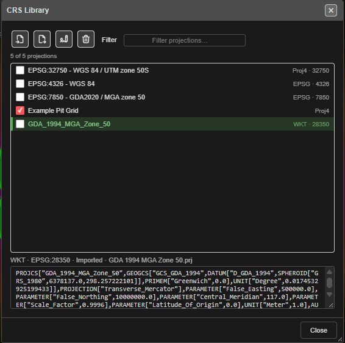
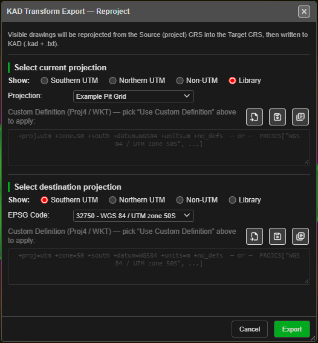
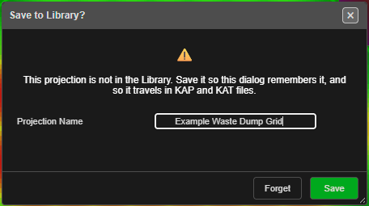

# CRS Library

The **CRS Library** keeps the coordinate systems your site uses — mine grids, UTM zones,
local survey grids — so you choose them by name instead of pasting a definition every time.
It travels inside your KAP project and KAT site template files, so a colleague who opens
your file gets the same grids, even with no internet.

---

## What it accepts

| Format | File | Example |
|---|---|---|
| **WKT** (ESRI or OGC) | `.prj`, `.wkt` | `PROJCS["GDA_1994_MGA_Zone_50", …]` |
| **Proj4** | `.proj4`, `.proj`, `.txt` | `+proj=tmerc +lat_0=0 +lon_0=117 …` |
| **EPSG code** | typed, or in a file | `EPSG:28350` |
| **A library file** | `.json` | Several projections at once, as exported from the CRS Library |

Each definition is checked when it comes in. A file Kirra cannot use is reported, and never
stored.

---

## Open it

Click **CRS Library — saved projections** on the **Analyse** toolbar. The dialog is
**CRS Library**.

*One entry ticked for Export or Delete; the highlighted entry shows its definition below.*

| Part | What it does |
|---|---|
| **Import** | Reads one or many projection files at once. Files that cannot be read are listed in an amber banner |
| **Export** | Saves the ticked projections, or the highlighted one. One WKT saves as `.prj`, one Proj4 as `.proj4`. An EPSG entry, or several entries, save as one `.json` that **Import** reads back |
| **Rename** | Renames the highlighted projection. Dialogs that remembered it still find it |
| **Delete** | Deletes the ticked projections, or the highlighted one, after asking |
| **Filter** | Narrows the list by name or EPSG code |
| **The list** | Tick boxes choose what Export and Delete act on. Click a row to see its type, EPSG code, where it came from, and the full definition |

---

## Projections in import and export dialogs

Every dialog that asks for a coordinate system uses the same picker. A transform import or
export asks two questions: **Select current projection** (the system the data is in now)
and **Select destination projection** (the system you want).

*The current projection comes from the Library; the destination is an EPSG code.*

| Control | What it does |
|---|---|
| **Show:** Southern UTM / Northern UTM / Non-UTM | Filters the **EPSG Code** list |
| **Show:** Library | Lists your CRS Library. The list label changes to **Projection:** |
| **— Use Custom Definition —** | In the EPSG list: use the Proj4 / WKT box below instead |
| **Load a projection file** (open-file icon) | Reads a `.prj`, `.wkt`, `.proj4` or `.json` into the custom box |
| **Save the active projection to the Library** (save icon) | Names the current pick and saves it to the Library |
| **Choose a projection from the Library** (library icon) | Lists your CRS Library in the dropdown — the same as **Show:** Library. If the Library is empty, Kirra says where to import projections |

### Saving a custom definition when you press OK

If you used a custom definition that is not in the Library, Kirra asks **Save to Library?**
when you press the dialog's OK button:

- **Save** — type a **Projection Name** and save. The dialog remembers it by name next time.
- **Forget** — use it this once. Nothing is kept.

If the same definition is already in the Library, Kirra uses that entry and asks nothing.
Saving under a name that is already taken by a different projection adds a number —
**Pit Grid (2)** — rather than replacing the first.

### What each dialog remembers

Each dialog remembers the last projection you used: an EPSG code, or a Library entry. These
choices are work settings, so they travel in a KAP or KAT with the Library itself. A
colleague who opens your file finds your grid already chosen.

---

## Working offline

The first time you use an EPSG code, Kirra downloads its definition and keeps a copy in the
Library, named **EPSG:** plus the code. From then on that code works without internet, and it
travels with your KAP and KAT files to sites that have none.

---

## Notes

- Only X and Y are converted. Elevations are never changed.
- ESRI `.prj` files for skewed mine grids (*Rectified Skew Orthomorphic*) are supported.
- The GeoTIFF export picker lists only Library entries with an EPSG code, because the file
  must record one.

---

## Related topics

- [Transform (Reproject) Import](../importing/transform-import.md)
- [Analyse Toolbar](analyse-toolbar.md)
- [Starting and Saving](../working-in-kirra/starting-and-saving.md) — KAP and KAT files
- [Coordinate System](../reference/coordinate-system.md)
