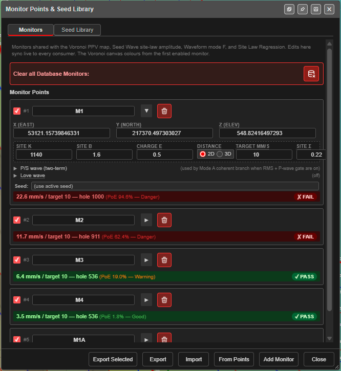
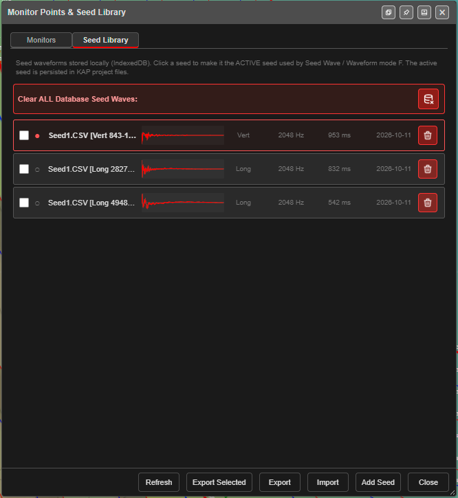
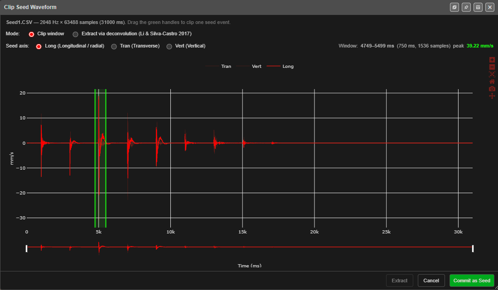
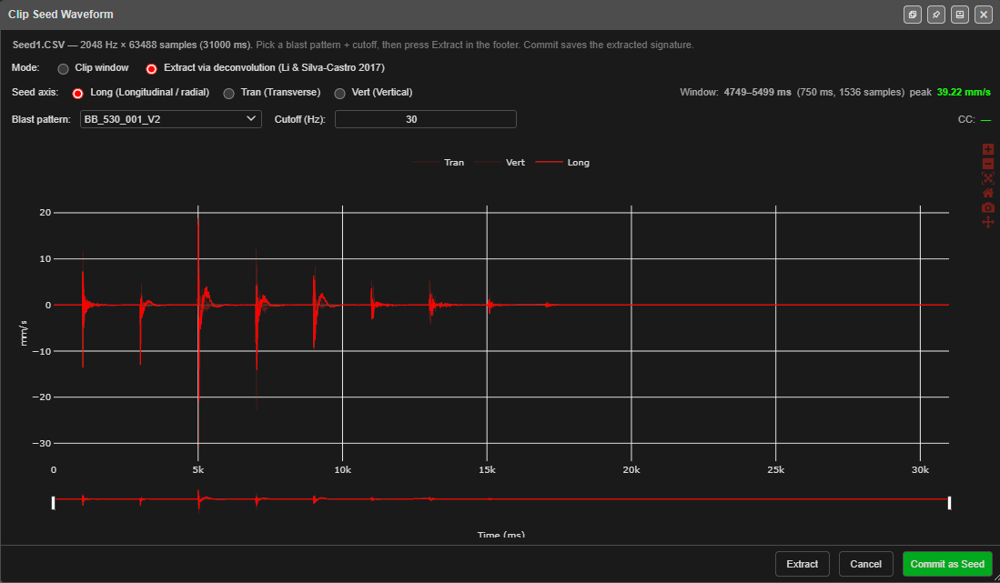

# Monitor Points & Seed Library

Monitors are the places you need to protect from vibration — a house, a fence line, a pipeline,
a highwall. Each one carries its own site law and target. They drive the
[PPV Voronoi modes](ppv-voronoi-modes.md), the Seed Wave and Forward Array tabs of
[Time Window](time-window.md), and [Site Law Regression](site-law-regression.md). The **Seed
Library** holds measured vibration traces used to shape the predicted waves.



---

## Open it

Click **Monitor Points Manager** on the **Analyse** toolbar. The dialog is
**Monitor Points & Seed Library**, with two tabs: **Monitors** and **Seed Library**. The buttons
along the bottom change with the tab.

You can also open it from **Voronoi Options**, with the button beside **Full editor:**.

---

## Monitors tab

*"Monitors shared with the Voronoi PPV map, Seed Wave site-law amplitude, Waveform mode F, and
Site Law Regression. Edits here sync live to every consumer."*

### Add monitors

| Button | What it does |
|---|---|
| **Add Monitor** | Adds a monitor at the centre of the loaded data, named **VM1**, **VM2** … Edit its position afterwards |
| **From Points** | Turns every visible KAD **point** into a monitor, named *drawing#point*. Lines, polygons and text are skipped |
| **Import** | Replaces **all** monitors from a CSV, or from a ZIP saved with seeds. If you have monitors, Kirra asks **Replace all monitors?** first |

### The monitor card

Each monitor is a card. Cards open collapsed; click ▶ to expand one.

| Part | Fields | Notes |
|---|---|---|
| Header | Tick, number, name, ▶, trash | The tick enables the monitor for every calculation. The trash button deletes it straight away, with no confirmation |
| Location | **X (East)**, **Y (North)**, **Z (Elev)** | Z is used only when **Distance** is **3D** |
| Site law | **Site K** (1140), **Site B** (1.6), **Charge e** (0.5), **Distance** (2D / 3D), **Target mm/s** (10), **Site σ** (0.22) | The monitor's own attenuation law, PPV = K × (D / Q^e)^−B, and its limit. **Site σ** is the scatter of the fit, needed by Mode F |
| **P/S wave (two-term)** | **Vp (m/s)** 5000, **Vs (m/s)** 2900, **fP (Hz)** 30, **ξP** 0.10, **amp P** 1.0, **fS (Hz)** 18, **ξS** 0.15, **amp S** 0.7 | The wave shape and speeds. Used by Mode A when RMS and the P-wave gate are on |
| **Love wave** | **Enable** (off), **Love T-amp** 0.3, **f Love (Hz)** 2.0, **v Love (m/s)** 800 | Used by the Forward Array tab and Mode E only |
| **Seed:** | **(use active seed)** or a seed from the library | Which measured trace this monitor uses |
| Result line | — | The monitor's result in the current Voronoi mode, ending with its probability of exceedance, and **✓ PASS** or **✗ FAIL** |

Each monitor has its own site law because the ground between the blast and each monitor is
usually different. Fit K, B and σ from your own records with
[Site Law Regression](site-law-regression.md).

### Save and share monitors

| Button | What it saves |
|---|---|
| **Export** | Every monitor, as CSV |
| **Export Selected** | Only the ticked (enabled) monitors |

If any monitor is linked to a seed, Kirra asks **Include linked seeds?** — **Incl. Seeds**
saves a ZIP with the monitors and their seeds; **Monitors Only** saves the CSV.

The CSV columns are:

```
Name,X,Y,Z,Enabled,SiteK,SiteB,ChargeE,DistanceMode,TargetPPV,VpMps,VsMps,FpHz,XiP,AmpP,FsHz,XiS,AmpS
```

**Name**, **X** and **Y** are required on import. Column names must match exactly (any case).

> **Note:** The CSV does not carry **Site σ**, the linked seed or the Love wave settings. To
> keep everything, use a ZIP with seeds or a [KAP project](../working-in-kirra/starting-and-saving.md#back-up-and-move-your-work).

### Clear all

**Clear all Database Monitors:** (the red bar) deletes every saved monitor after a warning.
It cannot be undone — export first.

---

## Seed Library tab

*"Seed waveforms stored locally (IndexedDB). Click a seed to make it the ACTIVE seed used by
Seed Wave / Waveform mode F. The active seed is persisted in KAP project files."*



Each row shows a tick, ● for the active seed, the name (file, axis and clip window), a small
trace, the axis, sample rate, duration and date, and a trash button.

| Button | What it does |
|---|---|
| **Add Seed** | Loads a trace — see [Add a seed](#add-a-seed) |
| **Import** | Merges a seed library ZIP into this one |
| **Export** | Saves the whole library as a ZIP |
| **Export Selected** | Saves only the ticked seeds |
| **Refresh** | Reloads the library |

Click a row to make that seed active. **Clear ALL Database Seed Waves:** deletes every seed.

### Add a seed

1. Click **Add Seed** and choose the file.
   - A two-column CSV (time in ms, velocity) or a one-column TXT (read at 1000 Hz) is added
     straight away.
   - A full-waveform export from an Instantel or Texcel monitor opens **Clip Seed Waveform**.
2. In **Clip Seed Waveform**, choose the **Seed axis:** — **Long (Longitudinal / radial)**,
   **Tran (Transverse)** or **Vert (Vertical)**.
3. Choose the **Mode:** — see below.
4. Click **Commit as Seed**. The seed is added to the library, named after the file, the axis
   and the window. **Cancel** adds nothing.

**Clip window** — *"Drag the green handles to clip one seed event."* Pick one clean hole
event. The readout shows the window, its length and its peak, for example
*Window: 4749–5499 ms (750 ms, 1536 samples) peak 39.22 mm/s*. The strip under the chart
pans and zooms along the record.



**Extract via deconvolution (Li & Silva-Castro 2017)** — *"Pick a blast pattern + cutoff,
then press Extract in the footer. Commit saves the extracted signature."* Instead of clipping
one event, Kirra works out the single-hole signature from the whole record, using the chosen
blast's deck firing times and charges. Choose the **Blast pattern** that was recorded and a
**Cutoff (Hz)** (default 30 — *"works for most blast spectra"*; set well below the trace's
main frequency it strips out the signature itself), then click **Extract**, then **Commit as
Seed**. A **CC** value shows after extraction.



---

## On the canvas

In any [PPV Voronoi mode](ppv-voronoi-modes.md#monitors-on-the-canvas), each enabled monitor
is drawn with a marker, a line to the hole that governs it, its distance, and its result.
Monitors are not printed.

---

## What is remembered

Monitors are kept with the workspace and in this browser, and travel in KAP projects. Seeds
are kept in this browser; the active seed travels in KAP projects.

---

## Troubleshooting

**A monitor shows *No charging data*.**
The blast has no charging yet. Assign charging to the holes.

**Import says *CSV missing required columns (Name, X, Y)*.**
The header row must name **Name**, **X** and **Y** exactly.

**My Love wave settings were lost after a CSV round trip.**
The CSV does not carry them — export as a ZIP with seeds, or use a KAP project.

---

## Related

- [PPV Voronoi Modes](ppv-voronoi-modes.md)
- [Site Law Regression](site-law-regression.md)
- [Time Window](time-window.md)
- [Voronoi Cells](voronoi.md)
