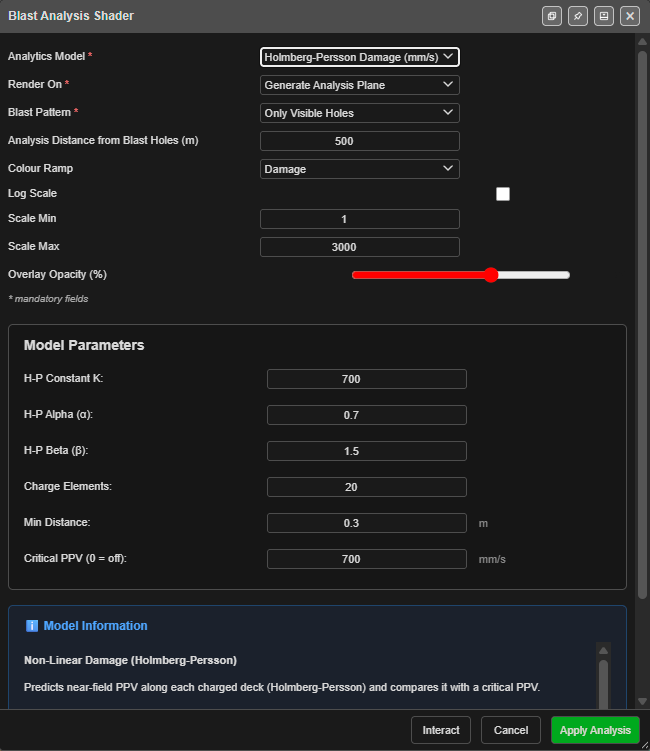

# Blast Analysis Shader

The **Blast Analysis Shader** paints a vibration, damage, pressure or powder-factor model across
a surface around your blast, so you can see how far an effect reaches and where it is
strongest. Most models run on the graphics card, so a result appears in seconds; one runs in
the background on the processor.

This is a different tool from the [PPV Voronoi modes](ppv-voronoi-modes.md), which colour one
cell per hole against your monitors. The shader paints a continuous field over the ground.

*The dialog on **Holmberg-Persson Damage**. Values shown are one user's settings.*

---

## Prerequisites

- A blast loaded. Charging on the holes gives the best result; without it, models assume a
  charge over 70 % of each hole.
- Timing on the holes, for the time-based models and **Interact**.
- Optional: a surface to paint on. Without one, Kirra makes a flat plane.

---

## How to run an analysis

1. Click **Blast Analysis Shader** on the **Analyse** toolbar. Kirra switches to the 3D view and
   opens the dialog.
2. Choose the **Analytics Model**.
3. Choose **Render On** — **Generate Analysis Plane**, or a loaded surface.
4. Choose the **Blast Pattern** to analyse.
5. Adjust the model's settings under **Model Parameters** if needed.
6. Click **Apply Analysis**.

Kirra shows *Baking analysis…* and adds a new surface named, for example,
**Analysis Scaled Heelan_ab12**, on the **Analysis** layer, with its own legend. It shows in 2D
and 3D.

- The surface you painted on is **copied**, not changed.
- A generated plane sits at the Drawing RL, or at the average collar height if no Drawing RL is
  set.
- When you move holes or change timing, the analysis surface updates itself shortly afterwards
  (all models except the time-domain one).

To remove an analysis, use **Undo** straight away, or delete the surface like any other.

---

## The dialog

| Field | Default | What it does |
|---|---|---|
| **Analytics Model** | Scaled Heelan Fast | The model — see the table below |
| **Render On** | **Generate Analysis Plane** | A flat plane, or a loaded surface to paint |
| **Blast Pattern** | **Only Visible Holes** | **Only Visible Holes**, **All Blast Holes**, or one blast |
| **Analysis Distance from Blast Holes (m)** | 200 | How far from the holes to analyse. A generated plane extends this far; a surface is cropped to this distance. Smaller is sharper and faster |
| **Colour Ramp** | Set by the model | The colours used |
| **Log Scale** | Set by the model | Spread the colours on a log scale |
| **Scale Min** / **Scale Max** | Set by the model | The colour range, in the model's unit. Values below **Scale Min** are not drawn |
| **Overlay Opacity (%)** | 70 | How solid the result is. Change it later in the surface's properties |

Changing the model resets the ramp, **Log Scale** and the scale to that model's defaults.
**Model Parameters** holds the model's own settings, and **Model Information** explains the
model.

### Buttons

| Button | What it does |
|---|---|
| **Apply Analysis** | Runs the model and adds the analysis surface. For the time-domain Blair & Minchinton model it reads **Compute** |
| **Interact** | Opens **Time Interaction** to step through the firing — see below. Not shown for the time-domain model |
| **Cancel** | Closes the dialog |

If the blast has more holes or decks than the model can draw, Kirra asks first — **Run anyway**
draws as many as it can; **Let me reduce it** returns to the dialog.

---

## The models

| Analytics Model | Unit | What it shows | Limit |
|---|---|---|---|
| **Peak Particle Velocity (PPV)** | mm/s | Site-law PPV from each hole | 2048 holes |
| **Heelan Original (Blair & Minchinton 1996)** | mm/s | Directional vibration from each charge (Heelan) | 1024 decks |
| **Scaled Heelan Fast (based on Blair & Minchinton)** | mm/s | Heelan directional pattern scaled to your site law | 1024 decks |
| **Holmberg-Persson Damage** | mm/s | Near-field PPV along each charge, against a critical PPV | 1024 decks |
| **Borehole Pressure** | MPa | Pressure from each charge, falling with distance | 512 decks |
| **Volumetric Powder Factor** | kg/m³ | Explosive energy per volume of rock | 2048 decks |
| **Jointed Rock Damage** | damage ratio | Damage by intact-rock fracture and/or joint slip | 1024 decks |
| **PPV (Per-Deck)** | mm/s | Site-law PPV from each deck | 2048 decks |
| **Blair Lite — Scaled Heelan 90% (Blair Radiation)** | mm/s | Scaled Heelan with Blair's radiation pattern | 1024 decks |
| **Temporal Lifecycle (VOD Ramp)** | mm/s | Each charge detonating from its primer at the explosive's VOD | 512 decks |
| **Scaled Heelan (Blair & Minchinton, Time-Domain)** | mm/s | Full waveform synthesis on the processor | — |
| **Ripple Tank — Forward Wave Field** | mm/s | The travelling P and S wave fronts | 2048 holes |

Each model's settings and defaults are listed in [PPV & Vibration Models](ppv-models.md).

---

## Time Interaction

**Interact** draws a live analysis and opens **Time Interaction**, so you can step through the
firing and see the effect build up hole by hole.

| Control | What it does |
|---|---|
| **Rewind to start**, **Step -0.5ms**, **Play** / **Pause**, **Stop**, **Step +0.5ms**, **Forward to end**, **Loop** | Move through time, as in [Blast Animation](blast-animation.md) |
| **Play Speed** | Playback speed |
| Time slider | Drag to a moment. It starts at the end, so the full blast shows first |
| **Generate** | Saves the analysis at the current time as a surface |
| **Cancel** | Closes it and removes the live analysis |

---

## The time-domain model

**Scaled Heelan (Blair & Minchinton, Time-Domain)** builds the full vibration waveform. It runs
in the background with a progress window — expect it to take longer — and has no
**Interact**. Its result is saved with the surface, so it does not need recomputing after a
reload.

**Display Time (ms):** chooses one moment to show; **-1** shows all decks.

---

## Interference — what the models show

Two models add waves **with their sign**, so waves can reinforce or cancel:

- **Scaled Heelan (Blair & Minchinton, Time-Domain)** — full waveform synthesis, for
  prediction.
- **Ripple Tank — Forward Wave Field** — simple wavelets, for seeing the idea. Its own
  information panel says it is an *"Educational visualisation — not a quantitative
  blast-prediction tool"*, and not for compliance.

The other vibration models add up the energy from each charge, which can only grow.
**Temporal Lifecycle** shows the order and timing of the burn along each charge, not
interference.

---

## Colour ramps

The ramps are **Ppv**, **Jet**, **Viridis**, **Damage**, **Compliance**, **Grey**, **Sdob**,
**Pressure**, **Spectrum**, **Thermal**, **Rgb** and **Diverging**. Each model starts with its
own (for example **Jet** for the Heelan models, **Damage** for Holmberg-Persson, **Diverging**
for Ripple Tank); change it in **Colour Ramp**.

---

## Saving and exporting

- Analysis surfaces are saved with the workspace and travel in KAP projects.
- To use one outside Kirra, export it as a baked GLB — see
  [GLTF / GLB export](../exporting/gltf-export.md).
- The dialog remembers your last settings for the same model.

---

## Troubleshooting

**Nothing appears after Apply Analysis.**
Check the **Blast Pattern** choice includes visible holes, and that **Scale Min** is not above
your values.

**"Too many charged decks for this model".**
The blast has more decks than the model can draw. Choose one blast in **Blast Pattern**, or a
model with a higher limit.

**The colours are all one end of the ramp.**
Adjust **Scale Min** and **Scale Max**, or switch **Log Scale**.

---

## Related

- [PPV & Vibration Models](ppv-models.md) — every model's settings
- [PPV Voronoi Modes](ppv-voronoi-modes.md) — per-hole vibration against monitors
- [Flyrock Modelling](flyrock.md)
- [Charging Overview](../charging/overview.md)
