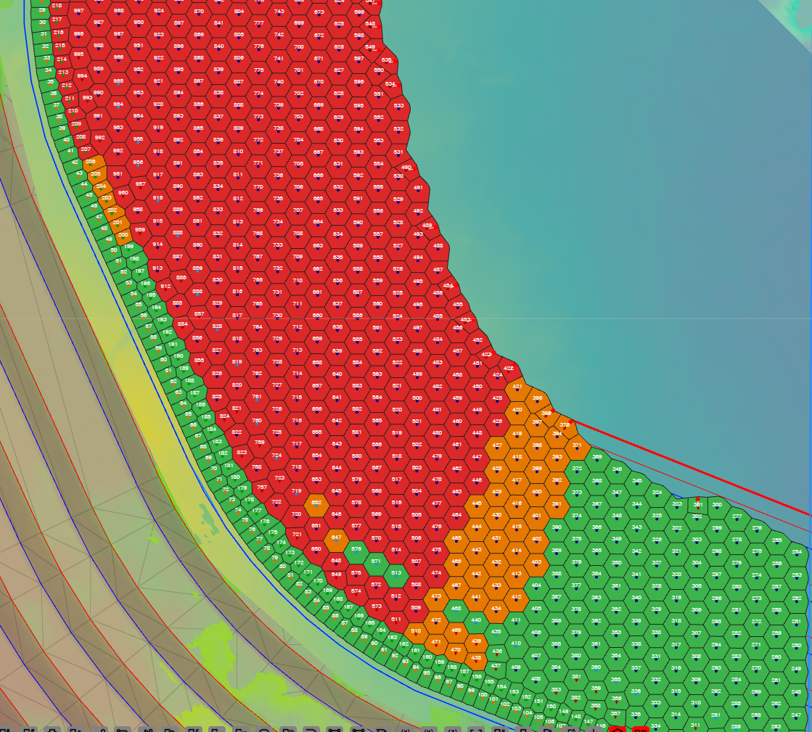
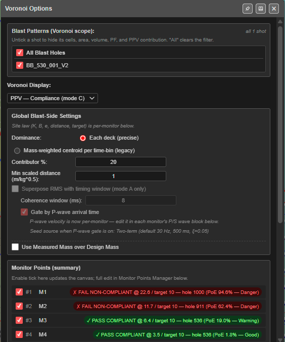
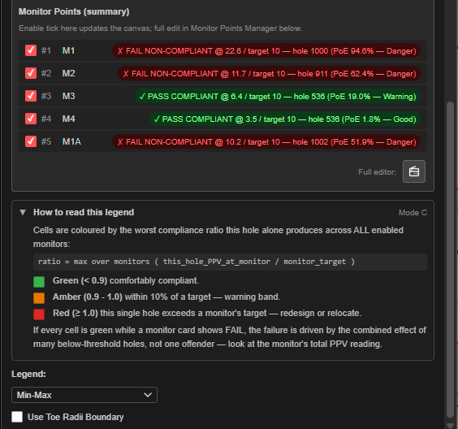
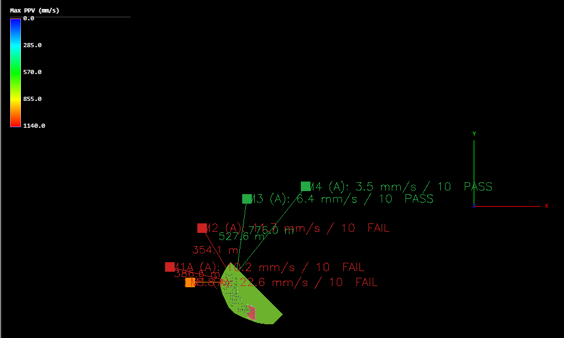

# PPV Voronoi Modes (A – F)

Six of the [Voronoi](voronoi.md) displays predict blast vibration (PPV) hole by hole, measured
against one or more **monitors** — the places you need to protect. Each hole's cell is coloured
by its effect, so you can see which holes to change before the blast fires.

This is not the same tool as the [Blast Analysis Shader](overview.md), which paints a physics
model across a whole surface. The Voronoi modes use each monitor's own **site law** and update
as you move holes or change charging.


*Mode C, Compliance. Green holes are comfortably under every target, amber within 10 %, red
over a target on their own.*

---

## Prerequisites

- A blast with charging (or a mass on each hole) and timing.
- For modes B to F: at least one **enabled** monitor, with its site law set. Add monitors in
  the [Monitor Points Manager](monitor-points.md).
- For Mode F: **Site σ** set on each monitor.

---

## Which mode to use

| Mode | Voronoi Display | Each cell shows | Use it to |
|---|---|---|---|
| **A** | **PPV — Max / Coherent Seed (mode A)** | Peak PPV predicted at the cell from the whole pattern | See where the blast itself shakes hardest. Needs no monitor |
| **B** | **PPV — Dominant Hole (mode B)** | This hole's effect at the most-stressed monitor, against the worst hole there | Find which hole to redesign first |
| **C** | **PPV — Compliance (mode C)** | The worst ratio of this hole's PPV to a monitor's target | Get a pass/fail, hole by hole, against every monitor |
| **D** | **PPV — Max Allowable Charge (mode D)** | The most charge this hole could fire and keep every monitor under target | Work out a charge limit per hole |
| **E** | **PPV — Full Forward Array (mode E)** | Wave synthesis of the whole pattern at each hole | Find hot zones inside the pattern |
| **F** | **PPV — Probability of Exceedance (mode F)** | The chance a monitor's target is exceeded, worst monitor | Judge risk, allowing for the scatter in your site law |

---

## Choose a mode

1. Right-click the **Voronoi** display button, or click **Voronoi Options** on the
   **Analyse** toolbar.
2. In **Voronoi Display**, choose a **PPV —** mode.
3. Switch on the **Voronoi** display button if the cells are not showing.

The dialog grows three extra sections: **Global Blast-Side Settings**, **Monitor Points
(summary)** and **How to read this legend**.



---

## Global Blast-Side Settings

These apply to the whole blast. *"Site law (K, B, e, distance, target) is per-monitor below."*

| Setting | Default | What it does |
|---|---|---|
| **Dominance:** | **Each deck (precise)** | **Each deck (precise)** treats every deck as its own source. **Mass-weighted centroid per time-bin (legacy)** lumps decks that fire in the same time bin into one charge — kept to reproduce older reports; it tends to overstate peak PPV |
| **Time bin (ms):** | 0 | Only with the legacy option. The bin width; 0 means no binning. 8 ms is the usual legacy value |
| **Contributor %:** | 20 | Sources below this percentage of the peak are left off the "contributors" lists. Reporting only — it does not change the PPV |
| **Min scaled distance (m/kg^0.5):** | 1.0 | Closer than this scaled distance the site law over-predicts, so Kirra holds the distance at this floor. For a 100 kg charge with e = 0.5 the floor is 10 m (Yang & Scovira 2007) |
| **Superpose RMS with timing window (mode A only)** | Off | **Off**: the single biggest deck sets the PPV. **On**: decks arriving close together are combined as the square root of the sum of squares |
| **Coherence window (ms):** | 8 | With RMS on: how close in time decks must be to combine |
| **Gate by P-wave arrival time** | On | With RMS on: compare *arrival* times at the monitor (fire time + distance ÷ P-wave velocity), not fire times at the blast |
| **Use Measured Mass over Design Mass** | Off | **On**: a hole whose measured mass is 0 counts as unloaded |
| **Use 3D Monitor location** | On | Mode D only. **On** measures slant distance including height; **Off** measures in plan |

- The P-wave velocity is set **per monitor**, in its P/S wave block.
- A line under the RMS settings shows the wave shape in use, for example *"Seed source when
  P-wave gate is on: Two-term (default 30 Hz, 500 ms, ξ=0.05)"*.
- Settings that do not apply to the current mode are greyed out. RMS is Mode A only. Modes E
  and F always work deck by deck.

> **Note:** In this version **Use Measured Mass over Design Mass** changes the cells in modes
> A and B. Modes C, D and F still use the designed charge.

---

## Monitor Points (summary)

One row per monitor: a tick, its number and name, and its result for the current mode, for
example *✓ PASS COMPLIANT @ 6.4 / target 10 — hole 536 (PoE 19.0% — Warning)*.



- Untick a monitor to leave it out of every mode.
- Each result ends with that monitor's probability of exceedance and its band (Safe, Good,
  Caution, Warning, Danger).
- To add, move or edit monitors, click the button beside **Full editor:** to open the
  [Monitor Points Manager](monitor-points.md). Each monitor carries its own site law,
  because the ground between the blast and each monitor is usually different.

---

## Reading each mode

The **How to read this legend** panel in the dialog explains the mode you are in. In summary:

### Mode A — Max / Coherent Seed

Each cell is coloured by the peak PPV predicted at that cell from the whole pattern — a
vibration heatmap of the blast itself, whatever the monitors. Blue is low, green moderate, red
the peak. It uses the site law of the first enabled monitor, or K 1140, B 1.6, e 0.5 if there
is none.

### Mode B — Dominant Hole

Each cell shows that hole's effect at the **binding monitor** — the enabled monitor under most
stress — compared with the single worst hole there.

| Colour | Meaning |
|---|---|
| Red (1.0) | The worst hole at the binding monitor. Redesign it first |
| Orange (0.75) | About 75 % of the worst hole's effect |
| Yellow (0.5) | Half the worst hole's effect |
| Green (0.35) | A minor contributor |
| Blue | Negligible at this monitor |

Fix the red hole and the next-worst turns red; repeat. Untick monitors to see the binding
monitor, and the red area, move.

### Mode C — Compliance

```
ratio = max over monitors ( this_hole_PPV_at_monitor / monitor_target )
```

| Colour | Ratio | Meaning |
|---|---|---|
| Green | under 0.9 | Comfortably compliant |
| Amber | 0.9 – 1.0 | Within 10 % of a target |
| Red | 1.0 and over | This hole alone exceeds a target — redesign or relocate |

If every cell is green but a monitor shows **FAIL**, many smaller holes are adding up — check
that monitor's total in the summary.

### Mode D — Max Allowable Charge

Each cell shows the largest charge that hole can load and still keep **every** enabled monitor
under its target. Blue is tightly limited (usually near a monitor), red has plenty of room.
With monitors on two sides, the smaller limit wins.

### Mode E — Full Forward Array

Each cell shows the peak vector sum a virtual geophone at that hole's collar would record from
all the other holes — where in the pattern the wave energy piles up. Blue is quiet, red a hot
zone. It is not a compliance measure; for that read the monitor results.

- It uses each monitor's P/S wave and Love wave settings, and keeps the worst result.
- It is worked out in the background — a progress window, **Computing Mode E PoE / PVS**,
  shows while it runs.

### Mode F — Probability of Exceedance

Each cell shows the chance that the worst-stressed monitor records more than its target,
allowing for the scatter in the site law (Blair 2011).

| Colour | Chance | Meaning |
|---|---|---|
| Blue | under 1 % | Safe |
| Green | 1 – 5 % | Good |
| Yellow | 5 – 10 % | Caution |
| Amber | 10 – 25 % | Warning — likely to cause a non-compliance |
| Red | 25 % and over | Danger — redesign or tighten σ |

Mode F needs **Site σ** on each monitor — the scatter of your site-law fit in log₁₀ units,
typically 0.15 – 0.30 (default 0.22). Fit it with
[Site Law Regression](site-law-regression.md).

---

## Cells with no value

A cell shows as a faint dashed outline (an outline only in 3D) when the hole cannot be
evaluated — for example it has no charging, no primer, an electronic delay that has not been
set, or, in modes B to F, there is no enabled monitor. Click the *No data* banner on the canvas
for the reason for each hole — see [Voronoi Cells](voronoi.md#cells-with-no-value).

---

## Monitors on the canvas

In any PPV mode each enabled monitor is drawn with:

- a marker at the monitor (a ring in 2D, a point in 3D);
- a line to the hole that governs it, with its distance, for example *47.3 m*;
- a label with the result, for example *M1 (A): 22.6 mm/s / 10 FAIL*.

Green means pass, red fail, orange the worst failing monitor, and grey no result yet.



Monitors are not printed. The cells print in the same colours as the screen — see
[Voronoi Cells — In 3D and in print](voronoi.md#in-3d-and-in-print).

---

## Troubleshooting

| Symptom | Likely cause | Fix |
|---|---|---|
| Every cell is a dashed outline | No charging, or **Use Measured Mass** is on and the measured masses are 0 | Add charging, or switch off **Use Measured Mass** |
| Modes B–F show dashed cells everywhere | No enabled monitor | Tick a monitor, or add one in the Monitor Points Manager |
| Mode F shows dashed cells | A monitor has no **Site σ** | Set **Site σ** on each monitor |
| **Superpose RMS** makes no difference | Only the peak deck falls inside the coherence window | Widen the window, or check the delays between holes |
| A monitor row says *No charging data* | The blast has no charging yet | Assign charging to the holes |

---

## Related

- [Voronoi Cells](voronoi.md)
- [Monitor Points & Seed Library](monitor-points.md)
- [Site Law Regression](site-law-regression.md)
- [Blast Analysis Shader](overview.md)
- [Time Window](time-window.md)

---

## References

- Yang, R. & Scovira, D.S. (2007). *A Model for Near-Field Blast Vibration Based on Signal
  Broadening and Amplitude Attenuation*. EXPLO Conference, Wollongong NSW, p 65 (Discussion).
- Blair, D.P. (2011). EFEE Conference, Lisbon — Eqs (16b), (19a/b).
- ISEE / Dowding — the 8 ms coherence window convention.
