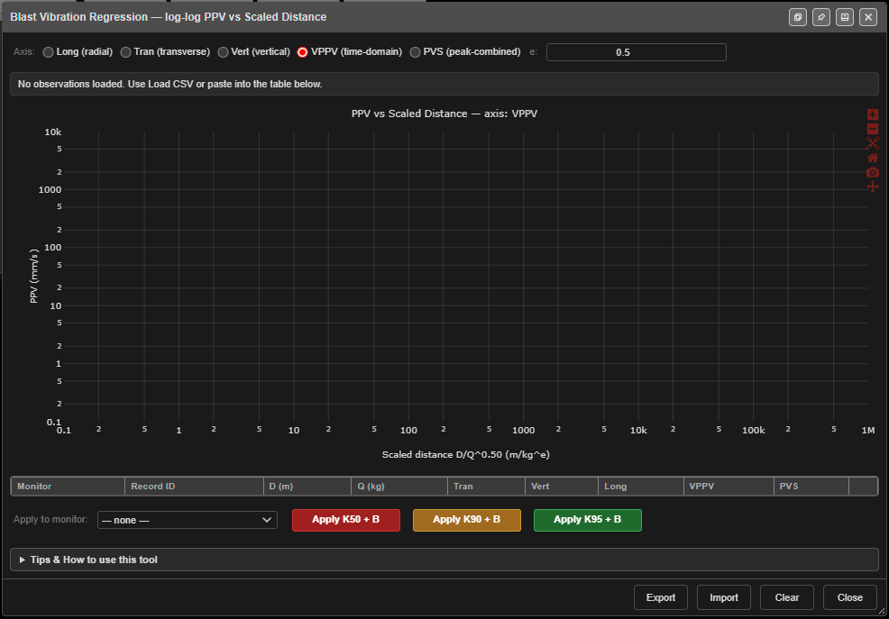

# Site Law Regression

Fits your site's vibration law from measured blasts. Load a CSV of monitoring records —
distance, charge and peak vibration — and Kirra fits

```
PPV = K × (D / Q^e) ^ −B
```

on a log-log chart, gives you K at three confidence levels and B, and can apply them to a
[monitor](monitor-points.md).


*The dialog before any records are loaded.*

---

## Prerequisites

- A CSV of at least **three** records, each with a distance, a charge and a vibration reading.
- To apply the result: at least one monitor in the
  [Monitor Points Manager](monitor-points.md).

---

## How to fit a site law

1. Click **Site Law Regression — log-log PPV vs Scaled Distance** on the **Analyse** toolbar.
   The dialog is **Blast Vibration Regression — log-log PPV vs Scaled Distance**.
2. Click **Import** and choose the CSV.
3. Choose the **Axis** to fit, and the charge exponent **e:**.
4. Read the fit in the bar above the chart.
5. To use it, choose a monitor in **Apply to monitor:**, then click **Apply K50 + B**,
   **Apply K90 + B** or **Apply K95 + B**.

The fit updates as soon as three usable records are loaded.

---

## The CSV

Commas, tabs or semicolons are all accepted. Header names are not case-sensitive.

| Column | Accepted headers |
|---|---|
| Distance (m) | `D`, `Distance`, `Distance_m`, `D_m`, `Effective_Distance` |
| Charge (kg) | `Q`, `Charge`, `Charge_kg`, `Charge_Weight`, `Q_kg`, `Charge (kg)` |
| Transverse | `Tran`, `Tran_mmps`, `Transverse` |
| Vertical | `Vert`, `Vert_mmps`, `Vertical` |
| Longitudinal | `Long`, `Long_mmps`, `Longitudinal`, `Radial` |
| Peak vector (VPPV) | `VPPV`, `VPPV_mmps`, `PeakVectorSum`, `Peak_Vector_Sum`, `PPV`, `Peak_Vector`, `Recorded_PPV` |
| Pseudo vector sum (PVS) | `PVS`, `PVS_mmps`, `PseudoVector`, `Pseudo_Vector_Sum`, `Naive_PVS` |
| Monitor (optional) | `MonitorName`, `Monitor_Name`, `Monitor`, `Mon`, `Receiver` |
| Record (optional) | `RecordID`, `Record_ID`, `Record`, `ShotID`, `Blast`, `SD_Hole`, `Seed`, `Hole` |

- A file with no header row is read as **D, Q, VPPV**.
- Rows without a positive distance and charge are skipped.
- A column headed `PPV` is read as **VPPV**.
- If there is no PVS column, PVS is worked out from the three components.

---

## Settings

| Setting | Default | What it does |
|---|---|---|
| **Axis** | **VPPV (time-domain)** | Which reading to fit: **Long (radial)**, **Tran (transverse)**, **Vert (vertical)**, **VPPV (time-domain)** or **PVS (peak-combined)** |
| **e:** | 0.5 | Charge exponent in scaled distance D / Q^e. *"0.5 = square-root (Holmberg-Persson), 0.333 = cube-root."* Range 0.1 – 1.0 |

---

## Reading the fit

| Value | Meaning |
|---|---|
| **n** | Records used |
| **K50** | The median line — half of real blasts will exceed it |
| **K90** | 90 % of blasts fall under it |
| **K95** | 95 % fall under it — the usual choice for compliance |
| **B** | The attenuation exponent (slope) |
| **RSQ** | How well the line fits (1 = perfectly). Shown green above 0.6, yellow above 0.4, orange below |
| **σ log** | The scatter of the records about the line, in log units — the **Site σ** a monitor needs for Mode F |
| **Outliers** | Records more than two σ from the line |

The chart plots **PPV (mm/s)** against **Scaled distance**, with the K50, K90 and K95 lines.
Outliers are shown as amber diamonds. The table below the chart lists every record; remove one
with its button.

> **Warning:** If **B** comes out at zero or below, the fit says vibration grows with distance.
> Kirra warns *"Non-physical fit"* and will not apply it. Check the data.

---

## Apply to a monitor

1. Choose the monitor in **Apply to monitor:**.
2. Click **Apply K50 + B**, **Apply K90 + B** or **Apply K95 + B**. The button reads
   **Applied ✓** briefly.

This sets the monitor's **Site K** and **Site B** only. Set **Charge e** and **Site σ** on the
monitor yourself, in the [Monitor Points Manager](monitor-points.md).

> **Note:** The monitor list is filled when the dialog opens. If you add a monitor, close and
> reopen the dialog.

---

## Other buttons

| Button | What it does |
|---|---|
| **Clear** | Removes all records, with no confirmation |
| **Export** | Saves the records and the fit as `site_law_regression_<axis>.csv` |
| **Close** | Closes the dialog |

The **Tips & How to use this tool** panel explains the axes, the percentiles and RSQ in more
detail.

---

## Troubleshooting

**"Loaded … observations — need ≥3 with positive D, Q, and … to fit."**
Fewer than three records have a distance, a charge and a value on the chosen axis. Check the
axis matches the columns in your file.

**"No valid rows with D, Q found in CSV".**
The distance or charge headers were not recognised — rename them to one of the headers above.

**Apply says "No monitor selected".**
Choose a monitor in **Apply to monitor:** first.

---

## Related

- [Monitor Points & Seed Library](monitor-points.md)
- [PPV Voronoi Modes](ppv-voronoi-modes.md)
- [PPV & Vibration Models](ppv-models.md)
