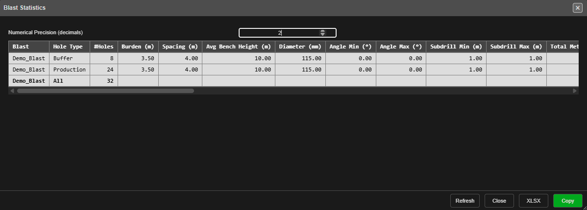
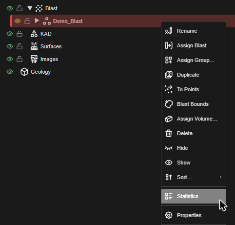
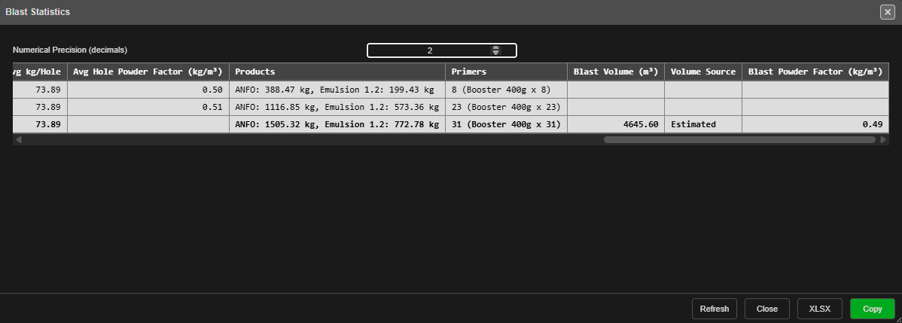

# Blast Statistics & Voronoi

Two ways to check a blast before you print or export it: the **Blast Statistics** table, which
lists each blast's holes, drilling and charging by hole type, and **Voronoi cells**, which colour
each hole's share of the ground by powder factor, mass, volume and more.

---

## Blast Statistics

*The table for a blast with two hole types: one row for each type, then a bold **All** row for
the whole blast.*

### Open it

1. Open the [Data Explorer](../working-in-kirra/data-explorer.md).
2. Right-click a blast. To compare several, select them first, then right-click one of them.
3. Choose **Statistics** — it sits just above **Properties**.

The table counts **every hole** in the chosen blasts, hidden or not — as Surface Statistics
counts every triangle of a surface.

### What's in the table

Each blast gets one row per hole type, in alphabetical order, then an **All** row for the blast.

| Column | What it shows |
|---|---|
| **Blast**, **Hole Type** | The blast, and the hole type the row covers — **All** for the blast's own row |
| **#Holes** | Number of holes |
| **Burden (m)**, **Spacing (m)** | Average burden and spacing |
| **Avg Bench Height (m)** | Average bench height |
| **Diameter (mm)** | Average hole diameter |
| **Angle Min (°)**, **Angle Max (°)** | Smallest and largest hole angle, measured from vertical (0° = vertical) |
| **Subdrill Min (m)**, **Subdrill Max (m)** | Smallest and largest subdrill |
| **Total Metres (m)** | Drilled metres, collar to toe |
| **Charged** | Holes with an explosive deck, out of all holes — for example **23/24** |
| **First Charge Depth Avg / Min / Max (m)** | Depth from the collar to the top of the first explosive deck |
| **Charge Length Avg / Min / Max (m)** | Total length of a hole's explosive decks |
| **Explosive Mass (kg)** | Explosive in the charged holes |
| **Avg kg/Hole** | Explosive mass ÷ charged holes |
| **Avg Hole Powder Factor (kg/m³)** | The average of each charged hole's own powder factor |
| **Products** | Mass of each explosive product, heaviest first |
| **Primers** | Number of primers, then the boosters by name — for example **23 (Booster 400g x 23)** |
| **Blast Volume (m³)** | The blast's volume (on the **All** row) |
| **Volume Source** | **Estimated**, or **Solid** and the solid's name when one is assigned |
| **Blast Powder Factor (kg/m³)** | The blast's explosive mass ÷ its volume (on the **All** row) |

The table is wide: scroll it sideways to reach the charging columns.

*Scrolled right: products, primers, the blast volume and the blast powder factor.*

> **Note:** **Avg Hole Powder Factor** and **Blast Powder Factor** are different numbers. The
> first averages each hole's own estimate; the second divides the blast's whole mass by its
> volume. With a blast solid assigned, the blast figure is the one to report. Choose how the
> volume is worked out with **Assign Volume…** on the same right-click menu.

### The controls

| Control | What it does |
|---|---|
| **Numerical Precision (decimals)** | Decimal places for every measured value, 0 to 6 — default **2**. Counts stay whole. The table updates as you type. Kept until you reload Kirra |
| **Refresh** | Reads the blasts again. The table is a snapshot taken when it opened — click **Refresh** after editing holes or charging |
| **Close** | Closes the table |
| **XLSX** | Saves the table as `blast-statistics.xlsx`, numbers rounded as shown |
| **Copy** | Copies the table to the clipboard as tab-separated text — paste it into a spreadsheet |

### Same numbers as the printed summaries

The table uses the same figures as the **blastSummary()** and **chargeSummary()** text formulas
used in print templates and KAD text — see [Summary Functions](../printing/pdf-print.md#summary-functions).
The formulas count visible holes only, so they match the table when nothing in the blast is hidden.

### Troubleshooting

| Problem | Cause and fix |
|---|---|
| **Statistics** is not on the menu | Right-click the blast's own row in the Data Explorer, not a hole or a group |
| The numbers don't show my latest edit | Click **Refresh** |
| **Charged** is lower than expected | A hole counts as charged only when it has an explosive deck. Stemming or air alone is not a charge |
| **Blast Volume** is blank | Kirra could not work out a volume. Check **Assign Volume…** on the blast |
| Every value shows too many or too few decimals | Change **Numerical Precision** |

---

## Voronoi Analysis

Voronoi cells divide the blast into one patch of ground per hole, and colour each by powder
factor, mass, volume, area, length, firing time, SDoB, stemming or predicted vibration.

The full guide — how to show the cells, every display choice, how cells are built and
trimmed, the legend ranges and printing — is in **[Voronoi Cells](voronoi.md)**. The six
vibration displays are covered in **[PPV Voronoi Modes](ppv-voronoi-modes.md)**.

---

## Related Topics

- [Data Explorer](../working-in-kirra/data-explorer.md)
- [Voronoi Cells](voronoi.md)
- [PPV Voronoi Modes](ppv-voronoi-modes.md)
- [Blast Analysis Shader](overview.md)
- [Charging Overview](../charging/overview.md)
- [Print to PDF — Summary Functions](../printing/pdf-print.md#summary-functions)
