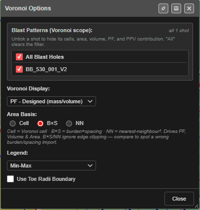
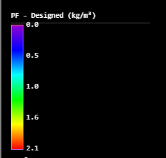

# Voronoi Cells

A Voronoi cell is the patch of ground closer to one hole than to any other. Kirra draws a
cell around every hole and colours it by a value — powder factor, mass, firing time, SDoB,
predicted vibration and more — so you can see at a glance where a pattern is heavy, light,
late or risky.

*PF - Designed, Min-Max legend. Light-blue cells are holes with less explosive for their
ground; yellow to red are the heaviest.*

---

## Prerequisites

- A blast loaded, with visible holes.
- For powder factor and mass: charging, or a mass on each hole. For measured values:
  measured mass or length recorded — see [Record Actuals](../working-in-kirra/starting-and-saving.md#record-actuals).
- For the vibration (PPV) choices: at least one monitor — see [PPV Voronoi Modes](ppv-voronoi-modes.md).

---

## Show the cells

1. On the [display toolbar](../working-in-kirra/display-options.md), switch on **Voronoi**
   (the hexagon with a V).
2. Kirra draws the cells and a colour legend at the top of the legend panel.
3. To choose what the cells show, **right-click** **Voronoi**, or click **Voronoi Options** on
   the **Analyse** toolbar.

> **Note:** **Voronoi Options** only sets the cells up. It does not switch them on — use the
> **Voronoi** display button for that.

---

## The Voronoi Options dialog

Every change applies straight away — there is no Apply button. **Close** shuts the dialog.
The pin in the title bar (**Dock to edge**) docks it to the side of the window.

### Blast Patterns (Voronoi scope)

A tick list of the blasts loaded. *"Untick a shot to hide its cells, area, volume, PF, and PPV
contribution. "All" clears the filter."* The counter on the right reads, for example,
**all 1 shot** or **3 of 10 shots**.

- **All Blast Holes** ticked: every blast is included.
- Untick a blast to leave it out of the cells and of every value, including vibration.
- Hidden holes are always left out, whatever is ticked here.

Kirra remembers the ticks in this browser.

### Voronoi Display

What each cell is coloured by. The default is **PF - Designed (mass/volume)**.

| Voronoi Display | Each cell shows | Unit |
|---|---|---|
| **PF - Measured (mass/volume)** | Measured mass ÷ (cell area × hole length). Holes with no measured mass have no value | kg/m³ |
| **PF - Designed (mass/volume)** | Designed mass ÷ (cell area × bench height; hole length if there is no bench height) | kg/m³ |
| **Measured Mass** | The hole's measured mass | kg |
| **Designed Mass** | The hole's designed mass | kg |
| **Volume** | Cell area × hole length | m³ |
| **Area** | The cell's area (see **Area Basis**) | m² |
| **Measured Length** | The hole's measured length | m |
| **Designed Length** | The hole's design length, collar to toe | m |
| **Hole Firing Time** | When the hole's first charge fires — surface plus downhole delay, or the electronic delay | ms |
| **Scaled Depth of Burial** | Stemming plus half the contributing charge, divided by the cube root of that charge's mass. A hole with no charging uses 30 % stemming and 70 % charge | m/kg^1/3 |
| **Stemming Length** | Total length of inert decks. Holes with no charging have no value | m |
| **PPV — Max / Coherent Seed (mode A)** | Predicted peak vibration at the cell | mm/s |
| **PPV — Dominant Hole (mode B)** | How this hole compares with the worst hole at the governing monitor | 0–1 |
| **PPV — Compliance (mode C)** | This hole's predicted vibration ÷ the monitor's target, worst monitor | ratio |
| **PPV — Max Allowable Charge (mode D)** | The most charge this hole could fire and keep every monitor under target | kg |
| **PPV — Full Forward Array (mode E)** | Full wave synthesis, worst monitor | mm/s |
| **PPV — Probability of Exceedance (mode F)** | Chance of exceeding the target, worst monitor | % |

The six PPV modes add more settings to the dialog — see [PPV choices](#ppv-choices) below and
[PPV Voronoi Modes](ppv-voronoi-modes.md).

### Area Basis

Shown for **PF - Measured**, **PF - Designed**, **Volume** and **Area**. It sets which area the
value is worked out from.

| Option | Area used |
|---|---|
| **Cell** | The Voronoi cell (trimmed at the blast edge) |
| **B×S** | The hole's burden × spacing |
| **NN** | The distance to the nearest hole, squared |

> **Tip:** From the dialog: *"B×S/NN ignore edge clipping — compare to spot a wrong
> burden/spacing import."* If **Cell** and **B×S** give very different powder factors, the
> burden and spacing on the holes are probably wrong.

Kirra remembers the choice, and it travels in a [KAP project](../working-in-kirra/starting-and-saving.md#back-up-and-move-your-work).

### Legend

| Option | Colour range |
|---|---|
| **Min-Max** (default) | Stretched from the lowest to the highest value in the cells. Powder factor, Max PPV and Mode E start at 0 |
| **Fixed** | A set range, so two blasts can be compared by colour |

Fixed ranges:

| Display | Fixed range |
|---|---|
| PF - Measured, PF - Designed, Scaled Depth of Burial | 0 – 3 |
| Measured Mass, Designed Mass | 0 – 1000 kg |
| Volume | 0 – 5000 m³ |
| Area | 0 – 500 m² |
| Measured Length, Designed Length | 0 – 50 m |
| Stemming Length | 0 – 10 m |
| Hole Firing Time | 0 – 5000 ms |
| PPV — Max (A), Full Forward Array (E) | 0 – 200 mm/s |
| PPV — Max Allowable Charge (D) | 0 – 500 kg |

Modes B, C and F always use their own scales (0–1, the compliance bands, and probability bands).

### Use Toe Radii Boundary

Off by default. When on, the cells are built around the hole **toes** instead of the collars.
Use it for angled holes, where the toes are where the explosive works.

---

## PPV choices

Choosing a **PPV —** display adds **Global Blast-Side Settings**, a **Monitor Points (summary)**
list and a **How to read this legend** panel to the dialog.

- Mode A works without a monitor. Modes B to F need at least one **enabled** monitor —
  without one their cells have no value.
- Each monitor row shows its result, for example
  *✓ PASS COMPLIANT @ 6.4 / target 10 — hole 536 (PoE 19.0% — Warning)*. Untick a monitor to
  leave it out. The button beside **Full editor:** opens the
  [Monitor Points Manager](monitor-points.md).
- **How to read this legend** explains the colours for the mode you are in.

*Mode C. Green holes are comfortably under every monitor's target, amber are within 10 %,
red exceed a target on their own.*

Every setting in the PPV section is explained in [PPV Voronoi Modes](ppv-voronoi-modes.md).

---

## How the cells are built

- Each visible hole in the ticked blasts gets one cell, around its collar (or toe — see
  **Use Toe Radii Boundary**).
- Cells at the edge of the blast are trimmed so they do not run off into open ground. The
  trim line sits about half a hole spacing outside the outer holes. There is no option to
  trim to a drawing or a surface.
- With **Area Basis** set to **Cell**, area, volume and powder factor use the trimmed cell.

---

## Colours

| Display | Colours, low to high |
|---|---|
| Powder factor | Violet → blue → cyan → green → yellow → red |
| Mass, volume, area, lengths, PPV (A, D, E) | Blue → cyan → green → yellow → red |
| Hole Firing Time | Lime (early) → red (late) |
| Scaled Depth of Burial | Red (shallow — flyrock risk) → orange → lime → cyan → blue (deep) |
| PPV — Dominant Hole (B) | Red (this hole is the worst) → yellow → blue (negligible) |
| PPV — Compliance (C) | Green under 0.9 × target, amber 0.9–1.0, red 1.0 and over |
| PPV — Probability of Exceedance (F) | Blue under 1 %, green 1–5 %, yellow 5–10 %, amber 10–25 %, red 25 % and over |

---

## Cells with no value

A hole with nothing to show — no measured mass for **PF - Measured**, no charging for
**Stemming Length**, no enabled monitor for a PPV mode — draws as a faint cell with a dashed
grey outline. In 3D it is an outline only.

When some cells have no value, a banner appears on the canvas:
*"No data: … — click for details"*. Click it to open **Voronoi — No-Data Diagnosis**, which
lists each reason (for example **No charging record**, **Measured mass is zero**, **No PPV
monitors enabled**), how many holes it affects, and a suggested fix.

### Spacing QC

If the burden × spacing stored on the holes is more than 20 % away from the actual cell areas,
a second banner reads *"Spacing QC: design B×S … is …% off the actual cell area … —
burden/spacing may be wrong"*. Click it for the holes concerned, or **×** to dismiss it. It
returns if the flagged holes change.

---

## In 3D and in print

- **3D:** each cell is a thin coloured slab just under the collar (or just above the toe), with
  the same colours and legend as 2D.
- **Print:** the raster, vector and template plots colour the cells exactly as the screen does,
  with the same legend range. A template can ask for a particular display with the `vor.`
  codes — see [Voronoi Metric Codes](../printing/pdf-print.md#voronoi-metric-codes). A map
  without a `vor.` code prints the display chosen on screen.
- PPV monitors (the crosshairs and lines) are not printed.

---

## What is remembered

| Setting | Remembered? |
|---|---|
| Blast Patterns ticks | In this browser |
| Area Basis | In this browser, and in KAP projects |
| Voronoi Display, Legend, Use Toe Radii Boundary | No — after a reload the display is **PF - Designed** |
| PPV settings and monitors | In this browser, and in KAP projects |

---

## Troubleshooting

**The cells are all one colour.**
Every hole has the same value — for example identical charging. Try **Fixed** to compare
against the normal range, or choose another display.

**Powder factor is missing on some holes.**
**PF - Measured** needs a measured mass; **PF - Designed** needs a designed mass. Click the
*No data* banner to see which holes and why.

**The powder factor looks wrong across the whole blast.**
Switch **Area Basis** between **Cell** and **B×S**. A large difference, or the **Spacing QC**
banner, points to wrong burden and spacing on the holes.

**A PPV mode shows dashed cells everywhere.**
Modes B to F need an enabled monitor. Add or tick one in the
[Monitor Points Manager](monitor-points.md).

**Voronoi Options is open but no cells are drawn.**
Switch on the **Voronoi** display button.

---

## Related

- [PPV Voronoi Modes](ppv-voronoi-modes.md) — modes A to F in detail
- [Display Options](../working-in-kirra/display-options.md)
- [Analyse Toolbar](analyse-toolbar.md)
- [PDF Printing — Voronoi Metric Codes](../printing/pdf-print.md#voronoi-metric-codes)
