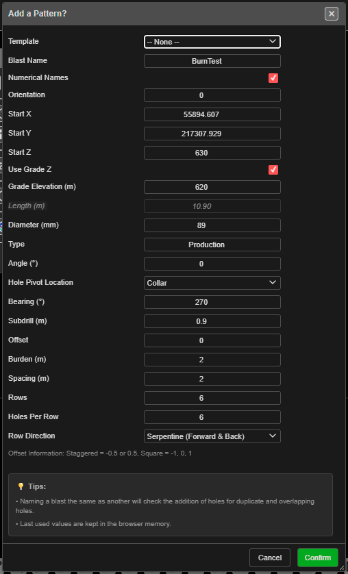

# Add Pattern

Generates a rectangular grid of blast holes — a set number of rows and holes per row at a set
burden and spacing — from a start point you click. This is the quickest way to lay out a regular
bench blast that has no boundary to fit.


*The Add a Pattern? dialog, after clicking the pattern start point.*

---

## Prerequisites

- None. To place the pattern on existing work, snap the click to a KAD point, vertex or hole.

---

## Lay out a grid

This tool is click-first: you click the start point, then the dialog opens.

1. Click **Add Pattern** on the **Holes** toolbar. Hole ID labels are switched on so you can see
   the numbering.
2. Click the canvas where the first hole goes. The click snaps to nearby objects; the status line
   says what it snapped to.
3. The **Add a Pattern?** dialog opens with the click in **Start X** / **Start Y**.
4. Set the row layout — **Orientation**, **Burden (m)**, **Spacing (m)**, **Offset**, **Rows**,
   **Holes Per Row** and **Row Direction**.
5. Set the hole properties — elevations, **Diameter (mm)**, **Type**, **Angle (°)**, **Bearing (°)**
   and **Subdrill (m)**.
6. Click **Confirm**.

### How the grid is laid out

- The start point is the first hole of the first row.
- **Orientation** is the bearing the rows run along (0 = North, 90 = East, clockwise).
- Each further row steps off by the burden, to the **left** of the row direction. With the default
  orientation of 90 the rows run east and step north.
- **Offset** shifts every second row along the row by that fraction of the spacing.

```
Row 3   *   *   *   *   *
Row 2     *   *   *   *   *    <- Offset 0.5: shifted half a spacing
Row 1   *   *   *   *   *      <- starts at your click, runs at the Orientation
        |<->|
       Spacing
```

---

## The fields

| Field | Default | What it does |
|---|---|---|
| **Template** | -- None -- | Fills the form from a saved [pattern template](pattern-templates.md). The template's text setup and charging are applied to the new holes. A remembered template is re-read each time the dialog opens |
| **Blast Name** | `Created_Blast` + a number | The blast the holes go into. An existing name adds to that blast |
| **Numerical Names** | Ticked | Ticked: numbers. Unticked: row letter + position (A1, A2 … B1, B2 …) |
| **Orientation** | 90 | Bearing of the rows, in degrees |
| **Start X** / **Start Y** | Your click | First hole position |
| **Start Z** | 100 | Collar RL of every hole |
| **Use Grade Z** | Unticked | Ticked: holes run to **Grade Elevation (m)**. Unticked: holes are set by **Length (m)** |
| **Grade Elevation (m)** | Calculated | Floor RL. Editing it recalculates the length |
| **Length (m)** | 6.2 | Collar-to-toe length, including subdrill. Editing it recalculates the grade |
| **Diameter (mm)** | 115 | Hole diameter |
| **Type** | Production | Hole type, free text |
| **Angle (°)** | 0 | Angle from vertical. 0 = vertical |
| **Hole Pivot Location** | Collar | Which point sits on each grid position: **Collar**, **Grade** or **Toe** |
| **Bearing (°)** | 180 | Direction angled holes lean (0 = North, clockwise) |
| **Subdrill (m)** | 1 | Vertical depth below grade |
| **Offset** | 0.5 | Stagger. The dialog's note: *"Staggered = -0.5 or 0.5, Square = -1, 0, 1"* |
| **Burden (m)** | 3.0 | Distance between rows. Left blank, it is 1.0 m |
| **Spacing (m)** | 3.3 | Distance between holes in a row |
| **Rows** | 6 | Number of rows |
| **Holes Per Row** | 10 | Holes in each row |
| **Row Direction** | Return (Forward Only) | Or **Serpentine (Forward & Back)** — every second row is numbered from the opposite end, so hole 1 of a row is next to the last hole of the row before |

The last values you used are kept for next time.

> **Note:** Add Pattern has no **Starting Hole ID** field. With **Numerical Names** ticked, numbering
> continues from the highest numeric hole ID already loaded. Use
> [Renumber Holes](renumber-holes.md) afterwards to set your own numbers.

---

## What to expect

- **Rows** × **Holes Per Row** holes appear. Each row gets its own row ID.
- The tool switches off, and the view's zoom and 3D orbit are reset.
- The pattern is one undo step — **Ctrl+Z** removes it.
- If a new hole would sit on a hole already in the same blast, the **Hole Proximity Warning** asks
  you to **Skip**, **Ignore**, **Skip All** or **Cancel**. See
  [Editing Holes → Hole coincidence](editing-holes.md#hole-coincidence).

---

## Other ways to use it

| Method | Result |
|---|---|
| **Cancel** in the dialog | Closes it. The tool stays on — the next click opens the dialog again |
| **Escape** (twice) | Leaves the tool and returns to **Pointer Select** |
| 3D view | Click the start point in 3D; the same dialog opens |
| **Template** list | Reuses a saved pattern, including its text setup and charging |
| [Pattern in Polygon](pattern-in-polygon.md) | A grid trimmed to a boundary instead of a fixed row count |

---

## Troubleshooting

**"Invalid Blast Name"** or **"Invalid Type"**
**Blast Name** or **Type** is empty.

**The rows step the wrong way.**
Rows always step to the left of the **Orientation**. Add 180° to the orientation and move the start
point to the other end of the first row.

**The numbers don't start at 1.**
Numbering continues from the highest numeric hole ID already loaded. Renumber the pattern
afterwards, or untick **Numerical Names** for row-letter names.

---

## Related

- [Pattern in Polygon](pattern-in-polygon.md) — fill a boundary
- [Holes Along Line](holes-along-line.md) — one straight row
- [Add Hole](adding-holes.md) — single holes
- [Pattern Templates](pattern-templates.md)
- [Pattern Generation](pattern-generation.md) — choosing a method
- [Holes Toolbar](holes-toolbar.md)
