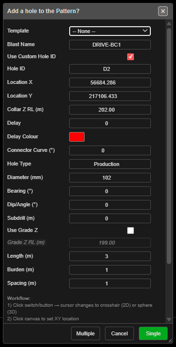

# Add Hole

Places individual blast holes where you click on the canvas — one at a time, or a run of holes with
the same settings. Use it for infill holes, relief holes, re-drills and small designs that no
pattern tool fits.

*The Add a hole to the Pattern? dialog, with Multiple, Cancel and Single in the footer.*

---

## Prerequisites

- None. To place the hole on existing work, snap the click to a KAD point, vertex or hole.

---

## Place a hole

This tool is click-first: you click the position, then the dialog opens.

1. Click **Add Hole** on the **Holes** toolbar. Hole ID labels are switched on so you can see the
   numbering.
2. Click the canvas where the hole goes. The click snaps to nearby objects; the status line says
   what it snapped to.
3. The **Add a hole to the Pattern?** dialog opens with the click in **Location X** / **Location Y**.
4. Set the blast name and hole properties (see [The fields](#the-fields)).
5. Click **Single** to place this one hole and finish, or **Multiple** to place it and keep going.

### Place several holes with the same settings

1. Fill in the dialog and click **Multiple**. The hole is placed and the dialog closes.
2. Click the canvas again. Each click places another hole with the same settings — no dialog.
3. Click **Add Hole** again, or press **Escape** twice, to finish.

The status line confirms each hole: *"Hole added to {blast name}"*.

---

## The fields

| Field | First-use value | What it does |
|---|---|---|
| **Template** | -- None -- | Picking a [pattern template](pattern-templates.md) fills the blast name, type, diameter, angle, subdrill, burden, spacing and elevations. Its text setup and charging are applied to the new hole |
| **Blast Name** | `Added_hole_` + a number | The blast the hole goes into. An existing name adds to that blast |
| **Use Custom Hole ID** | Off | Tick to type the ID yourself |
| **Hole ID** | — | The custom ID. A number at or below the blast's highest number becomes the next number after it; any other ID already in the blast is replaced with a free one |
| **Location X** / **Location Y** | Your click | Collar position. You can type over them |
| **Collar Z RL (m)** | Snapped elevation | The elevation of the object you snapped to, or the drawing elevation. If that is 0, the last value you used |
| **Delay** | 0 | Remembered for next time. A new hole starts **untied at 0 ms** — tie it with the [Connect toolbar](connect-toolbar.md) |
| **Delay Colour** | Red | Remembered for next time. A new hole starts with a red tie colour |
| **Connector Curve (°)** | 0 | Remembered for next time. The dialog's tip: *"Curved connectors: 45° to 120°, -45° to -120° \| Straight: 0°"*. A new hole is untied, so it has no connector to curve |
| **Hole Type** | Production | Free text |
| **Diameter (mm)** | 115 | Hole diameter |
| **Bearing (°)** | 0 | Direction an angled hole leans (0 = North, clockwise) |
| **Dip/Angle (°)** | 0 | Angle from vertical. 0 = vertical |
| **Subdrill (m)** | 0 | Vertical depth below grade |
| **Use Grade Z** | Off | Ticked: the hole runs to **Grade Z RL (m)**. Unticked: it is set by **Length (m)** |
| **Grade Z RL (m)** | Calculated | Floor RL. Editing it recalculates the length |
| **Length (m)** | 0 | Collar-to-toe length, including subdrill. Editing it recalculates the grade |
| **Burden (m)** | 3.0 | Stored on the hole for analysis |
| **Spacing (m)** | 3.5 | Stored on the hole for analysis |

The dialog remembers what you entered, so your last values become the defaults. Its **Workflow**
and **Tips** notes at the bottom summarise these steps.

> **Note:** Add Hole has no **Hole Pivot Location** field — the click is always the collar.

---

## What to expect

- The hole appears at the clicked position, collar at **Collar Z RL (m)**, toe set by the angle,
  bearing and length or grade.
- Each hole is its own undo step — **Ctrl+Z** removes the last one.
- If the new hole would sit on a hole already in the same blast, the **Hole Proximity Warning** asks
  you to **Skip**, **Ignore**, **Skip All** or **Cancel**. Holes in **other** blasts are not checked.
  See [Editing Holes → Hole coincidence](editing-holes.md#hole-coincidence).
- The Data Explorer updates with the new hole under its blast.

---

## Hole geometry in brief

Every hole is defined by three points: the **collar** (top), the **grade** (where it crosses the
design floor) and the **toe** (bottom).

- **Bench height** = collar RL − grade RL
- **Subdrill** = grade RL − toe RL (vertical; positive = below the floor)
- **Length** = the 3D distance from collar to toe
- **Angle** is measured from vertical; **bearing** clockwise from North

The full list of hole fields is in the [Hole Properties Reference](../reference/hole-properties.md);
axes and angle conventions are in [Coordinate System](../reference/coordinate-system.md).

---

## Other ways to use it

| Method | Result |
|---|---|
| **Multiple** | Keep clicking to place holes with the same settings |
| **Cancel** in the dialog | Closes it and switches the tool off |
| **Escape** (twice) | Leaves the tool and returns to **Pointer Select** |
| 3D view | Click in 3D; the same dialog opens, and **Multiple** works the same way |
| Section work plane | In **Multiple** mode each click on the plane takes its own elevation |
| [Insert Holes](insert-holes.md) | Adds holes **into an existing row**, renumbering the row |
| [Add Pattern](add-pattern.md) and the other pattern tools | Many holes at once |

---

## Troubleshooting

**"Invalid Blast Name"** or **"Invalid Type"**
**Blast Name** or **Hole Type** is empty.

**"No Location"** — *"Please click on the canvas to set hole location."*
The dialog has no clicked position. Close it and click the canvas first.

**The hole has no depth.**
**Length (m)** is 0 on first use. Enter a length, or tick **Use Grade Z** and set the grade RL.

**I typed a custom Hole ID but the hole got a different one.**
That ID is already used in the blast, so Kirra gave the hole a free one.

---

## Editing a hole after placement

Click the hole with **Pointer Select** to select it, then right-click for the **Edit Hole** dialog.
See [Editing Holes](editing-holes.md) for moving, bulk editing and deleting.

---

## Related

- [Add Pattern](add-pattern.md) — a rectangular grid
- [Pattern in Polygon](pattern-in-polygon.md) — fill a boundary
- [Holes Along Line](holes-along-line.md) and [Holes Along Polyline](holes-along-polyline.md) — rows
- [Pattern Templates](pattern-templates.md)
- [Editing Holes](editing-holes.md)
- [Hole Properties Reference](../reference/hole-properties.md)
- [Holes Toolbar](holes-toolbar.md)
