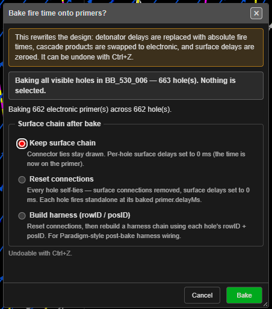

# Bake Delay

Moves the surface timing onto the electronic detonators. Each hole's firing time — from its ties,
connector delays and travel times — is written into its electronic primers as an absolute
programmed time. The toolbar button is **Bake Delay (electronic + nonel→electronic conversion)**.

---

## Before you start

- The holes need firing times — tie them to an [initiation point](initiation-points.md).
- Bake works on **electronic** primers. Kirra offers to add or replace detonators first (below).
- Decide which holes to bake (the scope):

| Selection | Holes baked |
|---|---|
| Holes are selected | The selection, visible or not, across any number of blasts |
| Nothing selected, one blast visible | Every visible hole in that blast |
| Nothing selected, several blasts visible | Refused — *"Select the holes to bake"* |
| Nothing visible | Refused — *"Nothing to bake"* |

---

## Bake

1. Click **Bake Delay** on the **Connect** toolbar. It is a one-click action — the button does not
   stay pressed.
2. If holes have no detonator, or carry primers that cannot hold a programmed time, Kirra asks
   first (see [Adding or replacing detonators](#adding-or-replacing-detonators)).
3. The **Bake fire time onto primers?** dialog shows what is about to happen. Choose what happens
   to the surface ties under **Surface chain after bake**.
4. Click **Bake**, or **Cancel**.

Bake can be undone with **Ctrl+Z**.

---

## Surface chain after bake

| Option | Result |
|---|---|
| **Keep surface chain** | Ties stay drawn. Each hole's surface delay becomes 0 ms — the time is now on the primer |
| **Reset connections** | Every hole is tied to itself, surface ties are removed and surface delays set to 0 ms. Each hole fires on its baked primer time alone |
| **Build harness (rowID / posID)** | Resets connections, then rebuilds a harness chain from each hole's row and position |

**Keep surface chain** is selected the first time. After that the dialog remembers your last
choice until Kirra is closed.

---

## What the dialog tells you

The **Bake fire time onto primers?** dialog lists, before you click **Bake**:

- What it rewrites: *"detonator delays are replaced with absolute fire times, cascade products are
  swapped to electronic, and surface delays are zeroed."*
- The scope — your selection, or all visible holes in one blast.
- How many electronic primers and holes are baked.
- Holes with no firing time (NA / null). These are **never** baked — writing 0 ms into a hole that
  is meant not to fire is a safety matter.
- Holes fed by a cord trunk (their times include the trunk's inline connectors), and holes on a
  cord trunk the signal never reaches.
- Primers skipped because they are not electronic programmable detonators.

---

## Adding or replacing detonators

Before the bake dialog, Kirra checks the holes:

| Found | Dialog | Button |
|---|---|---|
| Holes with **no detonator** | **No detonators in hole** | **Add** |
| Holes with a **nonel, electric or cord** primer | **Replace in-hole primers?** | **Replace** |

Each dialog has a **Detonator** and a **Booster** list. They show the products in your catalogue
first, then **Create G-EDET (generic electronic)** and **Create G-Booster (sized to the hole)**.
A new primer goes in at 80% of the hole length from the collar — move it in charging if you want it
elsewhere.

**Replace** is asked first when both apply. Both can be undone with **Ctrl+Z**. After either one,
the bake dialog opens on the same holes.

---

## Troubleshooting

| Symptom | Cause | Fix |
|---|---|---|
| *"Select the holes to bake"* | Several blasts are visible and nothing is selected | Select the holes, or hide the other blasts |
| *"Nothing to bake"* — holes have no fire time | No hole in scope has a time | Tie them to an initiation point, then bake again |
| *"Nothing to bake — no surface chain on the visible holes or no electronic primers to write to."* | No timing, or no electronic primers | Tie the holes, or add detonators |
| Some holes were not baked | They have no firing time (NA / null) | Give them a time and a primer, then bake again |
| Primers skipped | They are not electronic | Replace them when Kirra asks, or in [charging](../charging/deck-builder.md) |

---

## Other ways to use it

| Method | Result |
|---|---|
| **Bake Delay** in the [Electronic Timing](electronic-timing-constructs.md) dialog footer | Bakes the active construct's assigned holes, or every visible hole when none are assigned. The same scope rules apply |
| **Bake Delay** in the [Time Window](../analysis/time-window.md) dialog | The same bake from the timing analysis |
| **Ctrl+Z** | Undoes the bake, and any detonators it added or replaced |

---

## Related

- [Electronic Timing Constructs](electronic-timing-constructs.md)
- [Harness Wire Assignment](../charging/harness-wire-assignment.md)
- [Deck Builder](../charging/deck-builder.md)
- [Connect Toolbar](connect-toolbar.md)
