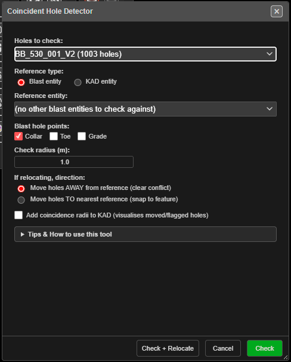

# Coincident Holes Check

Finds holes in one blast that sit too close to another blast's holes, or to a drawing, and can
move them clear. Use it before drilling a new bench over an old shot, or to keep holes out of a
no-drill zone.

*The Coincident Hole Detector. Check reports conflicts; Check + Relocate also moves the holes.*

---

## Prerequisites

- At least one visible blast. Without one, Kirra says *"No visible blast holes are loaded. Add a
  pattern or load a project before running the coincident-hole check."*
- A **reference**: a second visible blast, or a visible KAD drawing.

---

## Check a blast

1. Click **Coincident Holes Check** on the **Holes** toolbar. The **Coincident Hole Detector**
   opens.
2. In **Holes to check:** pick the blast whose holes may be flagged or moved.
3. Set **Reference type:** to **Blast entity** or **KAD entity**, then pick the **Reference
   entity:**.
4. Set **Check radius (m):**.
5. Click **Check**. The dialog closes and a result window lists every hole within the radius of a
   reference point, worst first, with the distance to it.

To move the flagged holes as well, choose a direction under **If relocating, direction:** and click
**Check + Relocate** instead.

---

## The options

| Option | Default | What it does |
|---|---|---|
| **Holes to check:** | First blast | The blast whose holes are tested — and moved, with **Check + Relocate**. Lists visible blasts with their hole counts |
| **Reference type:** | **Blast entity** | Test against another blast's holes, or a **KAD entity**'s vertices |
| **Reference entity:** | First in the list | The blast or drawing to test against. The blast being checked is not offered |
| **Blast hole points:** | **Collar** | Blast reference only. Which points of the reference holes count: **Collar**, **Toe**, **Grade**. Tick **Toe** to catch an angled hole whose collar is clear but which would drill into an old toe |
| **Check radius (m):** | 1.0 | A hole closer than this to a reference point is flagged |
| **If relocating, direction:** | **Move holes AWAY from reference (clear conflict)** | Or **Move holes TO nearest reference (snap to feature)**. Used only by **Check + Relocate** |
| **Add coincidence radii to KAD (visualises moved/flagged holes)** | Off | Draws a ring of the check radius around each affected hole |

What counts as a reference point:

- **Blast reference** — each hole's collar, plus its toe and grade if ticked. Unticking all three
  tests collars.
- **KAD reference** — every vertex of a line or polygon, a circle's centre, a text's anchor, a
  point itself.

The holes being checked are always tested at their **collar**.

The dialog's **Tips & How to use this tool** section explains each option in the app.

---

## What you get

**Check** reports without changing anything: how many holes were tested, how many reference
points, the radius, and each flagged hole paired with its nearest reference point.

**Check + Relocate** moves the flagged holes, then reports the moves:

- **Move holes AWAY** pushes each hole just past the radius, directly away from its nearest
  reference point. If that lands it inside another point's radius, it tries again — up to three
  times.
- **Move holes TO** puts each hole's collar on its nearest reference point.
- Each moved hole keeps its angle, bearing, length and collar elevation. Its toe and grade move
  with it.
- A hole that cannot be cleared is **blocked**: it is put back where it was and listed, with the
  reference points in the way. Move it by hand.
- All the moves are one step for **Ctrl+Z**.

With **Add coincidence radii** ticked, the rings go into a new drawing on the **Boundaries** layer,
**Coincidence** sub-layer, named after the blast and the radius. **Check** rings the flagged holes;
**Check + Relocate** rings the moved holes at their new positions. Blocked holes get no ring.
The rings are not part of the undo — delete the drawing in the Data Explorer if you do not want it.

---

## Other ways to use it

| Method | Result |
|---|---|
| Adding, inserting or moving a hole | Every hole tool already checks for a hole on top of another **in the same blast**, and warns before placing it. This tool checks **between** blasts and drawings |
| **Reference type: KAD entity** with a no-drill polygon | **Move holes AWAY** clears holes off the polygon's vertices. Only the vertices are tested, not the area inside |
| **Move holes TO** a set of surveyed points | Snaps designed holes onto surveyed collar positions |

---

## Troubleshooting

| Problem | Cause and fix |
|---|---|
| *"No Reference Entity"* | No other visible blast or drawing to test against. Show one in the Data Explorer |
| *"Invalid Radius"* | **Check radius (m):** must be greater than 0 |
| A hole on top of an old toe was not flagged | Only collars of the reference were tested. Tick **Toe** under **Blast hole points:** |
| A hole inside a polygon was not flagged | A KAD reference tests distance to its **vertices**, not whether a hole is inside the shape |
| Holes were listed as blocked | Reference points crowd the hole on several sides, so no move clears them all. Move it by hand |
| *"No coincident holes found within … m. Nothing to relocate."* | Nothing is inside the radius — no change was made |

---

## Related

- [Editing Holes → Hole coincidence](editing-holes.md#hole-coincidence) — the same-blast check every hole tool runs
- [Convert Holes to KAD Points](holes-to-kad-points.md) — turn an old shot's toes into a drawing
- [Holes Toolbar](holes-toolbar.md)
