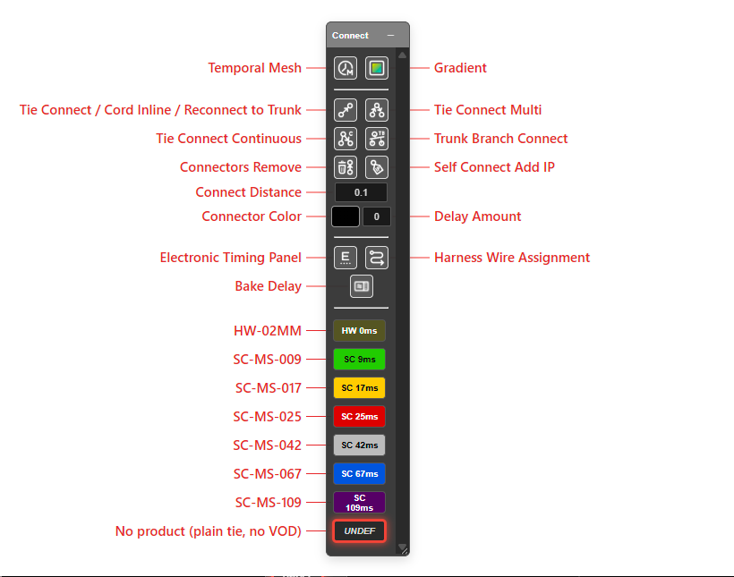

# Connector Settings

The inputs and product chips on the **Connect** toolbar decide what every new tie carries: its
delay, its colour, its product, and how wide the tie tools reach. Set them before you tie.

---

## The inputs

| Input | Default | What it controls |
|---|---|---|
| **Connect Distance (m)** | **2.0** | How far from the line or run a hole may sit and still be tied, for [Tie Connect Multi](tie-connect-multi.md), [Tie Connect Continuous](tie-connect-continuous.md) and [Trunk Branch Connect](trunk-branch-connect.md). Negative values are ignored |
| **Connector Color** | Red | Colour of new ties |
| **Delay Amount (ms)** | **25** | Delay of new ties, in whole milliseconds. Negative delays are allowed |

The tooltip on **Delay Amount** reads: *"a manually entered delay carries NO travel time. Only
connector products picked from the product list add VOD travel time."*

---

## Null connectors

Type `na`, `n/a`, `null` or `nan` (any case) into **Delay Amount** to make a **null connector**.
The tie is drawn, but carries no delay value.

---

## Product chips

Below the inputs is one chip for each **surface connector product** in the product list, sorted
by delay and labelled with a type prefix and the delay — for example `SC 25ms`. Hover a chip to
see the product's name.

| Prefix | Product type |
|---|---|
| **SC** | Surface connector |
| **HW** | Surface wire (harness or bell wire) |
| **DC** | Detonating cord |
| **CC** | Cord connector — a DRC or bridging detonator |

Click a chip to make it the **active product**. It fills **Delay Amount** and **Connector Color**
from the product and lights up. New ties then carry that product, including its signal travel
time.

### UNDEF

**UNDEF** is lit when no product is selected — which is the state Kirra opens in. From its
tooltip: *"Ties made now carry no product: they draw a plain arrow and have no VOD."*

- Click **UNDEF** to choose a product-free tie on purpose.
- Typing a **Delay Amount**, or picking your own **Connector Color**, also drops the product and
  lights **UNDEF**. The tie no longer matches a product, so it cannot carry the product's travel
  time.

The chips come from the product list. With no surface products loaded, no chips are shown. Add or
edit products in the [Product Manager](../charging/product-manager.md) or the
[Products CSV](../charging/products-csv.md).

---

## What is kept

**Connect Distance**, **Delay Amount** and **Connector Color** are remembered the next time Kirra opens. The selected
product is not — Kirra always opens on **UNDEF**.

---

## Troubleshooting

| Symptom | Cause | Fix |
|---|---|---|
| Ties draw as plain arrows | **UNDEF** is lit | Click a product chip |
| A product chip went dark after typing a delay | A typed delay drops the product | Click the chip again |
| No chips on the toolbar | No surface connector products are loaded | Add them in the [Product Manager](../charging/product-manager.md) |
| A multi-tie picked up the next row | **Connect Distance** is too wide | Lower it below about half the burden |

---

## Other ways to use it

| Method | Result |
|---|---|
| Right-click a hole → **Edit Hole** → **Additional** tab → **Surface Product**, **Delay**, **Delay Colour** | Change a tie already made — see [Timing Sequences](timing-sequences.md#tie-display-settings) |
| **Connector** in the [Initiation Point](initiation-points.md) dialog | Picks the product that lights a start point |

---

## Related

- [Tie Connect](tie-connect.md)
- [Product Manager](../charging/product-manager.md)
- [Timing Sequences](timing-sequences.md)
- [Connect Toolbar](connect-toolbar.md)
