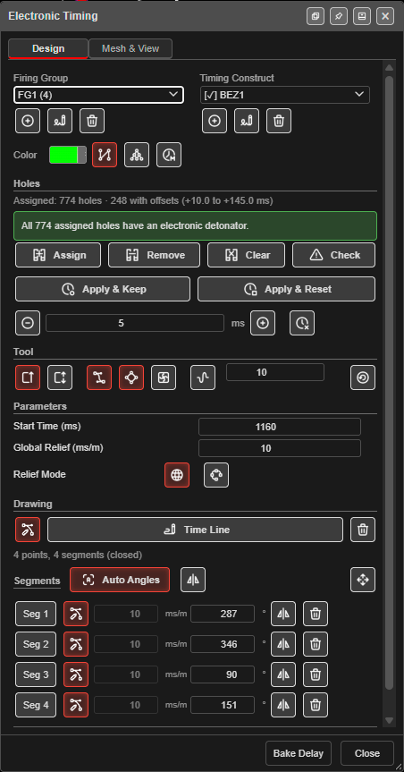
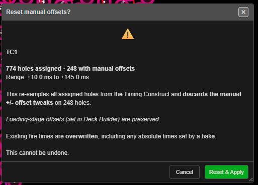
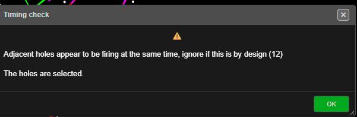
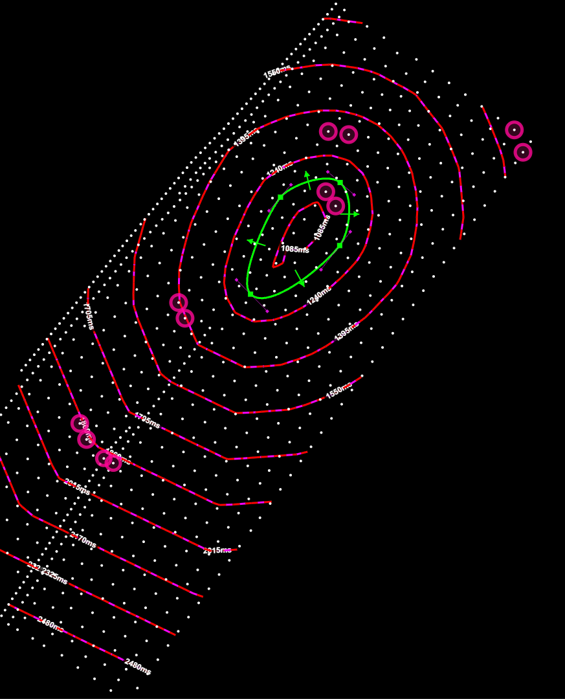
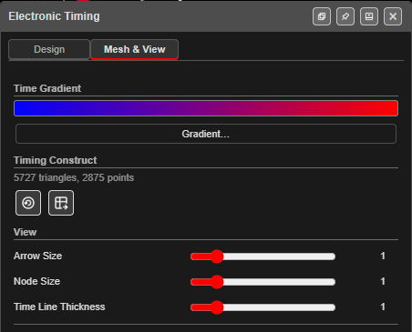
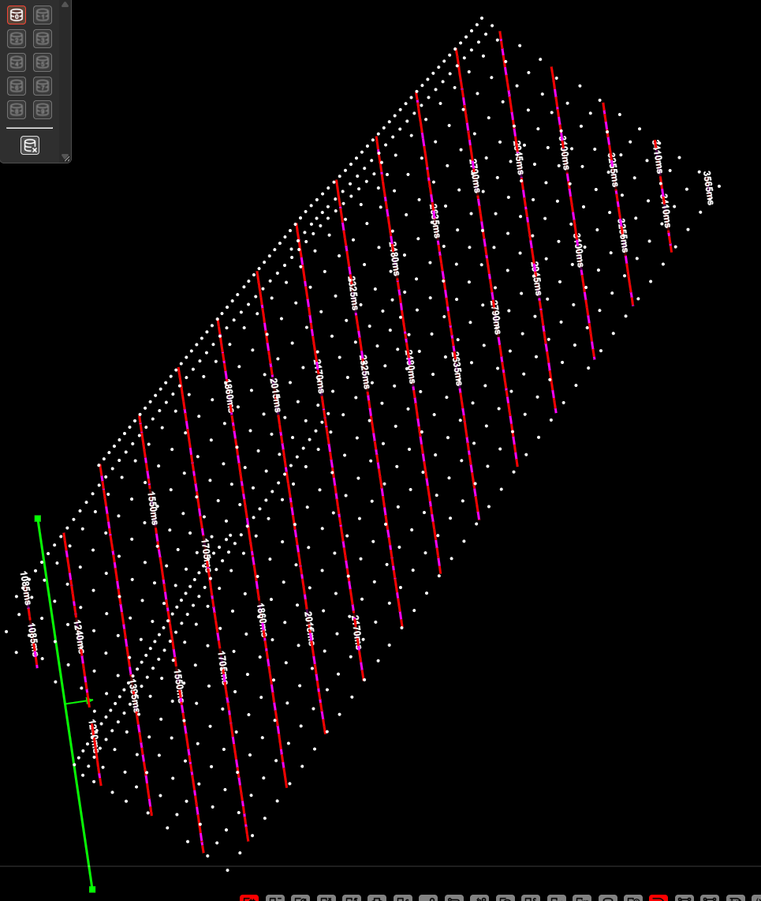
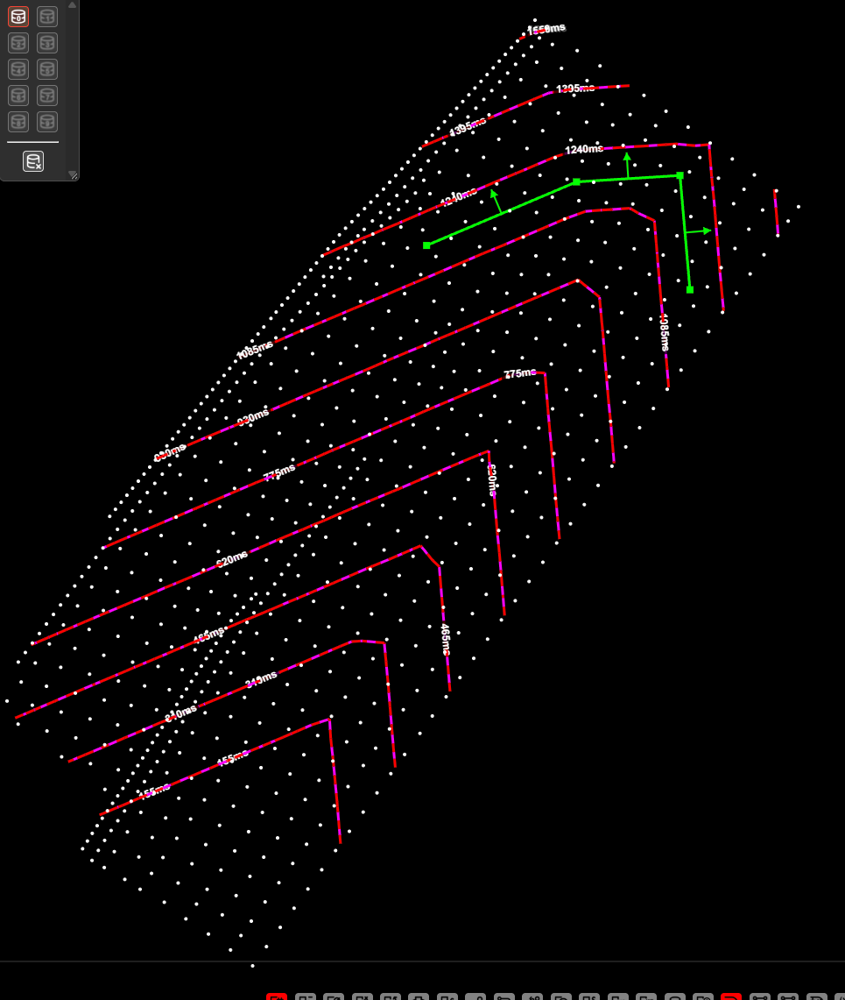
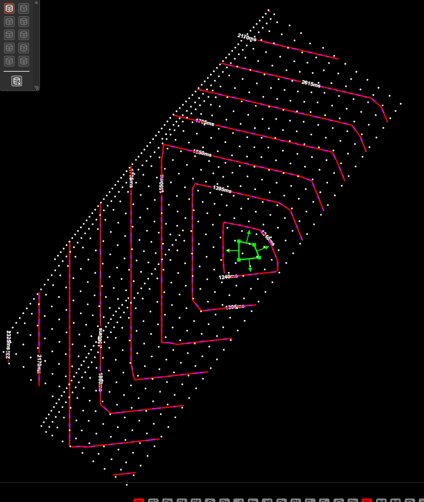
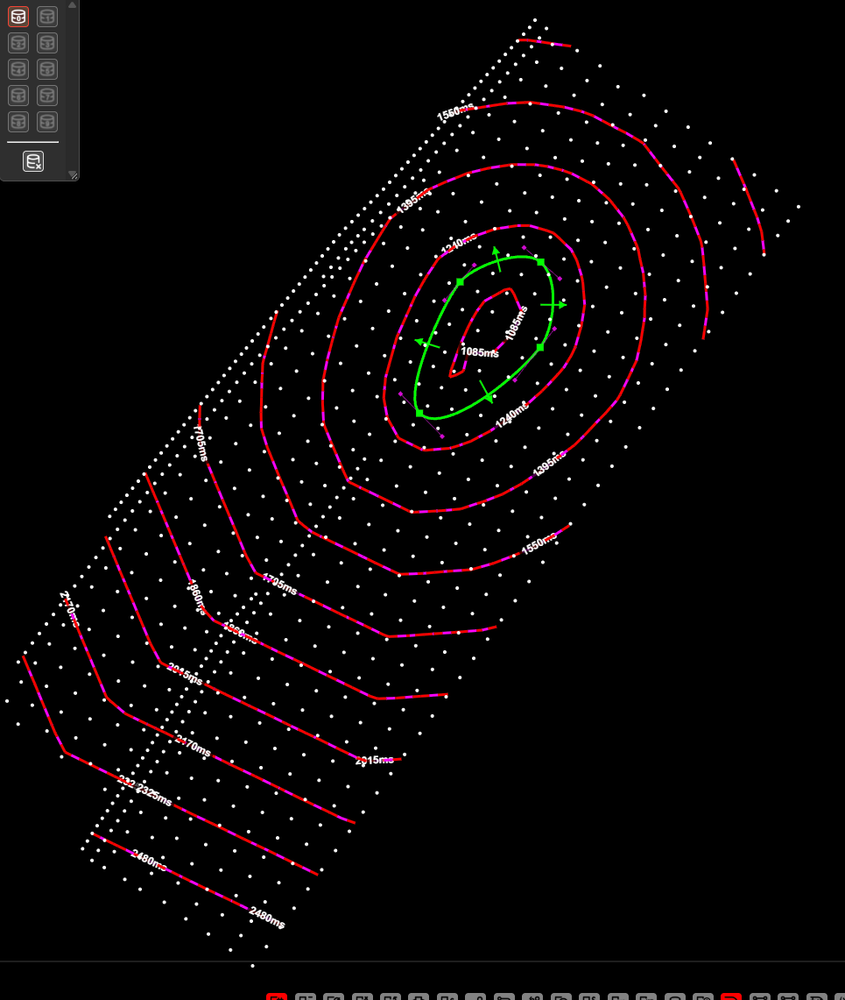
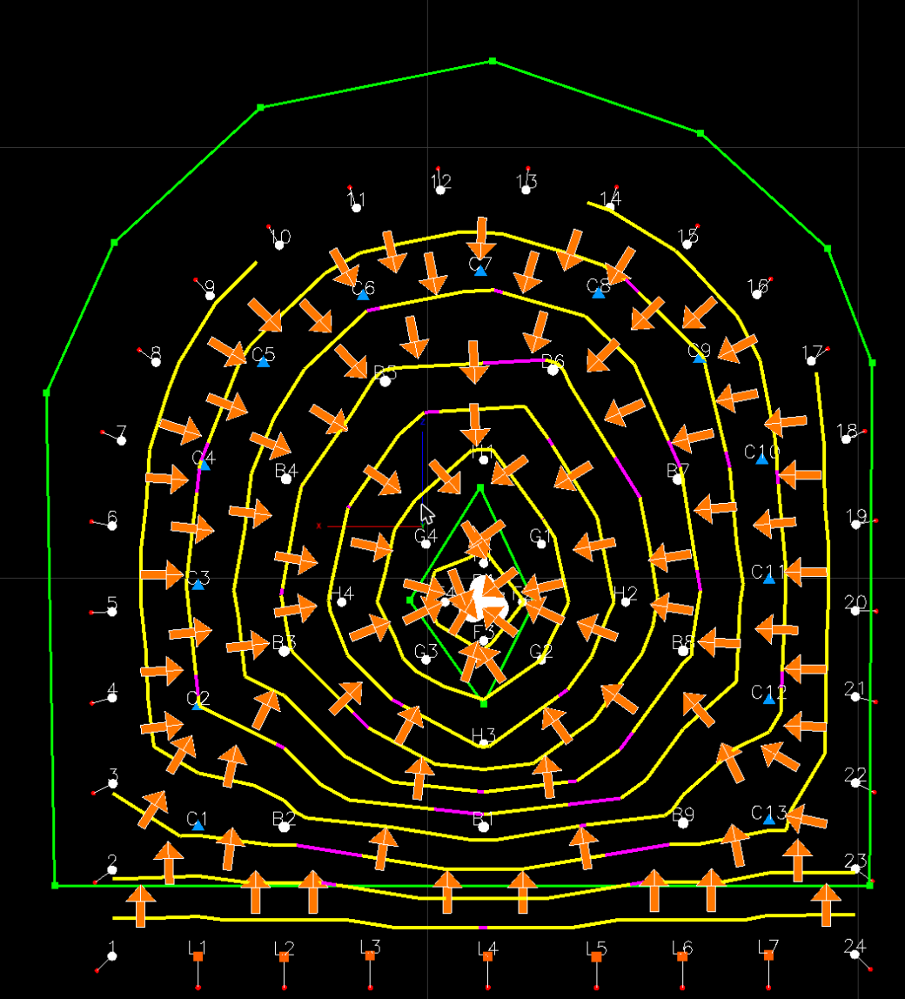

# Electronic Timing Constructs

**Electronic Timing** builds a **temporal mesh**: a triangulated surface in plan view (or [on an underground face](#timing-an-underground-face)) where **Z represents firing time in milliseconds**, not ground elevation. You draw one or two **timing contours** (polylines or sampled Bézier curves), set timing parameters, then assign **electronic detonators** in the charging design so their fire times follow that surface.

This workflow is separate from **connector timing** (each hole's **From Hole** and **Delay**, shown as tie arrows between collars). Electronic timing writes **primer detonator** fields for initiators marked **Electronic** in the charge design.

> **Availability:** Open the dialog with the **Electronic Timing Panel** button on the [Connect toolbar](connect-toolbar.md). The button is always shown; it does not depend on the charging design containing electronic detonators.

---

## Quick reference glossary

| Term | Meaning |
|------|---------|
| **Timing construct** | One complete temporal mesh: stored geometry, generated mesh, visibility, assigned holes, and parameters. |
| **Timing contour** | User-drawn polyline (or Bézier control structure); every vertex on that contour shares the same time at the **ridge** (relief mode) or lies on a fixed-time boundary (range mode). |
| **Contour polyline** | Connected chain of segments forming one continuous contour. |
| **Contour vertex** | Point where two segments meet; offset geometry uses **interior** vertex logic (bisector / mitre). |
| **Relief** | Rate of change of time with distance (**ms/m**). Treat it as a “velocity” of the timing wave along the offset direction, not acceleration. |
| **Bisector** | At an interior vertex, the direction used to place a single **mitre** offset point from the two adjacent segment normals. |
| **Mitre join** | One offset point along the bisector ray (normal case). |
| **Mitre limit** | Maximum mitre distance as a multiple of offset distance (implementation uses **3×** the strip offset). |
| **Mitre clamping** | When the geometric mitre distance would exceed the limit, it is capped to avoid blow-outs and preserve vertex count. |
| **Collapse** | Adjacent offset vertices converge; strip generation stops for that direction. |
| **Strip** | One offset copy of the contour at a given perpendicular distance; assigned a single time value for that row of the mesh. |
| **Quad strip** | Corresponding points on two adjacent strips form quads, split into two triangles each. |
| **Self-intersection** | Offset polylines can fold back on themselves at large offsets or sharp corners. |
| **Smooth temporal mesh** | When enabled, the generator **subdivides** the triangulated temporal mesh (two midpoint passes) then applies **Laplacian smoothing** in **X, Y, and Z** (time). **Smoothing strength** is controlled by a numeric field (fractional passes supported, e.g. `1` = one full pass blend toward neighbours). |
| **Bézier handle** | Each knot has an in and an out control point; the two handles stay in line, with independent lengths, when editing. |
| **Timing Relief tool** | One contour plus explicit **start time** and **relief (ms/m)** → offset strips in both time directions. |
| **Time Range tool** | Two contours plus **Line 1** and **Line 2** times → stitched mesh; effective relief is derived between the boundaries. |
| **Manual offset** | Extra milliseconds added in the **Electronic Timing** dialog with **+** / **−** (per selected holes’ **Electronic** detonators). Cleared by **Apply & Reset Offsets** (on re-apply) or **Reset Selected Hole Offsets**. |
| **Loading-stage offset** | The **Offset Delay (ms)** set in **Deck Builder** for the detonator; **always kept** when you apply timing or reset manual offsets — it is separate from the manual offset. |

---

## How it fits with charging and connectors

1. **Charge the holes** with at least one **Electronic** detonator on primers that should follow the mesh.
2. **Create a timing construct** and draw geometry (see below).
3. **Assign holes** to the construct (only assigned holes are considered when applying times).
4. Use **Apply & Keep Offsets** or **Apply & Reset Offsets** to re-sample times from the temporal surface at each assigned hole’s **collar XY** (on a face, the collar’s position on the face) and write electronic detonator fields (including a link back to the construct id). See [Holes](#holes) below.

Connector-based hole-to-hole delays and electronic mesh times can coexist in one project; they address different initiation models.

---

## Opening the Electronic Timing dialog

Click the **Electronic Timing Panel** button on the [Connect toolbar](connect-toolbar.md). The
**Electronic Timing** dialog opens with two tabs, **Design** and **Mesh & View**, and two footer
buttons, **Bake Delay** and **Close**. It can be docked to the edge of the window, popped out into
its own window, or collapsed, using the buttons in its title bar.

Closing the dialog ends any drawing in progress.

---

## The Design tab

*The **Design** tab with a closed Bezier construct selected. The rows run top to bottom in the order you
use them: pick the construct, assign holes, choose the tool, set the times, draw, then tune the segments.*

### Firing Group and Timing Construct

The top of the tab is two matching columns. Each has a dropdown and three icon buttons:

| Button | Firing Group column | Timing Construct column |
|---|---|---|
| **New** (+) | Asks for a name, then creates a firing group | Asks for a name, then creates a construct in the selected firing group |
| **Rename** | Renames the selected firing group | Renames the selected construct |
| **Delete** (bin) | Deletes the firing group. Refused while it still holds constructs | Deletes the construct — see below |

The construct dropdown lists the **applied** construct first, marked **[✓]** — the one the holes were
last timed from. Only one construct carries the mark. Choose **-- Select or New --** to clear the form.

Deleting a **timing construct** asks what to do with the holes it timed:

- **Delete & Release** — deletes the construct and releases its holes. They keep their fire times
  and are free to be timed by another construct. The release can be undone with **Ctrl+Z**.
- **Delete, keep link** — deletes the construct but leaves the holes linked to it, so re-importing a
  project that still contains it reattaches them. Until then Kirra reports it as missing (see
  [Missing constructs](#missing-constructs-and-releasing-holes)).
- Deleting the construct itself cannot be undone.

### What a Firing Group is

A **firing group** is the shot: the set of timing constructs that fire together. A construct belongs
to exactly one firing group; a group can hold many constructs. A hole fires from exactly one
construct.

> **Create a firing group before you create a timing construct.** A construct with no parent cannot
> be told which shot it belongs to.

Two blasts that fire together are drawn as one field. See [Timing Contours](timing-contours.md) —
contours, first movement, relief and slope stop splitting at the join once the blasts share a
construct or a firing group.

> Projects made before v1.1.32.30 have no groups. On first load Kirra creates one and adopts any
> parentless constructs into it, so nothing is lost.

### Colour and display

- **Color** — the colour the construct's time lines and arrows are drawn in.
- **Contour Line** — show or hide this construct's time lines and direction arrows.
- **Timing Construct** — show or hide this construct's own timing surface. The surface can fold back
  on itself where the timing doubles back; the hole times still read correctly.
- **Temporal Mesh** — show or hide the firing group's **Temporal Mesh**. It is the same switch as the
  Temporal Mesh button on the Connect toolbar.

### Holes

The line under **Holes** counts the assigned holes and any manual offsets on them, for example
*Assigned: 774 holes · 248 with offsets (+10.0 to +145.0 ms)*. A banner below it says whether the
assigned holes can take a fire time:

- When every assigned hole has an electronic detonator, it says so.
- When some do not, it says how many. Those holes take no fire time and are left out of the
  contours. Charge them to fix it.

| Button | What it does |
|---|---|
| **Assign** | Adds the selected holes to this construct. Holes already on another construct are moved to this one. |
| **Remove** | Takes the selected holes off this construct. |
| **Clear** | Takes every hole off this construct. |
| **Check** | Tidies the assignments, then checks the fire times — see [Check](#check). |
| **Apply & Keep** | Re-times the assigned holes from the construct and keeps your manual +/− offsets. |
| **Apply & Reset** | Re-times the assigned holes from the construct and discards the manual +/− offsets. |

Both Apply buttons ask first. Applying **overwrites** the holes' existing fire times, including any
absolute times set by a bake, and it cannot be undone. **Loading-stage offsets** (the **Offset Delay**
set in Deck Builder) are always kept.

*Apply & Reset says how many holes have manual offsets, and their range, before it discards them.*

An electronic detonator timed to **0 ms** fires at 0 ms. It is a real time, not a missing one.

#### Manual offsets

The row under the Apply buttons nudges the **selected** holes' electronic detonators:

- **Subtract time** (−) and **Add time** (+) move them by the step in the box (5 ms to start with).
- **Reset Selected Hole Offsets** clears the manual +/− on the selected holes. Loading-stage
  offsets are kept.

#### Check

**Check** does two jobs:

1. It reconciles the assignments: it drops references to holes that no longer exist, and adds
   holes whose detonator already names this construct.
2. It checks the fire times across the firing group. If a hole has no delay, or neighbouring holes
   fire at the same time, a **Timing check** message lists how many. Kirra selects those holes so you
   can see them. Ignore it if the timing is meant to be that way.

| The message | The holes it selected |
|---|---|
|  |  |
| **Check** on a closed Bezier construct finds 12 neighbouring holes firing at the same time. | The 12 holes are selected, so each double-up shows as a ringed pair. |

When nothing needs reconciling, the status line says *Assignments already match the holes — nothing
to reconcile*.

### Tool

The **Tool** row picks how the construct is built. From left to right:

| Button | What it does |
|---|---|
| **Timing Relief** | One time line. Time starts at **Start Time** on the line and grows away from it at the **Relief** rate (ms/m). |
| **Time Range** | Two time lines. Every point on **Time Line 1** fires at **Line 1 Time**, every point on **Time Line 2** at **Line 2 Time**, and holes between them are timed in between. |
| **Bezier** | All to Bezier / Straight: curves every node, or makes them all sharp corners. |
| **Closed** | Closes the time line into a loop, for centre-fire or centre-lift blasts. |
| **Marching Squares** | An experimental way to build a closed construct's surface. Greyed out unless the shape is closed. |
| **Smooth** | Smooths the timing surface. The box beside it sets the strength (0.2 to 50; a fraction is a partial pass). |
| **Regenerate** | Rebuilds the timing surface from the lines. |

> **Marching Squares is experimental.** Switching it on shows a warning: it is not reliable, and the
> straight cuts are the dependable option. Leave it off unless you are testing it.

**Straight lines take straight cuts.** Where a straight time line turns a corner, the timing contours
turn the same corner as a sharp mitre, and the contours stay parallel to each leg. A Bezier line
whose every node is sharp is treated the same way. Curved nodes give rounded contours.

### Parameters

For **Timing Relief**:

- **Start Time (ms)** — the time on the line itself.
- **Global Relief (ms/m)** — how fast time grows away from the line. Relief must be more than
  0 ms/m: to run the timing the other way, flip the arrow instead.
- **Relief Mode** — **Global** gives every segment the same relief; **Per-Segment** lets each segment
  keep its own. Switching back to Global asks before it overwrites the per-segment values. In
  Per-Segment mode the field shows **Av Segment Relief (ms/m)**, the area-weighted average.

For **Time Range**, **Range Parameters** show **Line 1 Time (ms)** and **Line 2 Time (ms)**, and
**Line 1 Extra Pts** / **Line 2 Extra Pts** to add points along each line for a finer surface.

### Drawing

- **Bezier Node** (the icon at the left) — when on, the nodes you place are curved; when off, they
  are sharp corners.
- **Time Line** (Timing Relief) or **Time Line 1** / **Time Line 2** (Time Range) — click to start
  drawing. The button is greyed out while that line exists; clear it with its bin to draw it again.
- **Bin** — clears the line. Kirra asks first: the assigned holes keep their fire times, but the
  construct has nothing to re-apply from until you draw it again. This cannot be undone.

While drawing:

1. Click to place each node.
2. Press **Backspace** to remove the last node.
3. Double-click or press **Enter** to finish.
4. Press **Escape** to cancel the line. Nothing is changed, and the dialog stays open.

A line needs at least two nodes, and a closed line at least three. Starting a line in the 3D view
shows a **Drawing in 3D** warning: the 3D cursor cannot always tell how deep you are pointing. Click
**Understood** to draw. On a bench, draw in 2D and check in 3D. On an underground face you draw in 3D
on the section — see [Timing an underground face](#timing-an-underground-face).

A closed **Time Range** needs Time Line 2 to enclose a closed Time Line 1, with more than two points
in each. If it does not, Kirra explains why and the lines stay open.

#### Edit on the canvas

With the dialog open and no drawing in progress, drag a node or a Bezier handle in 2D or 3D to
reshape the line. Dragging a node does not pan the view. Moving one side of a handle pair keeps the
curve smooth through the node.

### Segments

Each segment of a Timing Relief line has a row:

| Control | What it does |
|---|---|
| **Seg *n*** | Highlights the segment on the canvas, with the end node its bin removes. |
| **End node** icon | Curves the segment's end node, or makes it a sharp corner. One line can mix curved and sharp nodes. |
| **ms/m** | The segment's relief. Locked to the global relief in **Global** mode. |
| **°** | The segment's direction: the bearing in which time increases (0° = North). |
| **Flip** | Turns the direction 180°. |
| **Bin** | Deletes the segment: its end node is removed and the next segment joins up. |

Above the rows:

- **Auto Angles** — points every arrow the natural way: toward the centre for a closed line,
  square to the left of an open line.
- **Flip every arrow** — turns every arrow 180°. It works with Auto Angles on.
- **Select all nodes** (the move icon on the right) — selects every node, so dragging any one of
  them moves the whole construct.

For a **Time Range** construct the list shows one collapsible row per line, **L1** and **L2**, with
their segments under them. Each line has **Move L1** / **Move L2** (drag a node to move that whole
line) and a bin per segment.

---

## The Mesh & View tab

*The **Mesh & View** tab.*

- **Time Gradient** — the colour ramp that maps time to colour on the timing surface, in 2D and 3D.
  **Gradient…** edits its stops, its transparency and the surface's Z-magnification. The gradient
  does not change any fire time.
- **Timing Construct** — the surface's triangle and point counts, with **Regenerate** and
  **Export mesh + source lines to DXF**.
- **View** — **Arrow Size**, **Node Size** and **Time Line Thickness** scale how the construct is
  drawn, from 0.5× to 4×, in 2D and 3D. They are a display setting for this computer, not part of
  the design.

---

## Bake Delay

**Bake Delay** in the footer writes the fire time onto the primers of the selected construct's
assigned holes, or of all visible holes when no construct is selected. It shows what it will change
and asks before it does. See [Bake Delay](bake-delay.md).

---

## Four ways to shape the timing

The same blast timed four ways with **Timing Relief**. The green line is the construct; the red lines
are the [timing contours](timing-contours.md) it produces.

| Open straight line | Open line with corners |
|---|---|
|  |  |
| One straight segment: the contours run parallel to it, and time grows across the blast. | Straight segments with corners: each corner gives a sharp mitred corner in the contours. |

| Closed straight shape | Closed Bezier shape |
|---|---|
|  |  |
| **Closed** with sharp nodes: centre-fire, with straight-sided rings. | **Closed** with curved nodes: centre-fire, with rounded rings. |

---

## Timing an underground face

On a bench, a timing construct works in plan: each hole reads its time at its collar's X and Y.
On a vertical face that fails — a lifter and the back hole straight above it share the same X
and Y, so they would read the same time. Draw the construct **on the face** instead, and it
works in the face: each hole reads its time where its collar sits on the face, so a row higher
up fires later, by the relief times the distance up.

*A **Time Range** construct drawn on a drive face, looking along the drive: **Time Line 1** round
the cut in the middle, **Time Line 2** round the perimeter, and the timing contours between them.*

### Draw a construct on the face

1. Take a section across the drive at the face, and turn on **Draw on Section Plane** (or
   **Draw anywhere visible**) — see
   [Design Underground Rings and Drives](../tasks/underground-design.md#1-take-the-section-and-work-on-it).
2. Open **Electronic Timing** and make a new timing construct.
3. Choose **Timing Relief** or **Time Range**, then click **Time Line** (or **Time Line 1**).
   Click **Understood** on the **Drawing in 3D** warning.
4. Click the points of the line on the face, and double-click or press **Enter** to finish.
   Clicks snap to holes and points first; elsewhere they land on the section.
5. Assign the face holes and apply the timing as usual.

The construct takes the section's plane at the moment you start drawing, and keeps it — it
stays on that face when you move the section, close the dialog or reload. In **Time Range**,
**Time Line 2** goes on the same face as **Time Line 1**. A construct drawn with no draw switch
on is an ordinary plan construct, exactly as before.

### On the face

| | A construct on a face |
|---|---|
| **Holes** | Read their time at the collar, measured on the face. A collar set back into the rock reads the same time as the point on the face straight in front of it. |
| **Direction (°)** | Measured on the face: **0** points straight up the face, and angles run clockwise as you look at the face. **Flip** still adds 180°. |
| **Surface** | The timing surface stands in the face. Time lifts it off the face toward you, the way it lifts a bench surface upward. |
| **Editing** | Drag knots and handles in the 3D view; they slide across the face. In 2D they cannot be dragged. |
| **2D view** | The lines and arrows show as seen from above — usually a thin line along the face — and the surface is not drawn. |

### Not on the face yet

These still work in plan for a construct on a face:

- The **Temporal Mesh** of the whole firing group.
- The check for neighbouring holes firing together.
- Exporting the timing surface to DXF.

---

## Missing constructs and releasing holes

*(v1.1.32.45)*

Every hole a construct times remembers **which** construct timed it. If that
construct is no longer in the project — deleted, or not included in a file you
imported — Kirra shows **Timing construct missing** when the project loads or the
file is imported.

Nothing is lost when this happens:

- The holes' **fire times are intact.** The plan, exports and analysis all use them.
- The holes **can still be re-timed.** Assign them to any construct and apply it.
- Only the missing construct's own design is gone: its polyline, start time and relief.

The warning offers three choices:

| Button | What it does |
|---|---|
| **Release All** | Releases the holes from every missing construct, after one confirmation. |
| **Release from List** | Opens the list below so you can release one construct at a time. |
| **Close** | Leaves the links. Importing a project that still contains the construct reattaches its holes automatically. |

### Release from List

The list shows every construct your holes are timed by, and says which are missing:

| Column | Meaning |
|---|---|
| **Construct** | The construct's name, or its id if it is missing. |
| **Status** | **Orphan** — the construct is gone. **Valid** — it still exists. |
| **Holes** | How many holes it timed. |
| **Blast List** | The blasts those holes belong to. |
| **Release** | Releases that construct's holes. Only **Orphan** rows can be released. |

Valid constructs are listed so you can see they are safe. Their **Release** button is
greyed out, and a construct that still exists is never released.

### What a release changes

- It removes the holes' link to the missing construct. **Fire times do not change.**
- Once released, re-importing that construct will **not** reattach those holes.
  Only release a construct you deleted on purpose.
- Blasts that were joined **only** by the released construct become separate
  firing events, so their [timing contours](timing-contours.md) are drawn separately.
- Each release is one step on the undo stack: **Ctrl+Z** puts the links back.

---

## Persistence

Timing constructs are saved automatically in the browser's local database for the current workspace, so they survive a page reload.

**KAP project files (v1.0.47+):** Exporting a **.kap** project includes the timing constructs, and importing it restores them. Use KAP for full project round-trips that include electronic timing geometry.

---

## Related topics

- [Timing Sequences](timing-sequences.md) — Connector-based firing order, auto-timing, and validation.
- [Charging Overview](../charging/overview.md) — Deck builder and electronic initiators.
- [Harness Wire Assignment](../charging/harness-wire-assignment.md) — SurfaceWire path/commander tool (separate from mesh timing).
- [Connect Toolbar](connect-toolbar.md) — Electronic Timing Panel, Temporal Mesh and Bake Delay buttons.
