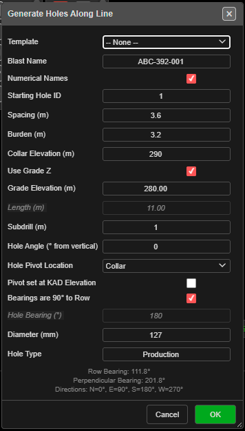

# Holes Along Line

Places a single straight row of blast holes between two points you click, at a set spacing. Use it
for presplit lines, buffer rows, trim rows and single-row blasts.

*Generate Holes Along Line, after clicking the start and end points.*

---

## Prerequisites

- Nothing needs to be drawn first — you click the two ends of the row.
- To place the row on existing work, snap the clicks to KAD points, line vertices or holes.

---

## Place a row of holes

This tool is click-first: you pick the two ends, then the dialog opens.

1. Click **Holes Along Line** on the **Holes** toolbar. The status line reads *"Step 1: Click to
   select line start point"*.
2. Click the **start point**. The status line reads *"Step 2: Click to select line end point"*.
3. Click the **end point**. The **Generate Holes Along Line** dialog opens.
4. Set **Spacing (m)** and the hole properties (see [The fields](#the-fields)).
5. Click **OK**.

The first hole sits on the start point. Further holes follow at the spacing, so the last hole sits
on the end point only when the line length is an exact multiple of the spacing. Clicks snap to
nearby objects, and the canvas labels the picks **START** and **END** with the distance between them.

Under the fields the dialog shows the **Row Bearing** (start to end), the **Perpendicular Bearing**,
and *"Directions: N=0°, E=90°, S=180°, W=270°"*.

---

## The fields

| Field | Default | What it does |
|---|---|---|
| **Template** | -- None -- | Fills the form from a saved [pattern template](pattern-templates.md). The template's text setup and charging are applied to the new holes. A remembered template is re-read each time the dialog opens |
| **Blast Name** | `LinePattern_` + a number | The blast the holes go into. An existing name adds to that blast |
| **Numerical Names** | Ticked | Ticked: numbers from **Starting Hole ID**. Unticked: a row letter + position (A1, A2 …) |
| **Starting Hole ID** | 1 | A number (`500`) or an alphanumeric seed (`A1`). Continues past any higher ID of the same series already in the blast |
| **Spacing (m)** | 3.0 | Distance between holes along the line |
| **Burden (m)** | 3.0 | Stored on each hole for analysis — it does not move the holes. Left blank, it is 1.0 m |
| **Collar Elevation (m)** | 0 | Collar RL of every hole |
| **Use Grade Z** | Ticked | Ticked: holes run to **Grade Elevation (m)**. Unticked: holes are set by **Length (m)** |
| **Grade Elevation (m)** | -10 | Floor RL. Editing it recalculates the length |
| **Length (m)** | Calculated | Collar-to-toe length, including subdrill. Editing it recalculates the grade |
| **Subdrill (m)** | 1 | Vertical depth below grade |
| **Hole Angle (° from vertical)** | 0 | 0 = vertical |
| **Hole Pivot Location** | Collar | Which point sits on the line: **Collar**, **Grade** or **Toe** |
| **Pivot set at KAD Elevation** | Off | The pivot point takes its RL from the elevation of the clicked points, interpolated along the line, instead of the RL boxes. Subdrill is unchanged; bench height varies along the line |
| **Bearings are 90° to Row** | Ticked | Every hole is set square to the line, to the right of the start-to-end direction |
| **Hole Bearing (°)** | 180 | Used when **Bearings are 90° to Row** is unticked. 0 = North, clockwise |
| **Diameter (mm)** | 115 | Hole diameter |
| **Hole Type** | Production | Free text |

The last values you used are kept for next time.

---

## What to expect

- The holes appear along the line, all in one new row, and the tool switches off.
- The row is one undo step — **Ctrl+Z** removes it.
- If a new hole would sit on a hole already in the same blast, the **Hole Proximity Warning** asks
  you to **Skip**, **Ignore**, **Skip All** or **Cancel**. See
  [Editing Holes → Hole coincidence](editing-holes.md#hole-coincidence).
- With **Pivot set at KAD Elevation** on, a hole whose grade would reach or rise above its collar is
  skipped, and a **Holes Skipped** message says how many.

---

## Other ways to use it

| Method | Result |
|---|---|
| **Escape** (once) | Clears the start point — *"Holes along line tool reset"* |
| **Escape** (twice) | Leaves the tool and returns to **Pointer Select** |
| **Cancel** in the dialog | Closes it and switches the tool off |
| 3D view | The same two clicks work in 3D |
| **Template** list | Reuses a saved pattern, including its text setup and charging |

---

## Troubleshooting

**"Invalid Spacing"**
Spacing must be a positive number.

**"Invalid Blast Name"**
The **Blast Name** box is empty.

**The holes lean the wrong way.**
With **Bearings are 90° to Row** ticked the holes lean to the right of the start-to-end direction.
Click the two ends the other way round, or untick it and type a **Hole Bearing (°)**.

**The last hole stops short of the end point.**
The line length is not a whole number of spacings. Adjust the spacing or the end point.

---

## Related

- [Holes Along Polyline](holes-along-polyline.md) — a row that follows a drawn line
- [Pattern in Polygon](pattern-in-polygon.md) — fill a boundary
- [Add Pattern](add-pattern.md) — a rectangular grid
- [Pattern Templates](pattern-templates.md)
- [Holes Toolbar](holes-toolbar.md)
