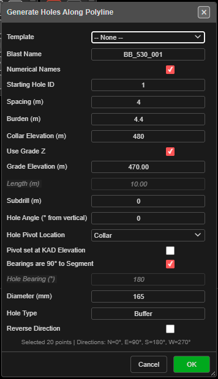

# Holes Along Polyline

Places a row of blast holes along an existing KAD line, polyline or polygon edge, at a set spacing
measured along the line. Use it for curved presplit lines, rows that follow a crest or toe, and
perimeter rows.

*Generate Holes Along Polyline. The footer reports how many points were selected.*

---

## Prerequisites

- A KAD **line** or **polygon** to follow. Draw it first, or import it.

---

## Place holes along a line

1. Click **Holes Along PolyLine** on the **Holes** toolbar. The status line reads *"Step 1: Click on
   an existing line, polyline, or polygon edge to select it."*
2. Click the line or polygon.
3. Click a vertex to set the **start point**. Kirra picks the vertex nearest your click.
4. Click another vertex to set the **end point**. The **Generate Holes Along Polyline** dialog opens.
5. Set **Spacing (m)** and the hole properties (see [The fields](#the-fields)).
6. Click **OK**.

Holes run from the start vertex to the end vertex. The spacing is measured **along** the line and
carries on round each bend, so it stays even through the corners. The first hole sits on the start
vertex; the last sits on or before the end vertex.

On a polygon, the stretch between the two vertices goes the shorter way round (the way with fewer
vertices). The canvas labels the picks **START** and **END** and shows the distance along the line.

The dialog footer reads *"Selected {n} points | Directions: N=0°, E=90°, S=180°, W=270°"*.

---

## The fields

| Field | Default | What it does |
|---|---|---|
| **Template** | -- None -- | Fills the form from a saved [pattern template](pattern-templates.md). The template's text setup and charging are applied to the new holes. A remembered template is re-read each time the dialog opens |
| **Blast Name** | `PolylinePattern_` + a number | The blast the holes go into. An existing name adds to that blast |
| **Numerical Names** | Ticked | Ticked: numbers from **Starting Hole ID**. Unticked: a row letter + position (A1, A2 …) |
| **Starting Hole ID** | 1 | A number (`500`) or an alphanumeric seed (`A1`). Continues past any higher ID of the same series already in the blast |
| **Spacing (m)** | 3.0 | Distance between holes, measured along the line |
| **Burden (m)** | 3.0 | Stored on each hole for analysis — it does not move the holes. Left blank, it is 1.0 m |
| **Collar Elevation (m)** | 0 | Collar RL of every hole |
| **Use Grade Z** | Ticked | Ticked: holes run to **Grade Elevation (m)**. Unticked: holes are set by **Length (m)** |
| **Grade Elevation (m)** | -10 | Floor RL. Editing it recalculates the length |
| **Length (m)** | Calculated | Collar-to-toe length, including subdrill. Editing it recalculates the grade |
| **Subdrill (m)** | 1 | Vertical depth below grade |
| **Hole Angle (° from vertical)** | 0 | 0 = vertical |
| **Hole Pivot Location** | Collar | Which point sits on the line: **Collar**, **Grade** or **Toe**. Use **Grade** or **Toe** when the line is a surveyed floor or toe line |
| **Pivot set at KAD Elevation** | Off | The pivot point takes its RL from the line's own elevation instead of the RL boxes. Subdrill is unchanged; bench height varies along the line |
| **Bearings are 90° to Segment** | Ticked | Each hole is set square to its own segment of the line, to the right of the start-to-end direction |
| **Hole Bearing (°)** | 180 | Used when **Bearings are 90° to Segment** is unticked. 0 = North, clockwise |
| **Diameter (mm)** | 115 | Hole diameter |
| **Hole Type** | Production | Free text |
| **Reverse Direction** | Off | Places the holes from the end vertex back to the start vertex |

The last values you used are kept for next time.

---

## What to expect

- The holes appear along the line, all in one new row, and the tool switches off.
- The row is one undo step — **Ctrl+Z** removes it.
- If a new hole would sit on a hole already in the same blast, the **Hole Proximity Warning** asks
  you to **Skip**, **Ignore**, **Skip All** or **Cancel**. See
  [Editing Holes → Hole coincidence](editing-holes.md#hole-coincidence).
- With **Pivot set at KAD Elevation** on, a hole whose grade would reach or rise above its collar is
  skipped, and a **Holes Skipped** message says how many.

---

## Other ways to use it

| Method | Result |
|---|---|
| **Reverse Direction** | Same stretch of line, holes numbered and placed from the other end |
| **Escape** (once) | Clears the picks and returns to Step 1 |
| **Escape** (twice) | Leaves the tool and returns to **Pointer Select** |
| **Cancel** in the dialog | Closes it and switches the tool off |
| 3D view | The same three clicks work in 3D |
| **Template** list | Reuses a saved pattern, including its text setup and charging |

---

## Troubleshooting

**"No line or polygon found."**
The first click did not land on a line or polygon. Points and text cannot be followed.

**"Click closer to a vertex on the selected line/polygon."**
The start and end must be vertices of the line. Zoom in, or click nearer a vertex.

**The holes go the long way round a polygon.**
The tool takes the shorter way round. To cover the longer stretch, pick intermediate start and end
vertices and run the tool twice, or draw the stretch as its own line.

**The holes lean the wrong way.**
With **Bearings are 90° to Segment** ticked, holes lean to the right of the start-to-end direction.
Tick **Reverse Direction**, or untick the bearing box and type a **Hole Bearing (°)**.

---

## Related

- [Design Underground Rings and Drives on a Section Plane](../tasks/underground-design.md) — setting holes out on a drive face
- [Holes Along Line](holes-along-line.md) — a straight row between two clicks
- [Pattern in Polygon](pattern-in-polygon.md) — Along Polyline mode fills a boundary with rows that follow a line
- [Pattern Templates](pattern-templates.md)
- [Holes Toolbar](holes-toolbar.md)
