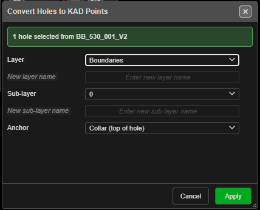

# Convert Holes to KAD Points

Creates a KAD point at the collar, grade or toe of each selected hole. Use it to carry hole
positions into drawing tools — triangulate a toe surface, offset a crest line, check a new bench
against old toes — or to export them as drawing geometry.

*Convert Holes to KAD Points, with one hole selected.*

---

## Prerequisites

- One or more holes **selected**. Without a selection, Kirra says *"Select one or more visible
  blast holes before converting to points."*
- Hidden and locked holes in the selection are skipped.

---

## Convert holes to points

1. Select the holes.
2. Click **Convert Holes to KAD Points (collar / grade / toe)** on the **Holes** toolbar. The
   banner at the top says how many holes are selected, and from which blast.
3. Choose the **Layer** and **Sub-layer** for the new points.
4. Choose the **Anchor**.
5. Click **Apply**. The status bar reports *"Created … point(s) in … entity"*.

---

## The options

| Option | Default | What it does |
|---|---|---|
| **Layer** | Your last choice, else the first layer (or **+ New Layer...** when there are none) | The drawing layer for the points. **+ New Layer...** enables **New layer name** |
| **New layer name** | — | Name for a new layer. A layer of that name already present is used instead of making a second |
| **Sub-layer** | Your last choice, else **0** | The folder inside the layer. **+ New File Layer...** enables **New sub-layer name** |
| **New sub-layer name** | — | Name for a new sub-layer |
| **Anchor** | **Collar (top of hole)** | Or **Grade (floor elevation)** or **Toe (bottom of hole)**. Each point takes that position's X, Y and Z exactly |

The dialog remembers the layer, sub-layer and anchor until Kirra is reloaded. A layer named `0`
is not offered.

---

## What you get

- **One drawing per blast.** A selection spanning three blasts makes three drawings.
- Each drawing is named after its blast and the anchor, such as `BLAST2_Toe_Points`. A repeat run
  gets a new name rather than overwriting.
- Each point's ID is its hole's number when the hole ID is a whole number (hole `57` → point 57).
  Holes named with letters (`A12`, `PS-4`) — or whose number is already taken — are numbered on
  after the last point, and the status bar says how many were renumbered.
- The points use the **KAD Color** and **Point and Line Size** set on the **KAD** toolbar.

Delete the drawing in the Data Explorer to remove the points — this tool does not add an undo
step.

---

## Other ways to use it

| Method | Result |
|---|---|
| [Data Explorer](../working-in-kirra/data-explorer.md) → right-click holes or a blast → **To Points…** | Opens the same dialog for the holes you right-clicked. A blast node converts all its visible holes |
| **Anchor: Toe** on an old shot, then [Coincident Holes Check](coincident-holes-check.md) with **KAD entity** | Checks a new bench against the old toes as a drawing |

---

## Troubleshooting

| Problem | Cause and fix |
|---|---|
| *"Select one or more visible blast holes before converting to points."* | Nothing selected, or every selected hole is hidden or locked |
| *"Nothing to Convert"* — all holes skipped | The chosen anchor has no coordinates on those holes. Try a different anchor |
| *"Layer Name Required"* / *"Sub-layer Name Required"* | **+ New Layer...** or **+ New File Layer...** is chosen but the name is blank |
| Point IDs do not match the hole names | Only whole-number hole IDs can become point IDs. A name such as `A12` cannot |

---

## Related

- [Coincident Holes Check](coincident-holes-check.md)
- [Layer Organisation](../kad/layer-organisation.md)
- [Points, Lines and Polygons](../kad/points-lines-polygons.md)
- [Holes Toolbar](holes-toolbar.md)
