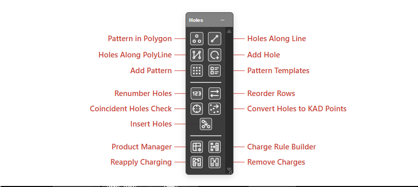

# Holes Toolbar

The **Holes** toolbar places blast holes, generates patterns, renumbers and checks them, and
charges the selected holes. Open it from its tab on the right edge of the window.

*The Holes toolbar with all tool buttons labelled.*

---

## The controls

Button names are the tooltips shown when you hover.

| Control | What it does | Other ways to use it | Guide |
|---|---|---|---|
| **Pattern in Polygon** | Fills a polygon with holes at a set burden and spacing | Right-click the button: **Straight Rows** or **Along Polyline**, ratios, marks | [Pattern in Polygon](pattern-in-polygon.md) |
| **Holes Along Line** | One straight row of holes between two clicked points | Works the same in 3D | [Holes Along Line](holes-along-line.md) |
| **Holes Along PolyLine** | A row of holes along a KAD line, polyline or polygon edge | **Reverse Direction** places them from the other end | [Holes Along Polyline](holes-along-polyline.md) |
| **Add Hole** | Places single holes where you click | **Multiple** keeps placing with the same settings | [Add Hole](adding-holes.md) |
| **Add Pattern** | A rectangular grid of holes from a clicked start point | **Template** list reuses a saved pattern | [Add Pattern](add-pattern.md) |
| **Pattern Templates** | Saves burden, spacing, hole, text and charging settings for reuse | Pick a template in any pattern dialog | [Pattern Templates](pattern-templates.md) |
| **Renumber Holes** | New hole IDs, rows and positions for a run of holes | Delete holes → **Renumber Holes?** | [Renumber Holes](renumber-holes.md) |
| **Reorder Rows** | Rebuilds row and position numbers from a row line you pick | **Renumber holes after reorder** | [Reorder Rows](reorder-rows.md) |
| **Coincident Holes Check** | Finds holes too close to another blast or a drawing, and moves them | **Check + Relocate**; undo with **Ctrl+Z** | [Coincident Holes Check](coincident-holes-check.md) |
| **Convert Holes to KAD Points (collar / grade / toe)** | A KAD point at the collar, grade or toe of each selected hole | Data Explorer → right-click → **To Points…** | [Convert Holes to KAD Points](holes-to-kad-points.md) |
| **Insert Holes** | Adds holes into an existing row, before or after a clicked hole | Right-click a hole → **Edit Hole** → **Insert** | [Insert Holes](insert-holes.md) |
| **Product Manager** | The explosive products list used by charging and the Connect toolbar | — | [Product Manager](../charging/product-manager.md) |
| **Charge Rule Builder** | Opens the Deck Builder to build charge decks and apply them | — | [Deck Builder](../charging/deck-builder.md) |
| **Reapply Charging** | Re-fits the selected holes' charging to their current length | — | [Reapply Charging](../charging/reapply-charging.md) |
| **Remove Charges** | Removes all charging from the selected holes | — | [Remove Charges](../charging/remove-charges.md) |

> **Note:** **Create Radii from Blast Holes** is no longer on the Holes toolbar. To draw radii
> around holes, use **Radii Holes/KADs** on the [Modify toolbar](../kad/modify-tools.md).

---

## Which pattern tool?

| You have | Use |
|---|---|
| A blast boundary drawn as a polygon | [Pattern in Polygon](pattern-in-polygon.md) |
| A start point and a regular grid in mind | [Add Pattern](add-pattern.md) |
| Two points for a single row (presplit, buffer, trim) | [Holes Along Line](holes-along-line.md) |
| A crest, toe or design line to follow | [Holes Along Polyline](holes-along-polyline.md) |
| A few holes to add by hand | [Add Hole](adding-holes.md) |
| A row that needs one more hole | [Insert Holes](insert-holes.md) |

[Pattern Generation](pattern-generation.md) compares the methods and covers the settings they share.

---

## Related

- [Pattern Generation](pattern-generation.md) — choosing a method, collar and grade elevation
- [Editing Holes](editing-holes.md) — selecting, moving, deleting and hole numbering
- [Hole Properties](../reference/hole-properties.md) — every hole field
- [Connect Toolbar](connect-toolbar.md) — tying and timing the holes
- [Charging Overview](../charging/overview.md)
