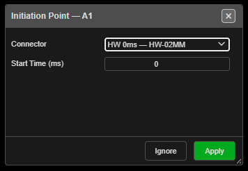

# Initiation Points

Adds or removes an **initiation point** — the place the blast is lit from. The toolbar button is
**Self Connect Add IP**. Every firing time in a blast is counted from its initiation points, so a
blast with none has no times.

> **Note:** In Kirra an initiation point is where the *surface* sequence starts — a hole, or a
> point on a cord trunk. It is not the primer position inside a hole.

---

## Add an initiation point to a hole

1. Click **Self Connect Add IP** on the **Connect** toolbar. The status bar reads *"Initiation
   Point: click a hole to add or remove the point the blast is lit from."*
2. Hover a hole — the status bar says what a click will do.
3. Click the hole. It becomes an initiation point, and the **Initiation Point — …** dialog opens.
4. Choose a **Connector** and **Start Time (ms)** (below), then click **Apply** — or click
   **Ignore** to keep it as it is.
5. The tool stays on. Click the button again to finish.

The hole is already an initiation point before the dialog opens, so **Ignore** does not undo it.

---

## The Initiation Point dialog

| Field | Default | What it does |
|---|---|---|
| **Connector** | The hole's current surface product, or **— Manual (no product) —** | The surface product that lights this point. Picking one fills **Start Time (ms)** from it |
| **Start Time (ms)** | The hole's current delay, or 0 | When this point fires. **0** means the blast starts here |

| Button | Result |
|---|---|
| **Apply** | Sets the product (its colour and travel time) and the start time. A typed time wins over the product's delay |
| **Ignore** | Keeps the initiation point with its current time |

---

## Remove an initiation point

Click a hole that is already an initiation point. The point is removed and the hole is left
**untied** — it is no longer part of the timing.

> **Warning:** Every hole fed from a removed initiation point loses its firing time. The status bar
> says how many: *"… hole(s) downstream now have no signal path."*

The hole's start time is kept, so adding the point back restores it.

---

## Cord trunks

Click a **trunk run** away from any collar to light the trunk at that spot. Click the same spot
again to remove it.

- *"Initiation added to …"* / *"Initiation removed from …"* confirm the change.
- A trunk with no initiation of its own is lit at its start. That default cannot be removed — add
  a source elsewhere to move it.
- A collar always wins over the trunk: click on the hole to light the hole, anywhere else along the
  run to light the trunk.

---

## When a cord feeds the hole

Lighting a hole that a cord already feeds keeps the cord: *"Initiation point added to … — the cord
that fed it was kept as a connection."* For harness wire and surface connectors, the hole's old
tie is replaced.

---

## Troubleshooting

| Symptom | Cause | Fix |
|---|---|---|
| *"Nothing under the cursor — click a collar, or a cord run to light it there."* | The click missed both | Click on the collar, or on the trunk line |
| Holes show no time after a click | That click removed an initiation point | Click the hole again to add it back |
| A locked hole will not take a point | Locked holes cannot be picked | Unlock its blast in the Data Explorer |
| *"… is lit at its start by default — add a source elsewhere to move it."* | The trunk's default start cannot be removed | Add an initiation elsewhere on the run |

---

## Other ways to use it

| Method | Result |
|---|---|
| Click a hole **twice** with [Tie Connect](tie-connect.md) or [Tie Connect Multi](tie-connect-multi.md) | Makes it an initiation point, with no dialog |
| Click the chain head again with [Tie Connect Continuous](tie-connect-continuous.md) | Makes it an initiation point and ends the chain |
| Right-click a trunk → **Add Initiation** / **Remove Initiation** | The same as clicking the trunk with this tool |
| Data Explorer → right-click holes → **Reset Connections** | Ties every selected hole to itself with a 0 ms delay — each becomes an initiation point |

---

## Related

- [Tie Connect](tie-connect.md)
- [Trunk Branch Connect](trunk-branch-connect.md)
- [Timing Sequences](timing-sequences.md)
- [Connect Toolbar](connect-toolbar.md)
