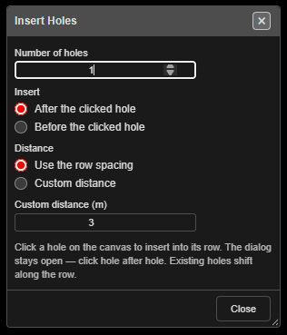

# Insert Holes

Adds one or more holes **into an existing row**, before or after a hole you click. The new holes
copy the clicked hole and take their place in the row's numbering. Use it to extend a row, or to
put infill holes between existing ones.

*Insert Holes. The dialog stays open while you click hole after hole.*

---

## Prerequisites

- A blast whose holes have row and position numbers. The new holes go into the clicked hole's
  row, in position order.

---

## Insert holes into a row

1. Click **Insert Holes** on the **Holes** toolbar. The **Insert Holes** dialog opens. The
   select pointer, hole selection and **Hole ID** display are switched on, and the cursor becomes
   a crosshair.
2. Set **Number of holes**, **Insert** and **Distance** (below).
3. Click a hole on the canvas. The new holes are added along its row, and the status bar reports
   *"Inserted … hole(s) after … — click another hole to continue"*.
4. Click the next hole to insert again. The dialog stays open.
5. Click **Close** — or click **Insert Holes** again — to finish.

It works in 2D and 3D.

---

## The options

| Option | Default | What it does |
|---|---|---|
| **Number of holes** | 1 | How many holes each click inserts |
| **Insert** | **After the clicked hole** | Or **Before the clicked hole**. After means towards the higher position numbers |
| **Distance** | **Use the row spacing** | Centre-to-centre step between the clicked hole and each new hole. **Use the row spacing** takes the clicked hole's spacing; **Custom distance** uses the field below |
| **Custom distance (m)** | 3 | The step when **Custom distance** is chosen |

The first new hole sits one step from the clicked hole along the row, the second two steps, and so
on. The row's direction comes from the clicked hole and its neighbour; a hole alone in its row uses
its own bearing.

If the clicked hole has no spacing recorded, **Use the row spacing** measures the gap to its
neighbour in the row, or uses 3 m when there is none.

---

## What you get

- **Existing holes do not move.** Their position numbers — and, for numbered blasts, their hole
  IDs — shift along to make room.
- In a **numbered** blast (1, 2, 3 …) every later hole in the blast moves up. In a **row-named**
  blast (A1, B1 …) only the clicked row is renumbered; other rows keep their names.
- Each new hole copies the clicked hole's design: diameter, type, angle, bearing, length, bench,
  subdrill, burden, spacing, colour and timing delay. Its **charge** (decks, products and
  primers) and label layout are copied too.
- The new holes are not tied into the row — like any new hole, each is tied only to itself. Tie
  them in with the [Connect toolbar](connect-toolbar.md).
- One click is one undo step, however many holes it inserted — **Ctrl+Z** removes them together.

### The amber banner

Copied charge and timing are a best guess, not a design. When the clicked hole is charged, an
amber banner at the foot of the dialog says so after the insert, for example:

> Hole 1483 inherits hole 1482's Design, Charge & Timing. Complete checks before issuing.

It counts the holes inserted since the dialog opened. If the copied detonator belongs to a timing
construct, the banner also names the construct — re-apply it so the new holes are timed at their
own position.

> **Warning:** Check the charge and timing of inserted holes before the blast is issued.

### Duplicate protection

If a new hole would land on another hole **in the same blast**, the **Hole Proximity Warning**
appears before anything is inserted: **Ignore** inserts them all, **Skip** or **Skip All** inserts
only the holes that do not clash, **Cancel** inserts none.

> **Tip:** Inside a row, **Use the row spacing** puts a new hole on top of the next existing hole.
> For an infill, choose **Custom distance** and enter half the spacing. At the end of a row, the
> row spacing extends it evenly.

---

## Other ways to use it

| Method | Result |
|---|---|
| Right-click a hole, then **Insert** in the **Edit Hole** dialog | Asks *"Enter custom Hole ID or leave blank to auto-renumber:"*, then **Before** or **After**. One hole goes halfway to the neighbouring hole, or one spacing on at the end of a row. A clash is inserted only on **Ignore**. The inheritance notice appears as a pop-up |
| Clicking another tool | Turns Insert Holes off and closes its dialog |

---

## Troubleshooting

| Problem | Cause and fix |
|---|---|
| A proximity warning on every click | The step lands on an existing hole. Use **Custom distance** with a shorter step, or insert at the row's end |
| *"Insert: all holes skipped (duplicates)"* | You chose **Skip** and every new hole clashed. Change the distance |
| *"Insert: enter a custom distance > 0"* | **Custom distance (m)** is blank or zero |
| New holes go the wrong way along the row | Switch **Insert** between **After** and **Before** |
| The row's other holes were renamed | Expected for a numbered blast — numbers stay continuous. Row-named blasts only renumber the clicked row |

---

## Related

- [Add Hole](adding-holes.md) — place standalone holes
- [Renumber Holes](renumber-holes.md)
- [Editing Holes → How hole numbers change when you edit](editing-holes.md#how-hole-numbers-change-when-you-edit)
- [Holes Toolbar](holes-toolbar.md)
