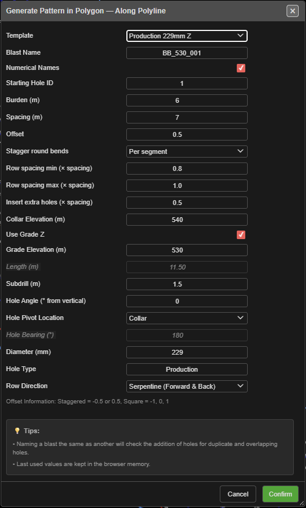
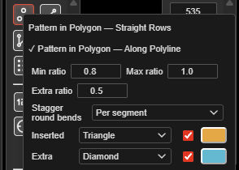
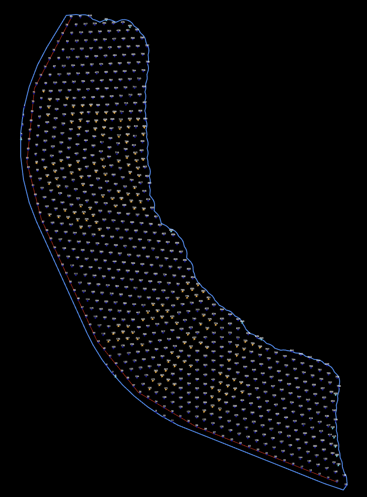
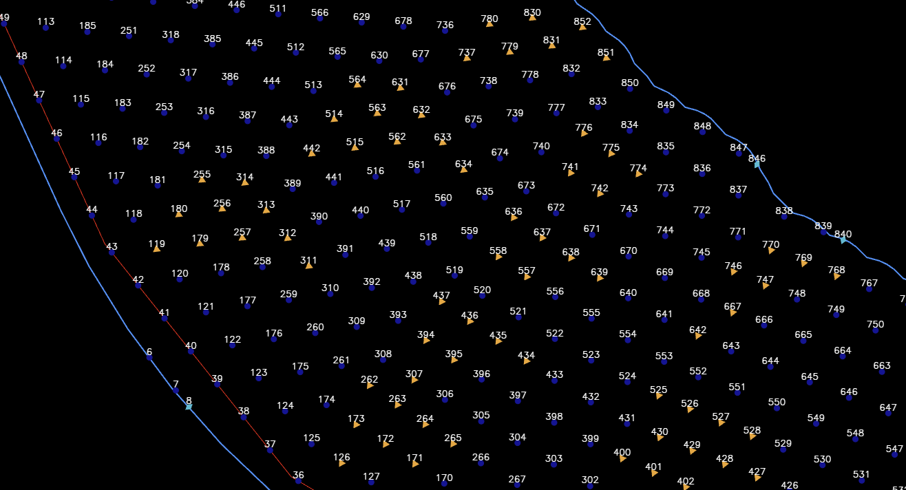

# Pattern in Polygon

Fills a drawn polygon with blast holes at a set burden and spacing, keeping only the holes whose
collars fall inside it. Use it for irregular blast boundaries, pit-edge shapes and curved benches.

---

## Prerequisites

- A closed KAD **polygon** marking the blast boundary.
- For **Along Polyline** mode, a reference line to follow: a KAD line, or the polygon's own edge.

---

## Two modes — right-click the button

Right-click **Pattern in Polygon** on the **Holes** toolbar to choose how the rows run. The ticked
item is the current mode. Choosing a mode also switches the tool on.

| Mode | Button colour | Rows |
|---|---|---|
| **Pattern in Polygon — Straight Rows** | Red | A straight grid along the direction you click, trimmed to the polygon |
| **Pattern in Polygon — Along Polyline** | Amber | Every row follows the reference line, stepped out by the burden on both sides until the polygon is full |

Hover the button to see which mode is set. Kirra remembers the mode.

---

## Fill a polygon — Straight Rows

1. Click **Pattern in Polygon** on the **Holes** toolbar. The status line reads *"Step 1: Click on
   a polygon to select it"*.
2. Click the polygon.
3. Click the pattern **start point**, then the **end point**. The line between them sets the row
   direction.
4. Click the **reference point**. The grid is anchored here — one grid position falls exactly on it.
   The **Generate Pattern in Polygon** dialog opens.
5. Set the burden, spacing and hole properties (see [The fields](#the-fields)).
6. Click **Confirm**.

The canvas labels the picked points **START**, **END** and **REF** and shows the distance between
them. Clicks snap to nearby objects; the status line says what was snapped to.

## Fill a polygon — Along Polyline

1. Right-click **Pattern in Polygon** and choose **Pattern in Polygon — Along Polyline**. The button
   turns amber.
2. Click the polygon to fill.
3. Click the **reference line** — a KAD line, or the polygon's own edge.
4. Click the **start** point on that line, then the **end** point. Each click picks the nearest
   vertex. The direction from start to end sets the walking and naming order.
5. The **Generate Pattern in Polygon — Along Polyline** dialog opens. Set the fields and click
   **Confirm**.

Row 0 sits on the reference line; further rows are offset by the burden to both sides. Each hole is
set square to its own row — its bearing comes from the line to its neighbouring hole — so
**Hole Bearing (°)** is greyed out in this mode.

---

## The fields

| Field | Default | What it does |
|---|---|---|
| **Template** | -- None -- | Fills the form from a saved [pattern template](pattern-templates.md). The template's text setup and charging are applied to the new holes. A remembered template is re-read each time the dialog opens |
| **Blast Name** | `PolygonPattern_` + a number | The blast the holes go into. An existing name adds to that blast |
| **Numerical Names** | Ticked | Ticked: numbers. Unticked: row letter + position (A1, A2 … B1, B2 …) |
| **Starting Hole ID** | 1 | First ID — a number (`500`) or an alphanumeric seed (`A1`). Continues past any higher ID of the same series already in the blast |
| **Burden (m)** | 3.0 | Distance between rows. Left blank, it is 1.0 m |
| **Spacing (m)** | 3.3 | Distance between holes along a row |
| **Offset** | 0.5 | Row stagger as a fraction of the spacing. The dialog's note: *"Staggered = -0.5 or 0.5, Square = -1, 0, 1"* |
| **Stagger round bends** | Per segment | *Along Polyline only.* **Per segment** keeps spacing and stagger exact on every straight; **Along row** keeps spacing exact along every row, but the stagger slips round bends |
| **Row spacing min (× spacing)** | 0.8 | *Along Polyline only.* A hole closer than this × spacing to the previous one is removed. 0 = off |
| **Row spacing max (× spacing)** | 1.2 | *Along Polyline only.* A longer step gets holes inserted evenly. 0 = off. A gap where the row leaves the polygon is never filled |
| **Insert extra holes (× spacing)** | 0 | At each end of a row, one more hole is tried this × spacing past the last hole, and kept only if it is inside the polygon. 0 = off |
| **Collar Elevation (m)** | 100 | Collar RL of every hole |
| **Use Grade Z** | Ticked | Ticked: holes run to **Grade Elevation (m)**. Unticked: holes are set by **Length (m)** |
| **Grade Elevation (m)** | 90 | Floor RL. Editing it recalculates the length |
| **Length (m)** | Calculated | Collar-to-toe length, including subdrill. Editing it recalculates the grade |
| **Subdrill (m)** | 1 | Vertical depth below grade |
| **Hole Angle (° from vertical)** | 0 | 0 = vertical |
| **Hole Pivot Location** | Collar | Which point sits on the grid position: **Collar**, **Grade** or **Toe** |
| **Hole Bearing (°)** | 180 | Direction the angled holes lean (0 = North, clockwise). Greyed out in Along Polyline |
| **Diameter (mm)** | 115 | Hole diameter |
| **Hole Type** | Production | Free text |
| **Row Direction** | Return (Forward Only) | Or **Serpentine (Forward & Back)** — alternate rows are numbered from the opposite end |

The last values you used are kept for next time. Both modes share one set of saved values, and
the right-click menu edits the same ones.

---

## Settings in the right-click menu

Below the two modes, the menu holds the settings you change most. Settings that do not apply to the
current mode are greyed out.

| Setting | Mode | Default | Same as dialog field |
|---|---|---|---|
| **Min ratio** / **Max ratio** | Along Polyline | 0.8 / 1.2 | **Row spacing min** / **max (× spacing)** |
| **Extra ratio** | Both | 0 | **Insert extra holes (× spacing)** |
| **Stagger round bends** | Along Polyline | Per segment | **Stagger round bends** |
| **Inserted** | Along Polyline | Amber triangle | How holes added by the min/max range are marked |
| **Extra** | Both | Cyan diamond | How the extra row-end holes are marked |

### Marked holes

Holes that Kirra adds to fit the polygon are marked so you can review them:

- **Inserted** — added by the min/max spacing range (Along Polyline only).
- **Extra** — the additional holes at the row ends.

For each, pick a **shape** (Circle, Triangle, Square, Cross or Diamond), a **colour**, or both.
Choose **Unchanged** for the shape, or untick the colour, to leave that part of the hole alone. The
mark is saved with the hole, shows on screen and in prints, and can be changed later like any
other [hole colour or shape](editing-holes.md#hole-colour-and-shape).

---

## What to expect

- The holes appear inside the polygon, and the tool switches off.
- A polygon pattern of more than 500 holes shows a **Generating Pattern** progress bar.
- The whole pattern is one undo step — **Ctrl+Z** removes it.
- Each row gets its own row ID, so [Reorder Rows](reorder-rows.md) and
  [Renumber Holes](renumber-holes.md) work on it straight away.
- If a new hole would sit on a hole already in the same blast, the **Hole Proximity Warning** asks
  you to **Skip**, **Ignore**, **Skip All** or **Cancel**. **Cancel** stops the whole pattern and adds
  nothing. See [Editing Holes → Hole coincidence](editing-holes.md#hole-coincidence).

---

## Other ways to use it

| Method | Result |
|---|---|
| Right-click the button, pick a mode | Sets the mode and switches the tool on |
| Right-click menu settings | Change the ratios, stagger and marks without opening the dialog |
| **Escape** (once) | Clears the picks — the status line reads *"Pattern tool reset - select polygon to start"* |
| **Escape** (twice) | Leaves the tool and returns to **Pointer Select** |
| **Cancel** in the dialog | Closes it and switches the tool off |
| 3D view | The same clicks work in 3D |
| **Template** list | Reuses a saved pattern, including its text setup and charging |

---

## Troubleshooting

**The status line says "No polygon found."**
The click did not land on a polygon. Lines and points cannot be filled — close the shape as a
polygon first.

**"No Holes Generated"**
No grid position fell inside the polygon. Check the burden, spacing and, in Along Polyline mode, the
reference line.

**Every hole has a number, not a row letter.**
Untick **Numerical Names** in the dialog.

**The holes lean the wrong way in Along Polyline mode.**
The bearing is square to the row, to the right of the start-to-end direction. Pick the reference
line's start and end the other way round.

---

## Related

- [Holes Along Line](holes-along-line.md) — one straight row
- [Holes Along Polyline](holes-along-polyline.md) — one row along a drawn line
- [Add Pattern](add-pattern.md) — a rectangular grid with no boundary
- [Pattern Templates](pattern-templates.md)
- [Pattern Generation](pattern-generation.md) — choosing a method
- [Holes Toolbar](holes-toolbar.md)
