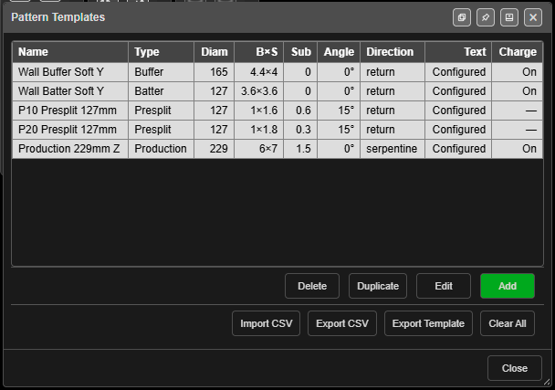

# Pattern Templates

Pattern Templates allow you to save and reuse sets of pattern generation parameters. Instead of entering the same burden, spacing, diameter, and hole type values each time you create a pattern, you can store them as named templates and apply them with a single click. A template can also set the holes' labels, colour and shape, and charge them as they are created.

*The Pattern Templates manager.*

---

## Why Use Templates?

On a typical mine site, you might use a small number of standard pattern configurations repeatedly -- for example:

- **Production 229mm** -- Burden 5.0 m, Spacing 6.0 m, 229 mm diameter, 1.5 m subdrill
- **Buffer 165mm** -- Burden 3.5 m, Spacing 4.0 m, 165 mm diameter, 1.0 m subdrill
- **Presplit 89mm** -- Spacing 1.2 m, 89 mm diameter, 0.5 m subdrill, 0 degree angle

Pattern Templates let you define these once and reuse them across your projects.

---

## Opening the Template Manager

Click **Pattern Templates** on the **Holes** toolbar. The **Pattern Templates** manager opens with a table of your templates:

| Column | Shows |
|---|---|
| **Name** | The template name |
| **Type** | Hole type |
| **Diam** | Diameter in mm |
| **B×S** | Burden × spacing in metres |
| **Sub** | Subdrill in metres |
| **Angle** | Hole angle from vertical |
| **Direction** | `return` or `serpentine` |
| **Text** | **Configured** when the Text tab has been set, otherwise — |
| **Charge** | **On** or **Off** when a charge rule is chosen, otherwise — |

Click a row to select it (it turns red). Double-click a row to edit it.

The manager can be docked to the edge of the screen or popped out into its own window, like other Kirra panels. Click **Close** when you are done.

---

## Template Properties

**Add** and **Edit** open the **Add Pattern Template** / **Edit Pattern Template** dialog. It has three tabs: **Pattern**, **Text** and **Charging**.

The **Pattern** tab holds:

| Field | Description | Default |
|----------|-------------|---------|
| **Template Name** | Unique name to identify the template | Unnamed Template |
| **Blast Name Pattern** | Default blast name for patterns made from it, such as `ORE-###` | (empty) |
| **Hole Type** | Classification, typed in (Production, Presplit, Buffer, etc.) | Production |
| **Diameter (mm)** | Hole diameter in millimetres | 115 |
| **Burden (m)** | Distance between rows | 3.0 |
| **Spacing (m)** | Distance between holes within a row | 3.3 |
| **Subdrill (m)** | Vertical distance below grade | 1.0 |
| **Hole Angle (°)** | Angle from vertical (0 = vertical) | 0 |
| **Hole Pivot Location** | Which point the holes are held by: **Collar**, **Grade** or **Toe**. **Collar** places the digitised line at the collars; **Grade** or **Toe** places it at the floor or the toes and projects the collars up | Collar |
| **Offset (m)** | Stagger offset for alternating rows | 0 |
| **Row Direction** | **Return (Forward Only)** or **Serpentine (Forward & Back)** | Return |
| **Collar Elevation (m)** | Default collar Z value (optional) | (none) |
| **Grade Elevation (m)** | Default grade Z value (optional) | (none) |
| **Hole Colour** | **App default (auto)**, **Auto (contrasts the background)** or **Fixed colour** | App default (auto) |
| **└ Colour** | The colour used when **Hole Colour** is **Fixed colour** | Orange |
| **Hole Shape** | **App default (circle)**, Circle, Triangle, Square, Cross or Diamond | App default (circle) |

Leaving **Hole Colour** and **Hole Shape** on *App default* means the holes are
drawn the usual way — contrasting with the background, as circles. See
[Hole Colour and Shape](editing-holes.md#hole-colour-and-shape).

A template's colour and shape are applied only to the holes it **creates**.
Adding a second pattern to an existing blast will not restyle the holes that
were already there.

> **Tip:** Use **Hole Pivot Location = Grade** to lay a presplit along a floor design string,
> or **Toe** to fit a surveyed toe line. The holes pivot about that point and their collars are
> projected up.

---

## Text Tab

The **Text** tab sets the hole labels every hole from this template is given.

- **Label Height (m)** — the height of hole labels in metres. Leave it blank to use the app default.
- A table lists every hole label (Hole ID, Hole Length, delay and the rest) with four columns:
  **Rot °** (rotation), **Bear °** and **Dist m** (an offset from the collar, along a bearing
  where 0° is north, clockwise) and **Size ×** (a multiplier on the label).
- The table starts filled with each label's default layout. Rows you change are tinted.
- **⟲** at the end of a row resets that label.
- The **All labels** row at the bottom is the fallback for every label without settings of its own.

Editing a hole's labels afterwards always wins over the template.

---

## Charging Tab

The **Charging** tab charges the holes a template creates, automatically.

1. Tick **Charge Holes**.
2. Pick a rule from **Charge Config**. The rule's decks and primers appear in the editor below, on a hole the size of the ones this template makes.
3. Change the rule if you need to. The editor is the [Deck Builder](../charging/deck-builder.md): drag products onto the hole, add primers, edit or remove decks.
4. Click **Save As Rule** to keep your version as a new rule, or **Save over Rule** to update the rule you picked. The template then uses the saved rule.
5. Click **Save** to save the template.

The dialog widens while the Charging tab is open, to make room for the editor, and returns to its normal size on the other tabs.

A line under **Charge Config** checks the rule as you choose it:

| Message | Meaning |
|---|---|
| *"Uses … products: … All present."* | Every product the rule needs is in your product list |
| *"⚠ This rule uses … product(s) your catalogue does not have: …"* | Holes will **not** be charged until those products are imported |
| *"⚠ Charging is on but no config is chosen — nothing will be charged."* | **Charge Holes** is ticked but **Charge Config** is **-- None --** |
| *"No charge config chosen. Holes will be created uncharged."* | Charging is off and no rule is chosen |

If you change a rule and click **Save** without saving the rule, Kirra asks what to do with the changes: **Save over Rule**, **Save as New Rule** or **Discard**. Picking a different rule while you have unsaved changes asks the same way, so nothing is thrown away without asking you.

A copy of the chosen rule is stored in the template, so the template still works on a computer that does not have that rule — the copy is added to that computer's charge rules and Kirra says so. If that computer already has a rule of the same name, its own rule is used. The products the rule uses must be in that computer's product list.

> **Warning:** When a product the rule needs is missing, the holes are **not charged at all**.
> Kirra never substitutes a product. A **Charging from template** message lists the missing
> products and how many holes were left uncharged.

---

## Managing Templates

The buttons under the table manage one template at a time. Select a template first.

### Add

Click **Add** to create a new template. Fill in the template name and parameters, then click **Add**.

### Edit

Select a template in the table and click **Edit** (or double-click the row) to modify its parameters, then click **Save**.

### Duplicate

Select a template and click **Duplicate** to create a copy named with **(Copy)** after it — for example `Buffer 165mm (Copy)`. A second copy becomes `(Copy 2)`. Useful for creating variations of existing templates.

### Delete

Select a template and click **Delete**. Kirra asks *"Delete template '…'?"* before the template is removed.

### Clear All

**Clear All** removes every template after asking *"Remove all … template(s)? This cannot be undone."*

---

## Applying a Template

The **Template** list sits at the top of these dialogs:

- **Add a Pattern?** — see [Add Pattern](add-pattern.md)
- **Generate Pattern in Polygon** (and its **Along Polyline** mode) — see [Polygon Pattern](pattern-in-polygon.md)
- **Generate Holes Along Line** and **Generate Holes Along Polyline**
- **Add a hole to the Pattern?** — see [Adding Blast Holes](adding-holes.md)

Select a template to populate the dialog fields with the template values. You can then adjust individual values before generating the pattern. The template's text setup, colour, shape and charging are applied to every hole created.

*(v1.1.32.48)*

- **The selected template is re-read every time the dialog opens.** The dialog
  remembers which template you used last, and fills the fields from that template
  rather than from your last run — so it never shows one template's name with
  another bench's collar, grade and length.
- **A template with a grade elevation designs to that grade.** Choosing it ticks
  **Use Grade Z**, and the hole length is worked out from the template's collar,
  grade and subdrill.
- If the template you used last has since been deleted, the dropdown resets to
  **-- None --** instead of showing a name that no longer exists.

---

## CSV Import / Export

Templates can be shared between projects and team members via CSV files.

### Export CSV

Click **Export CSV** to save all current templates as `patternTemplates.csv`. The CSV includes a header row and one row per template.

### Export Template

Click **Export Template** to save `patternTemplates-template.csv`: the column headers and five example rows. This is useful for creating templates in a spreadsheet before importing.

### Import CSV

Click **Import CSV** to load templates from a CSV file. The importer:

1. Reads the CSV header row
2. Parses each data row into a template
3. Detects conflicts with existing templates (same name)
4. Opens **Import Conflicts** when there are any, with three choices:
   - **Replace existing with imported**
   - **Keep existing, skip conflicts**
   - **Keep both (rename imported with suffix)** — the imported copy is renamed with **(Imported)**

Templates without a conflict are always imported. When nothing clashes, Kirra reports *"Imported … template(s)."* A file with no readable rows reports *"No valid templates found in CSV."*

### CSV Column Format

| Column | Type | Description |
|--------|------|-------------|
| `templateName` | Text | Unique template name |
| `blastName` | Text | Default blast/entity name |
| `holeType` | Text | Hole type classification |
| `holeDiameterMm` | Number | Diameter in mm |
| `burdenM` | Number | Burden in metres |
| `spacingM` | Number | Spacing in metres |
| `subdrillM` | Number | Subdrill in metres |
| `holeAngleDeg` | Number | Angle from vertical in degrees |
| `offsetM` | Number | Row offset in metres |
| `rowDirection` | Text | `return` (forward only) or `serpentine` (forward & back) |
| `collarElevation` | Number | Collar Z (optional, leave blank for none) |
| `gradeElevation` | Number | Grade Z (optional, leave blank for none) |
| `textSetup` | JSON | The Text tab (optional) |
| `chargeSetup` | JSON | The Charging tab, including the copy of the charge rule (optional) |
| `appearanceSetup` | JSON | Hole colour and shape (optional) |
| `holePivot` | Text | `collar`, `grade` or `toe` (optional; blank means `collar`) |

Columns are read by **position**, in this order. A blank number cell takes the default above. Older files with fewer columns still import — the missing settings read as "not set".

---

## Persistence

Templates are saved to **IndexedDB** in the browser, alongside your blast holes, surfaces, and other project data. They persist across browser sessions and page reloads. Templates are also included in KAP project files and KAT site templates, so they can be shared as part of a project.

---

## Troubleshooting

| Problem | Cause and fix |
|---|---|
| *"Template name is required."* | **Template Name** is blank. Enter a name and add the template again |
| **Name Already Used** | Names must be unique. Click **Use Suggested Name** to take the next free name — for example *Production (Copy)* — or **Keep Editing** and type another. The dialog stays open, so nothing you typed is lost |
| Holes were created uncharged | **Charge Holes** is off, no **Charge Config** is chosen, or a product is missing — see the Charging tab's status line |
| The Template list in a pattern dialog is empty | No templates saved yet in this workspace. Add one, or import a CSV or KAP that carries them |
| An imported template lost its charging | The CSV's `chargeSetup` cell was empty or malformed. Re-export it from a computer where the template charges |

---

## Related Topics

- [Pattern Generation](pattern-generation.md) -- Generate patterns using templates
- [Adding Holes](adding-holes.md) -- Place individual holes manually
- [Editing Holes](editing-holes.md) -- Modify hole properties after creation
- [Deck Builder](../charging/deck-builder.md) -- Build the charge rules a template uses
- [Holes Toolbar](holes-toolbar.md)
