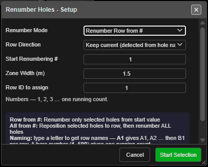

# Renumber Holes

Gives a run of holes new hole IDs, row and position numbers, by clicking the first and last hole
of the run. Use it to tidy the numbering after editing a pattern, or to name a blast by row
(A1, A2 … B1).

*Renumber Holes - Setup. Set the options, then click Start Selection.*

---

## Prerequisites

- At least one blast loaded. With no holes, Kirra says *"There are no blast holes to renumber."*
- The holes you want renumbered are visible and not locked. Hidden and locked holes are left alone.

---

## Renumber a run of holes

1. Click **Renumber Holes** on the **Holes** toolbar. The **Renumber Holes - Setup** dialog opens.
2. Set the options (below), then click **Start Selection**.
3. Click the **first** hole of the run. It turns green, and a stadium-shaped zone follows the
   cursor to show which holes will be collected.
4. Click the **last** hole of the run. Every hole inside the zone is collected and renumbered
   straight away, in order of distance from the first hole.
5. The status bar reports the result — for example *"Renumbered 12 holes in row 3: 1 to 12"*.

The tool switches itself off after each run. Click **Renumber Holes** again for the next one.
Press **Escape** to stop before the second click.

While the tool is on, **Row and Position** display is switched on so you can see the result.
It works in 2D and 3D.

---

## The options

| Option | Default | What it does |
|---|---|---|
| **Renumber Mode** | **Renumber Row from #** | **Renumber Row from #** renumbers only the holes in the zone. **Renumber All from #** puts the zone's holes into the row you name, then renumbers **every** hole in the blast |
| **Row Direction** | **Keep current (detected from hole names)** | Used by **Renumber All from #**. **Serpentine (alternate each row)** or **Forward & Return (same way each row)**. Keep current reads each row's direction from its existing names |
| **Start Renumbering #** | 1 (then your last value) | The first hole ID. It also chooses the naming scheme — see below |
| **Zone Width (m)** | 1.5 | Width of the collection zone around the line between your two clicks (0.5 to 50) |
| **Row ID to assign** | 1 | The row number the zone's holes are given |

The dialog remembers your settings for the session, except **Row ID to assign**, which starts at 1
each time.

### The start value chooses the naming scheme

| You type | You get |
|---|---|
| `1` or `500` | **Numbers** — one running count: 500, 501, 502 … |
| `A1` or `BH1` | **Row names** — the letter is the row and the number the position: A1, A2 … then B1 for the next row |

A preview under the field shows what you will get as you type. A value Kirra cannot read — `ABC`,
`A-1`, `12A` — is refused with *"Invalid Start Value"* rather than quietly renumbering from 1.

---

## What you get

- **Renumber Row from #** — the zone's holes take the IDs from your start value, the **Row ID to
  assign**, and position numbers that continue after the last position already in that row.
- **Renumber All from #** — the zone's holes join the row you named, then the whole blast is
  renumbered by walking its rows. **Row Direction** decides whether alternate rows run back
  (serpentine) or every row starts at the same end.
- Ties (the "from" hole of each connection), charging, label layouts, timing construct
  membership and blast groups follow the new IDs — each hole keeps its own label settings.
- Only holes in the **same blast** as the first hole are collected, even where another blast
  overlaps the zone.

> **Warning:** Renumbering cannot be undone with Ctrl+Z. Note the current IDs, or export the
> blast first, if you may want them back.

---

## Other ways to use it

| Method | Result |
|---|---|
| **Delete** holes, then answer **Yes** to *"Renumber Holes?"* | Deletes the holes and renumbers the rest of each affected blast from the **Start From** value you enter |
| **Reorder Rows** with **Renumber holes after reorder** ticked | Re-rows the whole blast from a row line you pick and renumbers it — see [Reorder Rows](reorder-rows.md) |
| Importing holes whose IDs clash | The **Duplicate Resolution** dialog offers **Renumber** to give the clashing holes new IDs |

---

## Troubleshooting

| Problem | Cause and fix |
|---|---|
| *"ID Conflict"* — *"The following IDs already exist in entity …"* | **Renumber Row from #** would reuse IDs held by holes outside the zone. Pick a start value that does not clash, or use **Renumber All from #** |
| *"No holes were collected in the zone."* | The holes between your clicks are hidden, locked, in another blast, or outside the zone. Widen **Zone Width (m)** |
| A hole beside the run was renumbered too | The zone was too wide and caught the next row. Lower **Zone Width (m)** below half the burden |
| The status bar says *"Please select a different hole as the last hole"* | The second click landed on the first hole. Click the other end of the run |
| A serpentine blast came out forward-and-return | **Row Direction** was set to **Forward & Return**. Choose **Keep current** or **Serpentine** |

---

## Related

- [Reorder Rows](reorder-rows.md) — rebuild row and position numbers from a row line
- [Insert Holes](insert-holes.md) — add holes into a row; the row renumbers itself
- [Editing Holes → How hole numbers change when you edit](editing-holes.md#how-hole-numbers-change-when-you-edit)
- [Holes Toolbar](holes-toolbar.md)
