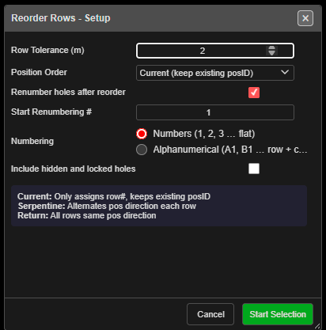

# Reorder Rows

Rebuilds a blast's row and position numbers from a row line you pick, and can renumber the holes to
match. Use it when automatic row detection has grouped or ordered the rows differently from how
you want them drilled, charged or tied.

*Reorder Rows - Setup.*

---

## Prerequisites

- At least one blast loaded. With no holes, Kirra says *"There are no blast holes to reorder."*
- Two holes in the **same row** of the blast, one near each end.

---

## Reorder a blast's rows

1. Click **Reorder Rows** on the **Holes** toolbar. The **Reorder Rows - Setup** dialog opens.
2. Set the options (below), then click **Start Selection**.
3. Click the **first** hole in a row. It turns green, and a line follows the cursor.
4. Click the **last** hole in the same row. The line now shows the row direction, and an arrow
   at right angles shows the **burden direction** — the way row numbers increase.
5. The **Confirm Row Reorder** dialog shows the **Row Direction** and **Burden Direction** as
   bearings. Click **Flip Burden Direction** to point the arrow the other way.
6. Click **Apply**. Every hole in the blast is given a row and position, and the status bar
   reports *"Reordered … holes into … rows"*.

Click **Cancel**, or press **Escape**, to stop without changing anything. The tool switches itself
off after each reorder.

While the tool is on, **Row and Position** display is switched on. It works in 2D and 3D.

---

## The options

| Option | Default | What it does |
|---|---|---|
| **Row Tolerance (m)** | 2.0 | How far, across the rows, a hole may sit from a row and still belong to it (0.5 to 20) |
| **Position Order** | **Current (keep existing posID)** | **Current** only assigns row numbers and keeps each hole's position. **Serpentine (alternate direction)** reverses every second row. **Return (same direction)** runs every row the same way |
| **Renumber holes after reorder** | Ticked | Also gives every hole a new hole ID |
| **Start Renumbering #** | 1 | The first hole ID when renumbering. `1` or `500` for numbers; `A1` for row names |
| **Numbering** | Follows the start value | **Numbers (1, 2, 3 … flat)** or **Alphanumerical (A1, B1 … row + column, gaps & infills)**. Typing in **Start Renumbering #** sets it; clicking a choice afterwards wins |
| **Include hidden and locked holes** | Unticked | Unticked: hidden and locked holes keep their row, position and name, and no new name repeats theirs. They still help line up the rows. Ticked: every hole in the blast is re-rowed and renamed |

The dialog remembers your settings for the session.

---

## How rows and positions are worked out

- **Rows** are numbered along the burden arrow. Row 1 is the row furthest back against the arrow.
- A hole joins a row when it sits within **Row Tolerance** of that row, measured across the rows.
- **Position 1** is at the end of the row you clicked first (for **Serpentine** and **Return**).
- With **Serpentine**, every second row runs back the other way.

### Hole names

| Numbering | Position Order | Names |
|---|---|---|
| **Numbers** | any | One running count across the blast, no gaps |
| **Alphanumerical** | **Return** or **Current** | Row letter plus the hole's **column** in a grid shared by every row, so A7 sits beside B7. A missing hole leaves a gap; an infill hole between two columns gets a suffix, such as B3a |
| **Alphanumerical** | **Serpentine** | Row letter plus the count along that row's walk, starting at 1 every row. Columns do not line up |

Ties, charging, label layout, timing construct membership and blast groups follow the new IDs.
A hole that is renamed but not moved keeps its own timing and its own blast group.

> **Warning:** Reorder Rows cannot be undone with Ctrl+Z. It changes every visible, unlocked
> hole in the blast — and hidden and locked ones too when **Include hidden and locked holes** is
> ticked. Lock the holes you want to keep before you start.

---

## Other ways to use it

| Method | Result |
|---|---|
| **Position Order** = **Current**, **Renumber holes after reorder** unticked | Fixes the row numbers only. Names and positions stay as they are |
| [Renumber Holes](renumber-holes.md) | Renumbers a run of holes, or moves a run into a named row, without re-rowing the whole blast |

---

## Troubleshooting

| Problem | Cause and fix |
|---|---|
| Two rows were merged into one | **Row Tolerance** is larger than the gap between rows. Set it below the burden — about half is a good start |
| One row was split into two | The row bends or is staggered more than **Row Tolerance**. Raise it, or reorder each part separately with [Renumber Holes](renumber-holes.md) |
| Rows are numbered from the wrong side | Click **Flip Burden Direction** before **Apply** |
| Positions start at the wrong end | Click the holes the other way round — position 1 is at your first click |
| The status bar says *"Select a hole from the same entity: …"* | Both clicks must be on holes of the same blast |

---

## Related

- [Renumber Holes](renumber-holes.md)
- [Insert Holes](insert-holes.md)
- [Editing Holes → How hole numbers change when you edit](editing-holes.md#how-hole-numbers-change-when-you-edit)
- [Holes Toolbar](holes-toolbar.md)
