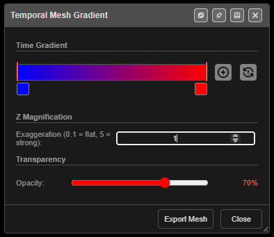

# Temporal Mesh

Shows the firing sequence as a surface: every hole with a firing time becomes a corner of a
triangle mesh, coloured by time and, in 3D, raised by time. Use it to read the firing front across
a whole pattern at a glance.

---

## Before you start

- The blast needs firing times — ties back to an [initiation point](initiation-points.md), or
  electronic primers with delays. Holes with no time leave a gap in the mesh.
- At least three holes in a blast must have a time for that blast to get a mesh.

---

## Show the mesh

1. Click **Temporal Mesh** on the **Connect** toolbar. The mesh is built straight away.
2. Click **Gradient** to change its colours, height and transparency (below).
3. Click **Temporal Mesh** again to hide it.

The mesh rebuilds itself whenever timing changes, so it stays in step as you tie holes.

---

## What the mesh shows

| Item | How it is worked out |
|---|---|
| **Corners** | One per hole, at the collar X and Y |
| **Time at a corner** | The earliest firing time of the hole's primers — an electronic primer's programmed time, or the surface time plus the downhole delay for other primers. An uncharged hole uses its surface time |
| **Gaps** | A hole charged with no detonator, or with no firing time, cuts a hole-shaped gap in the mesh |
| **One mesh per blast** | Each blast is meshed on its own, so two blasts never slope into each other |
| **Hidden holes** | Still shape the surface, but no mesh is drawn over ground you have hidden |
| **2D** | Flat triangles coloured by time, with a light wireframe |
| **3D** | Raised above the average toe level by 1 m per 50 ms, times **Z Magnification** |

---

## Gradient dialog

Click **Gradient** to open **Temporal Mesh Gradient**. Every change applies live — there is no
Apply button.

| Setting | Default | What it does |
|---|---|---|
| **Time Gradient** | Blue → red | Colour stops along the time range. Drag a middle stop to move it; the first and last stops are fixed at 0% and 100% |
| Add stop button | — | *"Add gradient stop (inserts at midpoint of widest gap)"* |
| × on a stop | — | Removes a middle stop. At least two stops always remain |
| Reset button | — | Back to blue → red, 70% opacity, Z magnification 1 |
| **Z Magnification** | 1 | Height exaggeration in 3D, from **0.1** (flat) to **5** (strong) |
| **Transparency** | 0.7 | Opacity, from 0 (fully transparent) to 1 (fully opaque) |

Click a stop's colour swatch to pick its colour.

Footer buttons:

- **Export Mesh** — saves the mesh as `temporal_mesh.dxf`: 3D faces on the layer
  `TEMPORAL_MESH`, with height as the raw firing time in milliseconds (no exaggeration).
- **Close** — closes the dialog and releases the **Gradient** button.

---

## What is kept

- The colour stops and transparency are saved with a [KAP project](../working-in-kirra/starting-and-saving.md).
- **Z Magnification** is not saved. It goes back to 1 whenever the mesh is switched off.

---

## Troubleshooting

| Symptom | Cause | Fix |
|---|---|---|
| Nothing appears | No hole has a firing time | Tie the blast to an [initiation point](initiation-points.md) |
| A hole-shaped gap | That hole has no time, or is charged with no detonator | Tie it in, or add a primer |
| *"Nothing to export"* on **Export Mesh** | The mesh has not been built | Switch on **Temporal Mesh** first |
| The mesh is flat in 3D | **Z Magnification** is low | Raise it in the **Gradient** dialog |

---

## Other ways to use it

| Method | Result |
|---|---|
| **Temporal Mesh** checkbox in the [Electronic Timing](electronic-timing-constructs.md) dialog | Same switch as the toolbar button — the two stay in step |
| Untick the **Gradient** button | Closes the Gradient dialog |

---

## Related

- [Electronic Timing Constructs](electronic-timing-constructs.md) — per-construct meshes
- [Timing Contours](timing-contours.md)
- [Time Window Dialog](../analysis/time-window.md)
- [Connect Toolbar](connect-toolbar.md)
