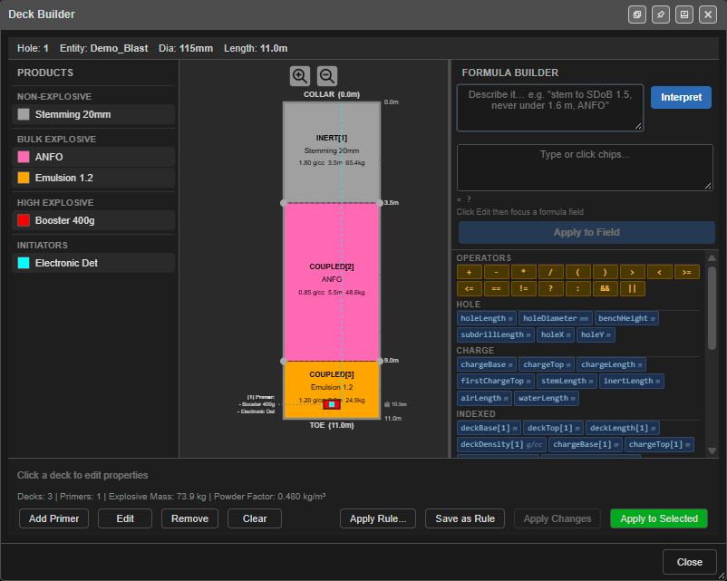
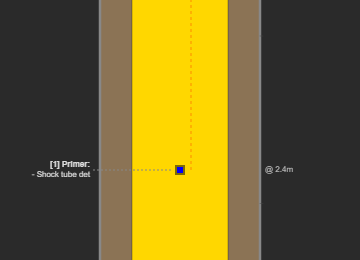
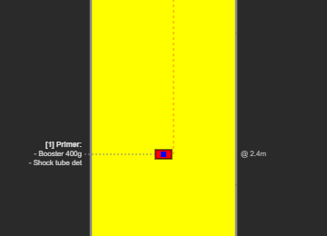
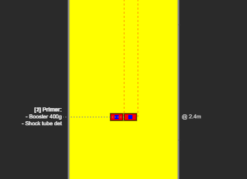
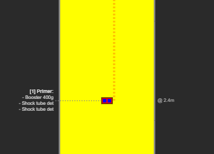
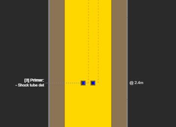
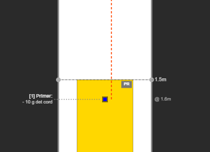

# Deck Builder

The Deck Builder is Kirra's visual tool for designing charge columns. It provides a drag-and-drop interface for stacking explosive decks, stemming layers, spacers, and primers into a complete charge design. You can apply the design to individual holes or save it as a reusable rule.

---

## Opening the Deck Builder

There are several ways to open the Deck Builder:

- Click **Charge Rule Builder** in the **Holes** toolbar
- Right-click a hole to open **Edit Hole**, go to the **Loading** tab and click **Edit Loading**
- In the **Product Manager** (Holes toolbar), click **Edit Rules** to load, edit, save or delete individual charge rules

When opened from **Edit Rules**, the Deck Builder works in rule mode: the buttons read **Load Rule...**, **Save As Rule** and **Save over Rule**, and nothing is applied to holes.

The same editor also appears on the **Charging** tab of a pattern template, so you can build or change a template's charge rule without leaving the template. See [Pattern Templates](../blast-design/pattern-templates.md#charging-tab).


*The Deck Builder opened on a charged hole: products on the left, the charge column in the
centre (stemming, ANFO and an emulsion toe charge with one primer), the Formula Builder on the
right. The line under the column totals the decks, primers, explosive mass and powder factor.*

---

## Deck Builder Layout

The Deck Builder dialog has three main panels:

| Panel | Description |
|-------|-------------|
| **Product Palette** (left) | Displays all loaded products. Drag a product onto the Section View to add a deck. |
| **Section View** (centre) | Interactive 2D cross-section of the hole showing all decks from collar to toe. Click to select a deck; drag deck boundaries to resize. |
| **Formula Builder** (right) | Drag-and-drop formula construction for setting deck lengths and primer positions. |

---

## Adding Decks

### By Dragging from the Product Palette

1. Locate the product you want in the Product Palette (left panel)
2. Drag it onto the Section View at the desired position
3. The deck appears in the hole cross-section with a default length
4. Adjust the length as needed (see below)

### By Type

1. Click **Add Deck** and choose the deck type: Inert, Coupled, Decoupled, or Spacer
2. Select a product from the dropdown
3. Enter the deck length or formula
4. The deck is added to the charge column

---

## Configuring Deck Properties

Select any deck in the Section View to edit its properties:

| Property | Description |
|----------|-------------|
| **Product** | The explosive or stemming product (from your products database) |
| **Length** | Deck length in metres, or a formula, or a mass value |
| **Scaling Mode** | How the deck adapts when applied to different hole lengths |
| **Swap Conditions** | Optional product substitution rules for wet, damp, or reactive holes |

### Setting Deck Length

You can set the length of a deck in four ways:

| Method | How to Enter | Example |
|--------|-------------|---------|
| **Fixed length** | Type a number in metres | `3.5` |
| **Formula** | Type a formula starting with `fx:` | `fx:holeLength - 3.5` |
| **Mass** | Type `m:` followed by kilograms | `m:50` (50 kg) |
| **Drag** | Drag the deck boundary in the Section View | Visual resize |

> **Note:** Dragging a deck boundary in the Section View overrides any formula on that deck. Use formulas for designs that need to adapt to different hole sizes.

### Scaling Modes

Each deck has a scaling mode that controls how it behaves when applied to holes of different lengths:

| Mode | Badge | Behaviour |
|------|-------|-----------|
| **Proportional** | (none) | Deck length scales proportionally with hole length (default) |
| **Fixed Length** | **F** (blue) | Deck keeps its exact length regardless of hole depth |
| **Fixed Mass** | **M** (orange) | Deck recalculates length to maintain the same explosive mass at different diameters |
| **Variable** | **VR** (green) | Formula is re-evaluated for each hole (set automatically for formula-based decks) |

---

## Using the Formula Builder

The Formula Builder panel provides a drag-and-drop interface for creating deck length and primer depth formulas.

### Variable Chips

Drag or click these variable chips to insert them into the formula bar:

| Variable | Description |
|----------|-------------|
| `holeLength` | Total hole length from collar to toe (metres) |
| `holeDiameter` | Hole diameter (millimetres) |
| `benchHeight` | Vertical distance from collar to grade (metres) |
| `subdrillLength` | Distance from grade to toe along the hole (metres) |
| `holeX` | Hole collar X coordinate — easting (metres) |
| `holeY` | Hole collar Y coordinate — northing (metres) |
| `chargeBase` | Depth to the base of the deepest charge deck (metres) |
| `chargeTop` | Depth to the top of the shallowest charge deck (metres) |
| `chargeLength` | Sum of all COUPLED / DECOUPLED deck lengths (metres) |
| `stemLength` | Sum of all stemming (INERT) deck lengths (metres) |
| `firstChargeTop` | Depth to the top of the **first** (shallowest) charge deck — the geometric uncharged zone (metres) |
| `inertLength` | Sum of **all** inert deck lengths, including Stemming / DrillCuttings / StemGel / SPACER (metres) |
| `airLength` | Sum of all Air deck lengths (metres) |
| `waterLength` | Sum of all Water deck lengths (metres) |
| `deckBase[N]` | Base depth of any deck at position N (works for all deck types) |
| `deckTop[N]` | Top depth of any deck at position N |
| `deckLength[N]` | Length of any deck at position N |
| `deckDensity[N]` *(v1.0.272+)* | Effective density (g/cc) of deck N's product — pre-populated for all decks, order-independent |
| `chargeBase[N]` | Base depth of the charge-only deck at position N (COUPLED / DECOUPLED only) |
| `chargeTop[N]` | Top depth of the charge-only deck at position N |
| `chargeLength[N]` | Length of the charge-only deck at position N |
| `chargeDensity[N]` *(v1.0.272+)* | Effective density (g/cc) of charge-only deck N |

> **Indexed densities are order-independent.** `deckDensity[N]` and `chargeDensity[N]` are populated for **every** deck before the position-resolution loop runs, so a formula on Deck 1 can safely reference `deckDensity[2]`. The position-indexed variables (`deckBase[N]`, `deckTop[N]`, `chargeBase[N]`) still resolve sequentially — Deck 1 cannot read Deck 2's depths.

> **`chargeBase[N]` vs `deckBase[N]`.** `chargeBase[N]` only counts COUPLED / DECOUPLED decks. `deckBase[N]` counts everything (including INERT / Stemming / SPACER). For cross-deck references, prefer `deckBase[N]`.

> **Unit badges.** Each chip shows a small muted unit after its name — `m` (metres), `mm` (hole diameter), `g/cc` (density), or, for function chips, the **return** unit (`sdobStem → m`, `sdobKg → kg`, `ppvKG → kg`). The badge is a display hint only; it is never inserted into the formula. Because functions nest, the badge tells you what a call returns, so you know which field it belongs in — `sdobKg → kg` feeds a **Mass** field, while `sdobStem → m` feeds a **length** field.

See the [Formula Engine](../formula-help/formula-engine.md) hub if you are unsure whether a formula belongs in charging, a print template, or a blast group.

See the [Deck Builder Formula Guide & Examples](Deck%20Builder%20Formula%20Guide%20Examples.md) for worked examples, including **Pattern 11 — Adaptive density via `deckDensity[N]`** (formulas that adapt automatically when a product swap fires).

### Operator Chips

Drag or click operator chips: `+`, `-`, `*`, `/`, `(`, `)`, `?`, `:`, `&&`, `||`, and comparison operators.

### Building a Formula

1. Click on a deck to select it, then click **Edit** on the length field
2. In the Formula Builder, drag variable and operator chips into the formula bar (or type directly)
3. The formula bar shows a **live preview** of the calculated value
4. Click **Apply to Field** to set the formula on the selected deck

### Example: Stemming that is 30% of hole length

1. Drag `holeLength` into the formula bar
2. Drag `*` operator
3. Type `0.3`
4. The formula bar shows: `fx:holeLength * 0.3` with a preview like `= 3.60 m`
5. Click **Apply to Field**

### Ask Kirra (plain English)

At the top of the Formula Builder is the **Ask Kirra…** box (called **Describe it…** before Kirra 1.1.37.12). Type what you want the deck to do in
ordinary English, click **Interpret**, and Kirra fills the formula bar with the matching `fx:`
formula and shows a one-line readback of what it understood. You can edit the result before applying.

The box reads English and Chinese, whatever language Kirra is set to. In other languages the placeholder shows an English example, because that is what the box reads.

This is a **deterministic translator**, not a chatbot — it recognises a fixed set of charging
patterns and will tell you plainly when a request is outside what a charge formula can express
(rather than guessing). It only works in the Deck Builder (deck length, mass, and primer-depth
fields).

**Things it understands:**

| You type | You get |
|----------|---------|
| `25 kg of ANFO` | `fx:massLength(25, "ANFO")` |
| `stemming 25% of the hole length` | `fx:holeLength * 0.25` |
| `hole length minus 3.5` | `fx:holeLength - 3.5` |
| `stem to SDoB 1.5 but never under 1.6 m` | `fx:Math.max(1.6, sdobStem(1.5, "ANFO"))` |
| `mass of ANFO for SDoB 1.4` | `fx:sdobKg(1.4, "ANFO")` |
| `put the primer at grade level` | `fx:holeLength - subdrillLength` |
| `primer 0.3 m above grade` | `fx:(holeLength - subdrillLength) - 0.3` |
| `primer at the toe` | `fx:holeLength - 0.3` |
| `primer 0.3 m above deck 4` | `fx:deckBase[4] - 0.3` |
| `if hole over 5 m then 25% of length else 40% of length` | `fx:holeLength > 5 ? holeLength * 0.25 : holeLength * 0.4` |
| `25% if hole > 5 m, 40% if 5 to 3 m, 75% if 3 to 1.5 m` | nested ternary on `holeLength` |
| `25% of the hole length only if the subdrill is 1 m else 35%` | `fx:subdrillLength == 1 ? holeLength * 0.25 : holeLength * 0.35` |
| `25% of hole length rounded to 0.1` | `fx:Math.round((holeLength * 0.25) * 10) / 10` |
| `1.5 times the burden, at least 1.6 m` | `fx:Math.max(1.6, 1.5 * burden)` |
| `powder factor 0.8` (a mass, in a mass field) | `fx:0.8 * burden * spacing * benchHeight` |

**Conditional words** it knows: `if`, `when`, `while`, `then`, `else`/`otherwise`; comparators
`more than` / `over` / `greater than` (→ `>`), `less than` / `under` / `below` (→ `<`),
`at least` / `at most`, and `is` / `equal to` for equality. You can stack bands ("25% if … and
40% if … and 75% if …") and the condition variable can differ from the branch variable (test the
subdrill, scale the hole length). **Rounding** — add "round to 0.1", "round up", or "round down" to
wrap any of the above.

**PPV / vibration limits.** Phrases like *"the biggest charge that keeps all monitors under
10 mm/s"* are recognised. Kirra reads the **PPV monitors you have placed on the plan** and builds a
formula that takes the smallest allowed charge across every monitor, using each monitor's own
coordinates and site constants (K, b):

```
fx:massLength(Math.min(ppvKG(1000, 2000, 10, 1140, 1.6), ppvKG(1500, 2200, 10, 1200, 1.7)), "ANFO")
```

If you haven't placed any PPV monitors yet, the readback asks you to add them first — it will not
invent monitor coordinates.

The PPV flow understands several refinements:

- **Both a PPV and an SDoB limit at once** — *"…40 mm/s at the monitors **or SDoB 1.5**"* folds
  `sdobKg(1.5, …)` into the same `Math.min`, so the tighter of the regulatory limit and the
  confinement limit wins.
- **3D distance** — say *"3D"* or *"slant"* and Kirra uses each monitor's elevation
  (`ppvKG3D(...)`) instead of the horizontal distance.
- **One named monitor** — *`monitor "FMG_A1_M01"`* restricts the formula to that single monitor
  (an unknown name returns a clear error).
- **Probability of exceedance** — *"1% probability of exceedance"* or *"1 in 100 blasts may
  exceed"* designs to a confidence buffer using each monitor's **site σ** (`ppvKGPoE(...)`); the
  read-back states the PoE %. Smaller σ allows a bigger charge, so set each monitor's σ from your
  own site-law regression rather than relying on the 0.22 default. See the
  [Probability of Exceedance](../analysis/) analytics for the underlying maths.

**Burden, spacing and powder factor.** The box knows the hole's burden, spacing and bench height, so *"1.5 times the burden"* and *"powder factor 0.8"* work. "Area" means burden × spacing, and "volume" means burden × spacing × bench height. A powder factor gives the deck's mass in kilograms.

**What it refuses (on purpose).** The box declines requests a single hole's formula cannot hold, and explains why
instead of returning a wrong-but-plausible formula: a **blast volume** (the whole blast, not one hole), **VED (vertical energy distribution)**, and **fragmentation / P80 / X50**.
Those belong to the solver or analysis tools, not a deck formula.

**Typos.** If a word is close to one it knows ("lenght" → "length"), it suggests the correction and
asks you to confirm — it never silently auto-corrects.

**A whole hole in one sentence.** Describe the whole hole and Ask Kirra builds every deck at once:

```
3.5 m stem then ANFO to the toe with a primer
3 m stemming on a gas bag, then 2 m air deck, then ANFO to the toe with a primer
```

After **Interpret**, Kirra shows a product picker for each part (stemming, explosive, detonator, booster), filled in with the best match from your Product Manager. Product names in a sentence rarely match exactly, so check each picker. Then click **Apply to Hole** to load the stemming, the explosive and the primer. Apply to Hole stays greyed out until you click Interpret, and editing the sentence greys it out again.

> Ask Kirra is a starting point. Always sanity-check the readback and the placeholder
> values (density, monitor constants) before applying the formula to your holes.

### Custom Functions

The Formula Builder includes function chips that you can click or drag into the formula bar. These functions use the hole's properties (diameter, length, position) automatically.

#### massLength(kg, density)

Calculates the deck length required to hold a given mass of explosive at the hole's diameter.

| Parameter | Description |
|-----------|-------------|
| `kg` | Target mass in kilograms |
| `density` | Density in g/cc, or a product name in quotes |

```
fx:chargeTop[4] - massLength(50, 0.85)    // 50 kg ANFO above deck 4
fx:chargeTop[4] - massLength(50, "ANFO")  // Same, using product lookup
```

#### packageLength(count, "Product")

The length of a set number of whole packages (cartridges, sticks or gas bags) stacked end to end: the count times the product's **Length (mm)** from the Product Manager.

| Parameter | Description |
|-----------|-------------|
| `count` | How many packages: a whole number, 0 or more |
| `"Product"` | The product's name in quotes. It needs a Length (mm) |

```
fx:holeLength - packageLength(4, "PRE32MM")       // top of 4 sticks sitting on the toe
fx:holeLength - packageLength(1, "PRE32MM") / 2   // a primer in the bottom stick
fx:deckBase[3] - packageLength(1, "GB230MM")      // top of one gas bag above deck 3's base
```

A count of 0 gives 0 m. If the product isn't in your product list, has no Length (mm), or the count is not a whole number, the formula doesn't evaluate and Kirra tells you which holes fell back.

#### packageFit(length, "Product")

The length of the nearest whole number of packages to a length you give, so a deck never ends in part of a stick. Where two counts are equally close, it takes the lower one.

| Parameter | Description |
|-----------|-------------|
| `length` | The length you'd like, in metres |
| `"Product"` | The product's name in quotes. It needs a Length (mm) |

```
fx:holeLength - packageFit(holeLength - 2.2, "PRE32MM")   // sticks up to about 2.2 m from the collar
```

On a 10 m hole with 0.4 m sticks, that asks for 7.8 m, gets 19 sticks (7.6 m) and puts the top at 2.4 m.

A length of 0 or less gives 0 m. Anything more gets at least one package. When the whole packages come out at a different length from the one asked for, the notice after you apply says so, under **Loaded in whole cartridges**. An unknown product, or one with no Length (mm), means the formula doesn't evaluate, as for `packageLength`.

#### vertical(distance)

Turns a vertical distance into metres along the hole, so a depth measured straight down works on an angled hole too. On a hole at 20° from vertical, `vertical(1)` is 1.064 m along the hole.

| Parameter | Description |
|-----------|-------------|
| `distance` | A vertical distance in metres |

```
fx:holeLength - vertical(subdrillAmount + 1)   // 1 m (vertically) above the grade
```

Up-holes and face holes are measured along the hole, so there `vertical(1)` is simply 1 m. If the point would land outside the hole (on a nearly flat hole a short vertical distance is very long along it), the formula doesn't evaluate and Kirra tells you which holes fell back.

#### ft(n), inch(n), lb(n)

Formulas work in metres and kilograms, in every project. A formula travels in charge rules, deck templates and KAPs, so it has to load the same charge on whichever machine opens it. To use a number in feet, inches or pounds, wrap it and Kirra converts it.

| Function | Reads `n` as | Example |
|----------|--------------|---------|
| `ft(n)` | feet | `ft(10)` = 3.048 m |
| `inch(n)` | inches | `inch(18)` = 0.4572 m |
| `lb(n)` | pounds | `lb(250)` = 113.398 kg |

```
fx:holeLength - ft(10)                       // 10 ft above the toe
fx:chargeBase - inch(18)                     // 18 in above the charge base
fx:chargeTop - massLength(lb(250), "ANFO")   // a 250 lb ANFO column
```

`ft( )` is always the international foot (0.3048 m), never the US survey foot, and `lb( )` is the exact pound (0.45359237 kg). Inches are `inch( )`, not `in( )`, because `in` is a reserved word. A number without a wrapper is still metres or kilograms. The **ft(n)**, **inch(n)** and **lb(n)** chips put them in the formula for you.

<!-- TODO SCREENSHOT: the formula panel's function chips showing ft(n), inch(n) and lb(n). Chrome is off for now; capture when Brent OKs it. -->

#### surfaceDepth("Surface", fallback)

Charge to a surface: a clay seam, a coal top, a water level, an RL plane. It gives the depth in metres along the hole from the collar to the first place the hole crosses the named surface. Each hole gets its own depth, so a deck follows an undulating seam. Angled holes and up-holes are measured along the hole, not vertically.

| Parameter | Description |
|-----------|-------------|
| `"Surface"` | The loaded surface's name in quotes, exactly as it's loaded (capitals count) |
| `fallback` | Optional. The depth in metres to use where a hole misses the surface |

```
fx:surfaceDepth("Clay seam")                       // stemming down to the clay seam
fx:surfaceDepth("Clay seam", 3)                    // 3 m where a hole misses the seam
fx:Math.max(surfaceDepth("Coal top", 3), 2.5)      // down to the coal, but never less than 2.5 m
```

Depth runs down the hole, so **+** is below the surface and **−** is above it:

```
fx:surfaceDepth("Clay seam") + 1      // 1 m below the clay
fx:surfaceDepth("Clay seam") - 0.5    // 0.5 m above the clay
```

What happens when it can't find the surface:

- **The hole misses it** (the surface is above the collar, below the toe, or not over the hole): the fallback is used. With no fallback the formula doesn't evaluate.
- **The surface isn't loaded**: each hole keeps the depth it last worked out for that surface. A hole with no depth remembered uses the fallback.
- **Two loaded surfaces share the name**: the formula doesn't evaluate. Rename one.

Every apply and Recalculate tells you, under **Charged to a surface**, which holes used a fallback or a remembered depth.

#### surfaceExitDepth("Solid", fallback)

For a seam with thickness drawn as a closed solid. It gives the depth along the hole to where the hole **leaves** the solid: the crossing after it goes in, or the first crossing if the collar is already inside.

```
fx:surfaceExitDepth("Coal")         // the bottom of the coal, per hole
fx:surfaceExitDepth("Coal") + 2     // 2 m below the seam
```

The solid must be closed. An open surface is refused, even with a fallback, and the notice says to use a closed solid or the seam's top and bottom surfaces. If your seam is two surfaces instead of a solid, use `surfaceDepth` once for each. A hole that ends inside the solid, or misses it, uses the fallback.

#### sdobStem(targetSDoB, density)

Calculates the stemming length required to achieve a target Scaled Depth of Burial. This is the Chiappetta SDoB formula used in flyrock risk assessment, solved in reverse to give you the stemming.

| Parameter | Description |
|-----------|-------------|
| `targetSDoB` | Target SDoB value in m/kg^(1/3) (typical: 1.2 to 1.8) |
| `density` | Explosive density in g/cc |

```
fx:sdobStem(1.5, 1.2)                    // Stem for SDoB 1.5, emulsion 1.2 g/cc
fx:sdobStem(1.8, 0.85)                   // Stem for SDoB 1.8, ANFO 0.85 g/cc
fx:Math.max(sdobStem(1.5, 1.2), 2.5)     // SDoB stem with a 2.5 m minimum
```

Use this as the **base depth** of a stemming deck. The charge deck below it fills the remainder of the hole. Each hole in the blast gets a stemming length tailored to its diameter and depth.

**Typical SDoB targets:**

| SDoB | Risk Level |
|------|------------|
| < 0.8 | Very high flyrock risk |
| 0.8 – 1.2 | High — review stemming |
| 1.2 – 1.8 | Normal blast conditions |
| 1.8 – 2.5 | Well-confined |
| > 2.5 | Over-confined |

#### sdobKg(targetSDoB, density)

The inverse of `sdobStem` — returns the **deck mass in kilograms** (not a length) that achieves a target Scaled Depth of Burial at the hole's current length and diameter. Internally it solves the stemming with `sdobStem`, then converts the remaining charge column to a mass. Use it in a deck's **Mass** field, or nested inside another function — **not** a length field.

| Parameter | Description |
|-----------|-------------|
| `targetSDoB` | Target SDoB value in m/kg^(1/3) (typical: 1.2 to 1.8) |
| `density` | Explosive density in g/cc, or a product name in quotes |

```
fx:sdobKg(1.4, "ANFO")                                       // kg of ANFO that hits SDoB 1.4
fx:Math.min(ppvKG(x, y, 4, 1140, 1.6), sdobKg(1.4, "ANFO"))  // smaller of the PPV-allowed and SDoB-compliant mass
```

`sdobKg` returns **kg** while `sdobStem` returns **m**, so mind which field you drop each into — the chip's unit badge shows the return unit.

#### ppvKG(monitorX, monitorY, targetPPV, K, b)

Calculates the Maximum Instantaneous Charge (MIC) in kilograms that keeps vibration below a target at a monitor location. The function uses the hole's collar coordinates (`holeX`, `holeY`) to compute the distance to the monitor point.

| Parameter | Description |
|-----------|-------------|
| `monitorX` | Monitor easting (metres) |
| `monitorY` | Monitor northing (metres) |
| `targetPPV` | PPV target in mm/s |
| `K` | Site constant from vibration regression |
| `b` | Site exponent from vibration regression |

```
fx:ppvKG(500000, 6000000, 5, 1140, 1.6)   // MIC (kg) for 5 mm/s at monitor
```

Each hole in the blast gets a different MIC because each hole is a different distance from the monitor. Holes closer to the monitor are allowed less charge; holes further away get more.

To convert the MIC to a charge column length, combine with `massLength`:

```
fx:deckBase[1] + massLength(ppvKG(500000, 6000000, 5, 1140, 1.6), 1.2)
```

This sets the charge deck base to: stemming base + the column length that holds the PPV-limited charge mass at 1.2 g/cc.

---

## Adding Primers

Primers are detonator assemblies positioned at specific depths within the charge column.

### How to Add a Primer

1. Click **Add Primer** in the Deck Builder
2. Set the primer depth using a fixed value (in metres) or a formula
3. Select the **Detonator** product
4. Select the **Booster** product (or choose "None" for detonating cord)

### Primer Depth Formulas

Primer depth formulas work the same as deck length formulas. Common patterns:

| Formula | What It Does |
|---------|-------------|
| `fx:chargeBase - 0.3` | Places the primer 0.3 m above the base of the deepest charge deck |
| `fx:deckBase[4] - 0.3` | Places the primer 0.3 m above the deck at position 4 (any deck type) |
| `fx:holeLength * 0.95` | Places the primer at 95% of hole depth |

### Multiple Primers

For multi-deck configurations, you can add multiple primers targeting different decks. Each primer has its own depth formula:

- Primer 1: `fx:deckBase[8] - 0.3` (targets the bottom charge deck)
- Primer 2: `fx:deckBase[4] - 0.3` (targets the upper charge deck)

### Reading the Primer Symbols

The charge column draws each primer as it is loaded. The detonator is the small centre square. A booster, when the primer has one, is the red box around it. A dotted line runs from the primer up to the collar: the downline, in the colour of its initiator (detonating cord, shock tube or electronic).

| Symbol | What is loaded |
|---|---|
|  | **Detonator only.** The centre square and its line to the collar, no booster. Used for cap-sensitive packaged product. |
|  | **Detonator and booster.** The centre square inside the red booster box, and the line to the collar. |
|  | **Two primers at the same depth.** Drawn side by side. |
|  | **Two detonators in one primer.** Two squares inside the one red booster box. |
|  | **Two detonators, no booster.** Two squares side by side with a thin outline round both. |
|  | **Two detonator-only primers at the same depth.** Two single squares side by side. |
|  | **Detonating cord, no booster** (a presplit): the centre square at the top of the sticks, and the cord's red line up through the air deck to the collar. |

A selected primer's outline turns blue.

The list beside each primer names what it holds: the booster first, then one line per detonator.

---

## Swap Conditions (Product Substitution)

Each deck can carry swap rules that automatically substitute the product when certain hole conditions are met.

### Setting Swap Conditions

1. Select a deck in the Section View
2. In the deck properties panel, find the **Swap Conditions** field
3. Enter rules using condition codes:

| Code | Condition | Example |
|------|-----------|---------|
| `w` | Wet hole | Swap ANFO to water-resistant ANFO |
| `d` | Damp hole | Swap ANFO to emulsion |
| `r` | Reactive ground | Swap to a reactive-ground-safe product |
| `t` | Temperature threshold | Swap if borehole temperature exceeds a limit |

### How Swap Conditions Work

When a charge rule is applied to a hole:

1. Kirra checks the hole's condition flags (wet, damp, reactive, temperature)
2. If a condition matches a swap rule on a deck, the product is substituted
3. The original product name is recorded for reference
4. Per-hole overrides take priority over deck-level rules

---

## Deck Order

Decks are ordered from collar (top) to toe (bottom) using a position number. The Section View displays this visually:

```
Collar (0 m)
  +-------------------+
  |  Position 1       |  Stemming (Inert, Fixed Length)
  +-------------------+
  |  Position 2       |  ANFO (Coupled, Formula)
  +-------------------+
  |  Position 3       |  Gas Bag (Spacer)
  +-------------------+
  |  Position 4       |  ANFO (Coupled, Fixed Length)
  +-------------------+
  |  Position 5       |  Stemming (Inert, Formula)
  +-------------------+
Toe (hole length)
```

Position numbers do not need to be sequential — gaps are allowed. The engine sorts all decks by position number to determine the collar-to-toe order.

---

## Saving as a Rule

1. After designing your charge column, click **Save as Rule**
2. Enter a **Config Code**, **Rule Name** and **Description**. Pattern templates link to a rule by its name.
3. Review each deck's **Top**, **Base**, **Mass** and **Swap** values. Each accepts a number or an `fx:` formula. Leave Top or Base blank with a Mass set and the mass decides the missing end.
4. Review the primer depth formulas if needed (indexed formulas are auto-generated based on deck positions)
5. Click **Save** — the rule is added to the rule list

Saved rules can be applied to any selection of holes and are included when you export charge configurations.

---

## Applying a Charge Design to Holes

### To the Current Hole

Click **Apply to Selected** in the Deck Builder to write the charge design to the selected hole. **Apply Changes** applies only the edits you made in this session, leaving the rest of each target hole's charging intact.

### To Multiple Holes

1. Select the holes you want to charge
2. Click **Charge Rule Builder** in the **Holes** toolbar
3. Click **Apply Rule...** and choose the saved rule
4. Click **Apply to Selected**
5. Kirra evaluates all formulas for each hole and generates the charge columns

To re-fit existing charging after hole lengths change, select the holes and click **Reapply Charging** in the **Holes** toolbar. **Remove Charges** clears charging from the selected holes.

---

## Previewing the Charge Column

The Section View in the Deck Builder shows a live preview of the charge design, including:

- Colour-coded deck types
- Deck lengths and masses
- Product names
- Scaling mode badges (F, M, VR)
- Primer positions with depth labels

As you change formulas or drag deck boundaries, the preview updates in real time.

---

## Related Topics

- [Formula Engine](../formula-help/formula-engine.md) — charging vs print vs blast group
- [Deck Builder Formula Guide & Examples](Deck%20Builder%20Formula%20Guide%20Examples.md) — full charging formula reference
- [Charging Overview](overview.md) — introduction to the charging system
- [Products CSV Reference](products-csv.md) — CSV format and formula reference
