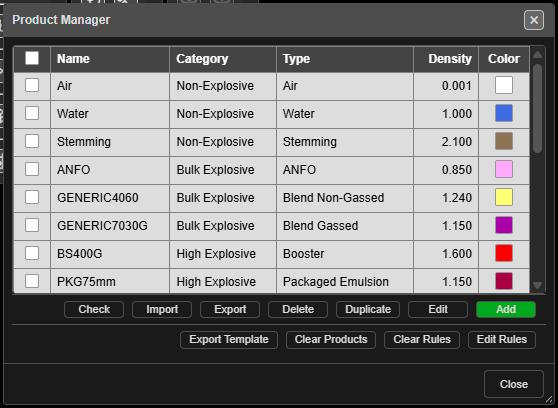

# Product Manager

Keeps the list of products you charge holes with — stemming and other inert fills, bulk
explosives, boosters and packaged product, initiators and spacers. Every product the Deck Builder,
charge rules, CSV charging imports and the Connect toolbar offer comes from this list.

---

## Open it

Click **Product Manager** on the **Holes** toolbar. The table lists every product with its
**Name**, **Category**, **Type**, **Density** and **Color**.

- Click a row to highlight it; double-click to edit it.
- Tick rows to act on several at once. The header box ticks them all.

---

## Add a product

1. Click **Add**. The **Add Product** dialog opens.
2. Choose the **Category** first — the fields below change to suit it.
3. Fill in **Type**, **Name**, **Supplier**, **Density (g/cc)**, **Color** and **Description**,
   then the category's own fields (below).
4. Click **Add**. If a required field is missing, it is highlighted and the dialog stays open.

| Category | Types | Extra fields |
|---|---|---|
| **Non-Explosive** | Air, Water, Stemming, Stem Gel, Drill Cuttings | **Particle Size (mm)** |
| **Bulk Explosive** | ANFO, Blend Gassed, Blend Non-Gassed, Emulsion, Molecular | **Compressible**, **Min Density (g/cc)**, **Max Density (g/cc)**, **Limiting Density (g/cc)**, **Critical Density (g/cc)**, **VOD (m/s)**, **RE (kJ/kg)**, **RWS (%)**, **Water Resistant** |
| **High Explosive** | Booster, Packaged Emulsion, Packaged Watergel, Cast Booster, Pentolite | **Mass (grams)**, **Diameter (mm)**, **Length (mm)**, **VOD (m/s)**, **RE (kJ/kg)**, **Water Resistant**, **Cap Sensitive** |
| **Initiator** | Detonating Cord, Shock Tube, Electronic, Electric | **Initiator Type**, **Delivery VOD (m/s)**, and delay fields to suit |
| **Spacer** | — | **Spacer Type** (Gas Bag, Stem Cap, Stem Brush, Stem Plug, Stem Lock), **Length (mm)**, **Diameter (mm)** |

### Initiators

The **Type** decides which **Initiator Type** you can choose:

| Type | Initiator Type options | Delay fields |
|---|---|---|
| Detonating Cord | Surface Cord, Detonating Cord (downline), Surface Cord Connector | **Core Load (g/m)**; **Delay (ms)** for the surface roles |
| Shock Tube | Shock Tube, Surface Connector | **Delay (ms)** |
| Electronic | Electronic, Surface Wire (harness) | **Min Delay (ms)**, **Max Delay (ms)**, **Delay Inc. (ms)** |
| Electric | Electric, Surface Wire (bell wire) | **Delay (ms)** |

Surface connectors, cords and wires also have a **Bidirectional** box.

> **Note:** Ticking **Compressible** on a bulk explosive asks first — Kirra will then work out
> its loaded density down the hole by gas compression, using the min, max and critical
> densities.

---

## Edit, copy and delete

| Button | What it does |
|---|---|
| **Edit** | Edits the highlighted product. Changes to name, colour and density carry into holes already charged with it |
| **Duplicate** | Copies the ticked products — or the highlighted one — as `Name_Copy_…` |
| **Delete** | Deletes the ticked products — or the highlighted one — after a prompt |
| **Check** | Opens **Product Check**: missing or contradictory settings on initiators |

If a product is in use, **Product In Use** lists the holes, decks and primers that use it.
**Delete Anyway** leaves those holes as they are — they keep the stored product details — but
the product is gone from the list.

---

## Import, export and clear

Products travel with your charge rules in one ZIP file. See [Product Database
CSV](products-csv.md) for what is inside.

| Button | What it does |
|---|---|
| **Import** | Loads products and charge rules from a ZIP |
| **Export** | Saves products and rules as `kirra-charging-config.zip` |
| **Export Template** | Saves a blank ZIP to fill in, `kirra-charging-config-template.zip` |
| **Clear Products** | Removes every product, after a prompt |
| **Clear Rules** | Removes every charge rule, after a prompt |
| **Edit Rules** | Opens the [Deck Builder](deck-builder.md) to load, edit, save or delete charge rules |

When an import holds names you already have, **Import Conflicts** asks what to do with each:
**Update (overwrite)**, **Skip (don't import)** or **Copy (import with suffix)** — or use
**Update All**, **Skip All** or **Copy All**.

> **Warning:** **Clear Products** and **Clear Rules** cannot be undone. **Export** first.

---

## Troubleshooting

| Symptom | Cause | Fix |
|---|---|---|
| **Edit** does nothing | No row is highlighted | Click a row first |
| A product will not save | A required field is empty | Fill the highlighted field |
| An initiator role shows *"DOES NOT MATCH TYPE"* | Its **Initiator Type** does not suit its **Type** | Choose a matching role |
| **Product Check** appears after an import | The imported initiators have problems | Fix them from the list it gives |

---

## Other ways to use it

| Method | Result |
|---|---|
| Double-click a row | Edits that product |
| **Fix Products…** in a **Product Check** report | Opens the Product Manager with the report still open |
| **Edit Rules** | Goes straight to the charge rules |

---

## Related

- [Product Database CSV](products-csv.md)
- [Deck Builder](deck-builder.md)
- [Charging Overview](overview.md)
- [Holes Toolbar](../blast-design/holes-toolbar.md)
