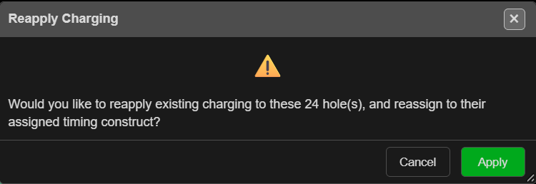

# Reapply Charging

Re-fits the charging already in a hole to the hole as it is now. Use it after you change hole
length, bench height, subdrill or diameter, so the decks, masses and primers follow the new hole.

---

## Re-fit the charging

1. Select the holes. Holes with no charging are skipped.
2. Click **Reapply Charging** on the **Holes** toolbar.
3. The **Reapply Charging** prompt asks whether to reapply the existing charging to that many
   holes and reassign them to their timing construct. Click **Apply**.
4. Kirra reports *"Reapplied charging to … hole(s)."*

---

## What changes

Reapply does **not** run the charge rule again. It takes each hole's own decks and stretches or
shrinks them to the new length, following each deck's scaling setting from the
[Deck Builder](deck-builder.md):

| Deck setting | On a longer or shorter hole |
|---|---|
| Fixed length | Keeps its length |
| Fixed mass | Keeps its mass, so its length changes with the diameter. A mass formula is worked out again |
| Variable | Its formulas are worked out again for this hole |
| Proportional | Shares the rest of the hole in proportion |

- The last deck always ends at the toe.
- Primers move in proportion to the new length, staying between the collar and 0.1 m above the
  toe.
- A formula that gives no answer keeps the deck's old length.
- Masses are recalculated, then timing constructs are reapplied across the blast so detonator
  times stay right.

> **Tip:** To load holes with a **different** rule, use the
> [Deck Builder](deck-builder.md) — **Apply Rule…**, then apply to the selected holes. Reapply only
> re-fits what is already there.

---

## Troubleshooting

| Message | Cause | Fix |
|---|---|---|
| *"No holes selected. Select holes on the canvas before reapplying."* | Nothing selected | Select the holes first |
| *"None of the selected holes have an existing charging configuration to reapply."* | The holes are not charged | Charge them with the Deck Builder first |

Reapply cannot be undone.

---

## Related

- [Remove Charges](remove-charges.md)
- [Deck Builder](deck-builder.md)
- [Charging Overview](overview.md)
- [Holes Toolbar](../blast-design/holes-toolbar.md)
