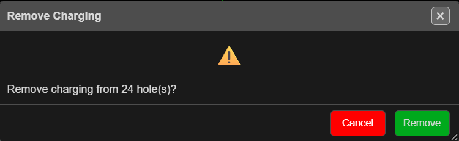

# Remove Charges

Takes all charging out of the selected holes — every deck, product and primer. Use it to start a
hole's loading again, or to clear holes that will not be fired.

---

## Clear the charging

1. Select the holes.
2. Click **Remove Charges** on the **Holes** toolbar.
3. The **Remove Charging** prompt asks *"Remove charging from … hole(s)?"* Click **Remove**.
4. Kirra reports *"Removed charging from … hole(s)."*

With nothing selected, Kirra says *"No holes selected."*

---

## What is kept

- The holes themselves, their geometry and their timing (delay and tie).
- Their place in any timing construct.
- The products and charge rules in the [Product Manager](product-manager.md).

Displays that depend on charging — powder factor, PPV and the like — update straight away.

> **Warning:** Remove Charges cannot be undone. To keep a copy, export the charging
> first — see **Charging CSV** in [CSV Export](../exporting/csv-export.md).

---

## Related

- [Reapply Charging](reapply-charging.md)
- [Deck Builder](deck-builder.md)
- [Charging Overview](overview.md)
- [Holes Toolbar](../blast-design/holes-toolbar.md)
