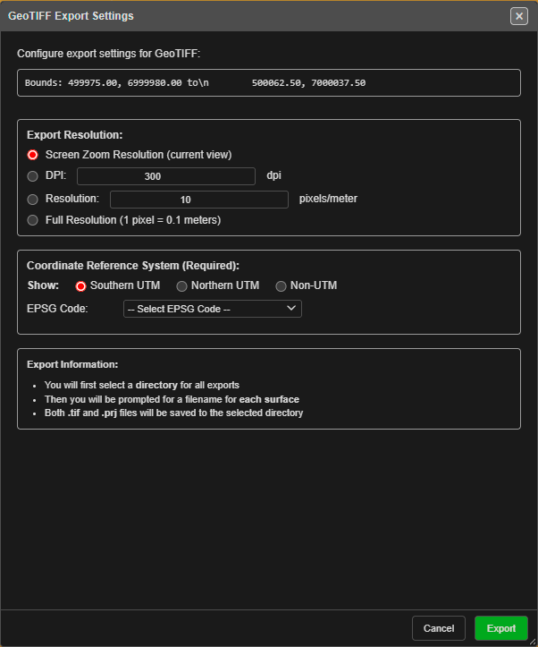

# GeoTIFF Export

Export surfaces as georeferenced raster images for use in GIS software such as QGIS, ArcGIS, and Global Mapper.

---

## How to Export

1. Load a surface with a gradient applied
2. Click the **Import Export Print** button (file icon) in the menu bar and choose **Export** — or open the left sidenav (☰) and click **Export** under **File Management**
3. In the **Export** dialog, open the **Surfaces / Mesh** tab. On the **GeoTIFF / Image** row, choose **GeoTIFF** (coloured image) or **Elev.GeoTIFF** (elevation raster) and click **Save**
4. For a coloured GeoTIFF, configure the **GeoTIFF Export Settings** dialog (see below)
5. Click **Export**
6. Select a directory for the exports, then enter a filename for each surface. A `.tif` and a `.prj` file are saved for each one

---

## Export Settings

| Setting | Description |
|---------|-------------|
| **Export Resolution** | Controls the output pixel density (see table below) |
| **Coordinate Reference System (Required)** | Coordinate reference system for the output file (e.g., EPSG:32755 for UTM Zone 55S) |

### Resolution Modes

| Mode | Description | Typical Use |
|------|-------------|-------------|
| **Screen Zoom Resolution (current view)** (default) | Uses the current 2D view resolution | Quick preview |
| **DPI** | Dots per inch, 72–600 (default 300) | Print-quality reports |
| **Resolution** | Pixels per metre, 1–1000 (default 10) | Engineering precision |
| **Full Resolution (1 pixel = 0.1 meters)** | 10 pixels per metre | Maximum detail |

> **Tip:** Higher resolution produces larger files and takes longer to export. Choose based on your final use -- screen display, printing, or archival.

---

## What Gets Exported

The GeoTIFF contains:

- **Raster data**: RGB pixels rendered from the surface gradient (elevation colours, hillshade, scientific colour maps, or texture)
- **Geotransform**: Maps pixel coordinates to real-world coordinates
- **CRS metadata**: The EPSG code you selected

**Coordinate systems in feet.** When the EPSG code you pick is measured in feet (a US State Plane
zone, for example), the GeoTIFF is written in that system's feet and marked as feet, and Kirra
says so when the export finishes: *Coordinates are written in US survey feet, the unit of
EPSG:2232.* If Kirra can't read the system's unit, it writes metres and says that instead.

A code that isn't in the list can be typed in **Other code:**, for example `2232`, then press
**Enter**. See [CRS Library](../analysis/crs-library.md).

The gradient visible in Kirra at the time of export is preserved in the GeoTIFF.

---

## Use Cases

- **GIS integration** -- Import into QGIS or ArcGIS as a base layer
- **Reporting** -- Generate high-resolution surface images for blast reports
- **Archive** -- Document pre/post-blast surface conditions with embedded coordinates

---

## Related Topics

- [Surface Gradients](../surfaces/gradients.md)
- [Importing Surfaces](../surfaces/importing-surfaces.md)
- [CSV Export](csv-export.md)
