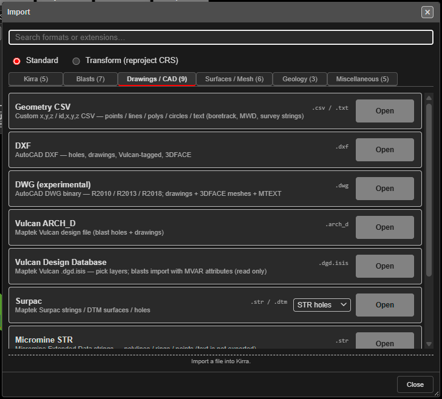

# DXF Import

Kirra imports AutoCAD DXF files as drawings (KAD points, lines, polygons, circles and
text) and as surfaces (3DFACE and polyface meshes). Holes in a DXF come in as drawing
entities, not as blast holes.

---

## How to import

1. Open the **Import** dialog and choose the **Drawings / CAD** tab — see
   [The Import Dialog](import-dialog.md).
2. Click **Open** on the **DXF** row.
3. Select one or more `.dxf` files. Hold **Ctrl** or **Shift** to pick several — for
   example one file per bench.
4. A **DXF Import Progress** bar runs for larger files. When the import finishes,
   **Import Complete** reports how many files were imported, or **DXF Import Failed**
   lists the files that could not be read.

You can also drop `.dxf` files onto the canvas. Each dropped file is imported, and
reported, on its own.

If the new drawing is more than 100 km from the data already loaded, Kirra warns that
the coordinate systems may not match — see
[The Import Dialog](import-dialog.md#coordinate-check).

---

## What each DXF entity becomes

| DXF entity | In Kirra |
|---|---|
| **POINT** | KAD points, grouped into one entity per DXF layer |
| **INSERT** (block) | A KAD point at the insertion point. The block's contents are not exploded |
| **LINE** | KAD line |
| **LWPOLYLINE** / **POLYLINE** | KAD line, or polygon when the polyline is closed |
| **ARC** | KAD line following the arc |
| **CIRCLE** | KAD circle |
| **ELLIPSE** | Closed KAD polygon |
| **TEXT** / **MTEXT** | KAD text, keeping its rotation |
| **3DFACE** and polyface meshes | A surface — one per DXF layer |

Other entity types (SPLINE, HATCH, DIMENSION and so on) are skipped.

Polylines from Maptek Vulcan that carry a Vulcan name come in named `VN_<name>`, with a
text label at their first point.

---

## Names, layers and colours

- Every drawing entity gets its own name, built from its DXF layer, its type and a
  number: `<layer>_<type>_0001`, `<layer>_<type>_0002` and so on.
- All of a file's drawings go into one drawing layer named after the file. Importing a
  file with the same name again creates `name_2`, `name_3` and so on.
- Each 3DFACE layer becomes a surface named after its DXF layer.
- Entity colours come from the DXF colour index or true colour. Entities coloured
  **ByLayer** take their layer's colour. Entities coloured **ByBlock** come in white.
- Lines and polygons longer than 10,000 points are split into parts, named `_chunk1of3`
  and so on, so they stay quick to draw and edit.

---

## Coordinates

X, Y and Z are kept exactly as they are in the file, unless the file says it is drawn in
feet or yards. If your DXF is in a different coordinate system from your project, use
**DXF — Transform (reproject CRS)** — see [Transform Import](transform-import.md).

### Drawings in feet or yards

Kirra works in metres. A DXF records its drawing units in its header (`$INSUNITS`), and
Kirra reads three of them:

| `$INSUNITS` | Drawn in | What Kirra does |
|---|---|---|
| 2 | Feet | Converts to metres, using the international foot (0.3048 m) |
| 21 | US survey feet | Converts to metres, using the US survey foot (1200/3937 m) |
| 10 | Yards | Converts to metres (0.9144 m to the yard) |

Every X, Y and Z converts, and so does each circle's radius. **Import Complete** then adds a
line for each converted file, for example "pit_crest.dxf is drawn in feet; Kirra converted
it to metres."

There is nothing to set. The conversion happens whatever [units Kirra shows](../working-in-kirra/units.md), because
it depends on the file, not on how Kirra shows numbers.

Any other unit code, or none at all, reads as metres, exactly as before. Many CAD packages
and templates write a default code that doesn't match the drawing: some metre UTM
files say inches. A feet or yard code is never a default, so Kirra trusts only those.

A DXF imported through **DXF — Transform (reproject CRS)** is not converted. There the
source coordinate system decides the units.

---

## Binary DXF

Import ASCII (text) DXF. If your CAD package saves binary DXF, save as ASCII DXF instead.
For AutoCAD's own `.dwg` format, see [DWG](cad-formats.md#dwg-experimental).

---

## Related topics

- [The Import Dialog](import-dialog.md)
- [Other CAD Formats](cad-formats.md)
- [DXF Export](../exporting/dxf-export.md)
- [Coordinate System](../reference/coordinate-system.md)
