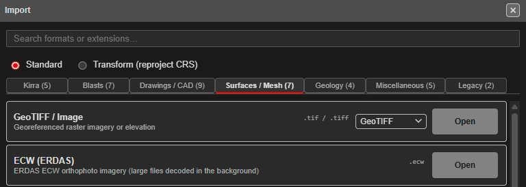
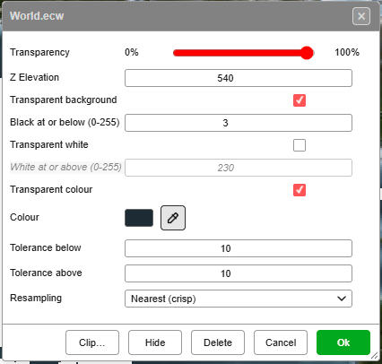
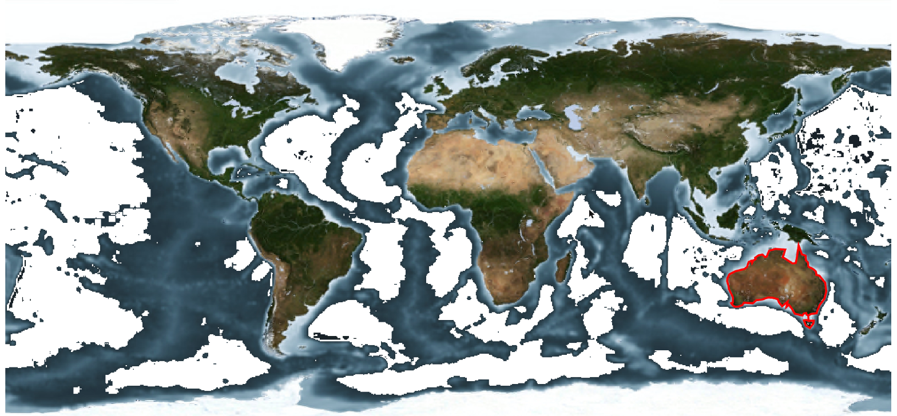
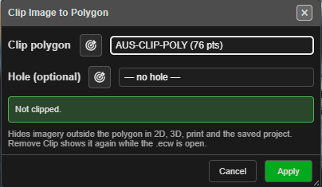
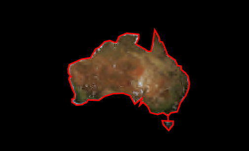
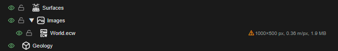
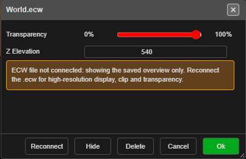
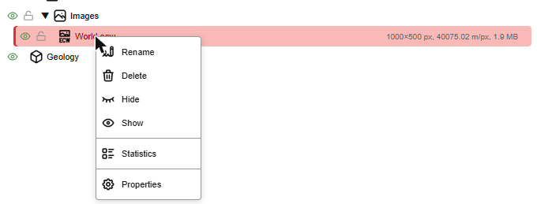
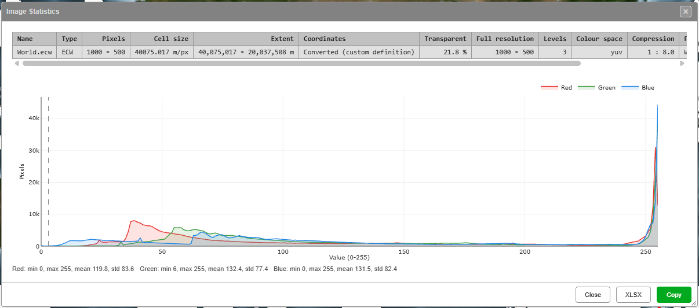
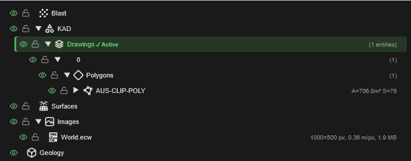

# ECW Imagery

ERDAS ECW (`.ecw`) is a compressed format for large orthophotos and aerial images. A mine-wide
ECW is often more than 100,000 pixels across and several gigabytes. Kirra never loads the whole
file: it shows a downsampled overview of the whole image, then decodes the area on screen at
full detail as you zoom in.

ECW imagery sits in **Images** in the [Data Explorer](../working-in-kirra/data-explorer.md),
alongside GeoTIFFs.

---

## Import an ECW

1. Open the Import dialog and choose the **Surfaces / Mesh** tab.
2. On the **ECW (ERDAS)** row, click **Open** and pick the `.ecw` file.

You can also drop a `.ecw` onto the canvas.

Kirra reads the file in the background and shows its progress in **Importing ECW**, so the rest
of the app keeps working. Click **Cancel** to stop the import. When it finishes, the whole image
appears and the view zooms to fit it. A multi-gigabyte ECW usually takes a few seconds.

**Latitude / longitude files.** If the ECW is in latitude and longitude, Kirra asks for the
coordinate system to convert it to, in **Coordinate System Conversion Required**, exactly as for a
GeoTIFF (see [GeoTIFF / Image](surfaces-and-point-clouds.md#geotiff--image)). Mine grid and other
projected ECWs import without asking.

**A whole-world image.** A UTM zone only covers a few degrees of longitude, so a map of the
world needs a world projection. Under **Show**, choose **Non-UTM**, then
**4087 - WGS 84 / World Equidistant Cylindrical**. Kirra then works with the world in metres.

This projection keeps north-south distances true, but stretches east-west distances away from
the equator: by about 10% at 25° latitude and 41% at 45°. Areas stretch the same way. For
example, an outline of Australia traced on the world image measures about 8.7 million km²,
against a true 7.7 million km². Use it to see where things are, not to measure them.

**If the import fails**, Kirra says why in **ECW Import Error**:

| Message | Meaning |
|---|---|
| Not an ECW file. | The file is not an ECW, even if it is named `.ecw`. |
| ECW version 3 is not supported yet. | Kirra reads ECW version 2 files. |
| The ECW file is damaged or truncated. | The file is incomplete, for example a copy that did not finish. |

---

## Full detail when you zoom in

The first picture you see is an overview, at most 4096 pixels across for the whole image. Zoom
in and, a moment after the view stops moving, Kirra decodes just the area on screen at the
resolution you are looking at, and draws it over the overview. Pan and it decodes the new area;
zoom out and it goes back to the overview.

This works in 2D and in 3D, including a tilted 3D view, and for an ECW converted from latitude
and longitude at import.

Prints do not depend on how far you zoomed in. When you print, Kirra reads the ECW again for the
printed area at the print resolution, up to the detail the file holds, so a print can be sharper
than the screen. Set the resolution with **Image DPI** (Kirra Inbuilt) or the template DPI
controls: see [Print from Template](../printing/xlsx-templates.md#image-dpi) and
[Map View Resolution](../printing/xlsx-templates.md#map-view-resolution-dpi).

---

## Transparency and display

ECW files have no transparency. The area outside the photo is stored as near-black, which would
otherwise hide everything under the image. Kirra makes those pixels see-through, and it can also
remove near-white pixels or one chosen colour.

Right-click the image on the canvas to open its menu:

Each value is greyed out while the box above it is unticked.

**Transparent background**
- Tick it to make the dark border see-through. Untick it to keep black as black.
- **Black at or below (0-255)**: a pixel becomes see-through when its red, green and blue are all
  at or below this value. The ECW border is usually 0 to 2, so the default of 3 is safe. Raise it
  only if a dark fringe remains; a higher value also removes deep shadow.

**Transparent white**
- Tick it to remove near-white pixels, such as a white collar around the photo or the margin of
  a scanned map.
- **White at or above (0-255)**: a pixel becomes see-through when its red, green and blue are all
  at or above this value. The default is 230. A lower value also removes pale ground and cloud.

**Transparent colour**
- Tick it to remove pixels close to one colour, such as a coloured no-data fill.
- **Colour**: the colour to remove. Click the swatch to choose it, or use the eyedropper (below).
- **Tolerance below** and **Tolerance above**: how far below and above that colour (0-255) each of
  red, green and blue may be and still be removed. The default is 10 each way. Higher values
  remove a wider band of shades.

**Pick the colour from the image.** Click the eyedropper button beside **Colour**, then click
the image, in 2D or 3D. The colour of the image at that point goes into the well. Kirra reads
the image itself, not the screen, so the image's own **Transparency**, overlays and 3D lighting
do not change the colour you get. Press **Esc**, or click the eyedropper again, to cancel.

- Zoom in before you pick: zoomed right out, one screen pixel covers several image pixels.
- A click outside the image, or on a pixel that is already see-through, leaves the colour as it
  was, and the status message at the top of the view says why.

In this world image, a transparent colour taken from the deep ocean removes it, and leaves the
shallow water and the land:

**Resampling**
- How pixels are combined when the ECW is shown smaller than its full resolution.
- **Nearest (crisp)** keeps edges sharp, and matches what QGIS shows.
- **Average (smooth)** blends neighbouring pixels. It removes speckle on fine texture, such as
  roads and scrub, when you are zoomed out.

Click **Ok** to apply. Kirra re-reads the ECW once for all the changes, so it takes a moment on a
large file.

---

## Clip an ECW to a polygon

To hide the imagery outside an area, such as a pit outline or a lease boundary:

1. Draw the area as a closed KAD polygon.
2. Right-click the image and click **Clip…**.
3. In **Clip Image to Polygon**, choose the polygon in **Clip polygon**, or click the target
   button beside it and click the polygon on the canvas.
4. To leave a hole in the clipped image, choose a second polygon in **Hole (optional)**.
5. Click **Apply**.

Everything outside the polygon is hidden, in 2D, 3D, prints and the saved project. Zooming in
stays clipped.

Kirra refuses a hole that would give the wrong result:

| Message | Fix |
|---|---|
| Choose a clip polygon first. | Choose a polygon in **Clip polygon**. |
| The hole cannot be the clip polygon itself | Choose a different polygon for the hole. |
| The hole must lie completely inside the clip polygon. | Use a hole that is fully inside the outline. |

**To remove the clip**, right-click the image, click **Clip…**, then **Remove Clip**.

Clip is available for ECW images only, and only while the ECW is connected (see below).

---

## After a reload: Reconnect

Kirra saves the overview with your project, but never the `.ecw` itself, which can be gigabytes.
After the page is reloaded, or when a project is opened on another computer, the image shows the
saved overview (including any clip). Full detail, clipping, and the transparency and resampling
settings need the original file again.

The Data Explorer marks the image with a warning:

To reconnect, click the warning, or right-click the image and click **Reconnect**, then pick the
`.ecw`. The image menu says the same thing while the file is not connected:

The file can have moved or been renamed, but it must be the same ECW. Kirra checks its size and
position, and refuses a different file with *This is not the same ECW as ...*. Once reconnected,
the warning goes, and your transparency, resampling and clip settings come back with it.

---

## Image Statistics

Image Statistics shows the details of an image and a histogram of its colours. It works for
GeoTIFFs as well as ECWs.

1. In the Data Explorer, right-click the image under **Images**. To compare several, select them
   first.
2. Choose **Statistics**, above **Properties**.

The table has one row per image:

| Column | Shows |
|---|---|
| **Pixels** | The size of the image as displayed. For an ECW this is the overview. |
| **Cell size** | The ground size of one displayed pixel, in m/px (°/px for an image in latitude and longitude). |
| **Extent** | The ground width and height of the image. |
| **Coordinates** | *As in the file*, *Latitude / longitude*, or the coordinate system it was converted to at import. |
| **Transparent** | The share of the displayed image that is see-through. |
| **Full resolution** | ECW only: the size of the image in the file. |
| **Levels** | ECW only: how many resolution levels the file holds. Needs the file connected. |
| **Colour space** | ECW only: how the file stores colour. Needs the file connected. |
| **Compression** | ECW only: how many times smaller the file is than the raw image, for example *1 : 57.7*. |
| **File** | ECW only: the file name and size. |
| **Status** | ECW only: *Connected*, or *Needs Reconnect* (see above). |

The chart counts how many pixels have each red, green and blue value, from 0 (dark) to 255
(bright). See-through pixels are left out. Below it are the lowest, highest, mean and standard
deviation of each colour. For an ECW, dashed grey lines mark the **Black at or below** and
**White at or above** values: everything beyond a line has been made see-through.

With several images selected, choose which one the chart shows in **Histogram of**. Drag an edge
of the window to make the chart bigger.

| Button | Does |
|---|---|
| **Copy** | Copies the table to the clipboard, ready to paste into a spreadsheet |
| **XLSX** | Saves the table as `image-statistics.xlsx` |
| **Close** | Closes the window |

---

## In the Data Explorer

ECW images have their own icon under **Images**; GeoTIFFs keep theirs.

Beside each image, the Data Explorer shows its size in pixels, its cell size and its memory use.
An image still in latitude and longitude shows its cell size in degrees (°/px), not m/px.

---

## Related topics

- [Surfaces and Point Clouds](surfaces-and-point-clouds.md) (GeoTIFF / Image)
- [The Import Dialog](import-dialog.md)
- [Data Explorer](../working-in-kirra/data-explorer.md)
- [Other Import Formats](other-formats.md) (KAP projects)
