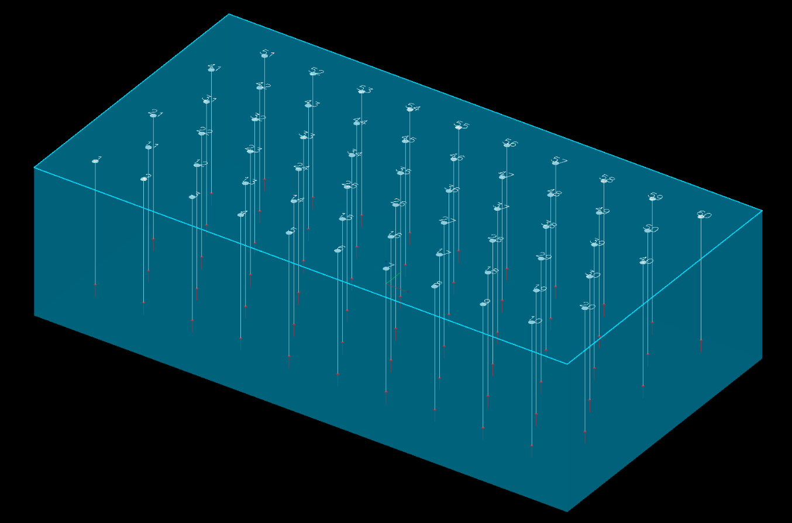

# Extrude, Boolean, and Section Plane

These tools connect KAD drawings to surface operations, enabling you to create 3D geometry from 2D design boundaries.

*A closed polygon around a blast, extruded 12 m down and shown part-transparent in 3D.*

---

## Extrude KAD to Solid

Extrudes a closed KAD polygon straight up or down into a closed 3D solid, from **Extrude KAD to
Solid** on the **Surface** toolbar. Choose the **Polygon**, set **Depth (m) +ve=up, -ve=down**, and
click **Apply**. See [Extrude KAD to Solid](../surfaces/extrude-kad-to-solid.md).

### Use Cases

- Creating pit shell volumes from 2D outlines
- Building bench outline solids for volume calculations
- Generating exclusion zone meshes
- Creating design surfaces from plan-view boundaries

---

## KAD Boolean

Union, intersect, difference and XOR of closed polygons, from **KAD Boolean** on the **Modify** toolbar. See [KAD Boolean](boolean.md).

---

## Section Plane

Slices the 3D scene along a plane so you can see the design side-on — holes, drawings,
surfaces and block models. It is on the **Select** toolbar. Draw a line where you want
the section, then choose **Segment** in the Section Plane dialog and click the line; or
choose **Two Points** and click the two ends.

See [Section Views](../reference/section-views.md#section-plane).

### Use Cases

- Verifying pit wall design against actual terrain
- Checking bench geometry at specific locations
- Visualising sub-surface layers

---

## Related Topics

- [Drawing Points, Lines, and Polygons](drawing-tools.md)
- [Modify Toolbar](modify-tools.md) -- Transform, Offset, Radii, Reorder, Boolean, Join, Split tools
- [Surface Boolean & CSG](../surfaces/boolean-csg.md)
- [Importing Surfaces](../surfaces/importing-surfaces.md)
