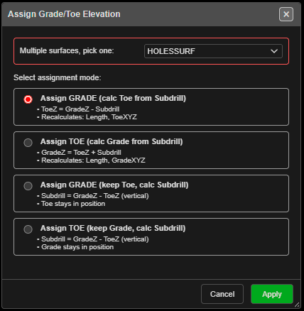

# Assign Surface and Assign Grade

Set the collar, grade or toe of selected holes from a surface — or from a typed elevation when
no surface is showing.

Subdrill is the **vertical** drop from grade to toe (grade Z − toe Z). The along-hole distance
from grade to toe is the subdrill **length**, which is longer on an angled hole.

---

## Prerequisites

- Select the holes first. With none selected, Kirra says *"Select the holes to adjust, then
  choose Assign Surface again."*
- A visible surface, or an elevation to type.

---

## Assign Surface (collar)

1. Select the holes.
2. Click **Assign Surface** on the **Modify** toolbar.
3. What happens next depends on the surfaces showing:

| Visible surfaces | Kirra |
|---|---|
| One | Uses it straight away |
| Several | Asks **Select Surface for Collar** — choose one under **Surface:** and click **Use** |
| None | Asks **Assign Collar Elevation** — type it in **Set collar elevation to:** and click **Apply** |

Each collar moves along its own hole to the surface. **The toe stays where it is**, and the angle
and bearing are kept — so on an angled hole the collar's X and Y move too. Hole length and bench
height are recalculated. Kirra reports *"Successfully adjusted … holes to … collar elevation."*

---

## Assign Grade

1. Select the holes.
2. Click **Assign Grade** on the **Modify** toolbar. **Assign Grade/Toe Elevation** opens.
3. Pick the surface (or type an elevation if none is showing) and a mode, then click **Apply**.

| Mode | You set | Kept | Recalculated |
|---|---|---|---|
| **Assign GRADE (calc Toe from Subdrill)** (default) | Grade | Collar, subdrill | Toe, length, bench height |
| **Assign TOE (calc Grade from Subdrill)** | Toe | Collar, subdrill | Grade, length, bench height |
| **Assign GRADE (keep Toe, calc Subdrill)** | Grade | Collar, toe | Subdrill = grade Z − toe Z, bench height |
| **Assign TOE (keep Grade, calc Subdrill)** | Toe | Collar, grade | Subdrill = grade Z − toe Z, length |

The surface height is read at each hole's collar position. Every mode keeps the angle and
bearing, and the subdrill length is updated to match.

---

## Design Plane holes

Holes set out on a Design Plane (see [Section Plane](../reference/section-views.md#section-plane)) are moved along their own line
to meet the surface. Kirra reports any that do not meet it. A typed elevation does not apply to
them, and they are skipped.

---

## Undo

The whole assignment is one **Ctrl+Z** step. It restores the holes and their charging.

---

## Troubleshooting

**Nothing happened.**
No holes were selected. Select them, then run the tool again.

**The collar moved sideways.**
On an angled hole the collar slides along the hole to reach the surface — that is expected.

**A hole was skipped.**
Holes lying almost flat cannot reach a different height along their own line.

---

## Related

- [Editing Holes](../blast-design/editing-holes.md)
- [Modify Toolbar](modify-tools.md)
