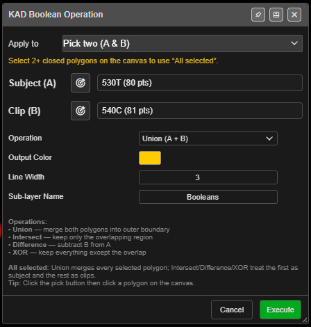

# KAD Boolean

Combines closed polygons — union, intersect, difference or XOR — into new polygons. The originals
are kept.

---

## Combine polygons

1. Click **KAD Boolean** on the **Modify** toolbar. **KAD Boolean Operation** opens.
2. Choose what to combine under **Apply to**:
   - **All selected polygons** — every selected closed polygon (select them with **Shift** on the
     canvas; the count updates while the dialog is open), or
   - **Pick two (A & B)** — choose **Subject (A)** and **Clip (B)** from the lists, or with the
     target buttons on the canvas.
3. Choose the **Operation** and click **Execute**.

You need at least 2 closed polygons: *"Need at least 2 closed KAD polygons. Create polygons first,
then use this tool."*

---

## The fields

| Field | Default | What it does |
|---|---|---|
| **Apply to** | **All selected** when 2 or more are selected, otherwise **Pick two (A & B)** | Which polygons |
| **Operation** | **Union (A + B)** | **Union (A + B)**, **Intersect (A ∩ B)**, **Difference (A - B)**, **XOR (A △ B)** |
| **Output Color** | Yellow `#FFCC00` | |
| **Line Width** | 3 | 1 – 10 |
| **Sub-layer Name** | Booleans | *"Sub-layer under Analysis that the results are filed in"* |

From the dialog: *"All selected: Union merges every selected polygon; Intersect/Difference/XOR
treat the first as subject and the rest as clips."*

---

## What you get

New closed polygons named after the first input and the operation, for example
`Pit_Union_ab12`, on **Analysis / Booleans** — or your active layer. Their height is the average
of all the input points. The whole operation is one undo step.

---

## Troubleshooting

**"Boolean operation produced no results. The polygons may not overlap."**
Intersect needs the polygons to overlap.

**"Subject and Clip must be different polygons."**
Pick two different polygons for A and B.

---

## Related

- [Clip-KAD](clip-kad.md)
- [Extrude, Boolean, and Section Plane](advanced-tools.md)
- [Modify Toolbar](modify-tools.md)
