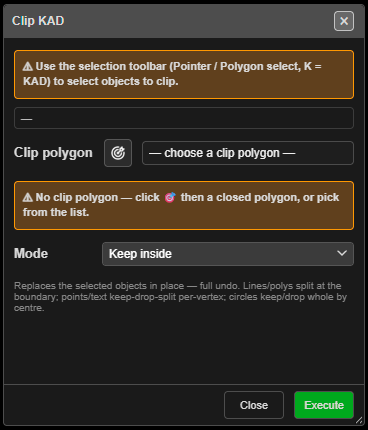

# Clip-KAD

Cuts selected drawings with a closed polygon — keep what is inside, keep what is outside, or split
them and keep both.

---

## Clip drawings

1. Click **Clip-KAD** on the **Modify** toolbar. The **Clip KAD** dialog opens and stays open.
2. Select the drawings to clip with the Select toolbar (**Pointer** or **Polygon** select, **K**).
   The dialog counts them — *"✔ 4 objects selected to clip"*.
3. Choose the **Clip polygon**:
   - pick it from the list (it starts at **— choose a clip polygon —**), or
   - click the target button, then click a closed polygon on the canvas.
4. Choose the **Mode** and click **Execute**. The dialog stays open for the next clip.
5. **Close** when done.

---

## Modes

| Mode | Result |
|---|---|
| **Keep inside** (default) | Only the parts inside the polygon remain |
| **Keep outside** | Only the parts outside remain |
| **Dissect (split, keep both)** | Both parts remain, as separate drawings |

- Lines and polygons are cut at the boundary. The pieces are open lines.
- Points and text are kept, dropped or split by where each point lies.
- Circles are kept or dropped whole, by their centre.

---

## What you get

The originals are replaced in place. Pieces are named after the original — `Name_clip0`,
`Name_clip1`… (`_in` / `_out` for points and text) — and stay on the original's layer. Kirra
reports *"Clip KAD (…): … replaced, … created."* The whole clip is one undo step.

---

## Other ways to use it

| Method | Result |
|---|---|
| Change the selection while the dialog is open | The target count updates live |
| Target button | Freezes the current targets while you pick the clip polygon; click it again to cancel the pick |
| Switch to another tool | The dialog stays open, so you can use the Select toolbar |

---

## Related

- [KAD Boolean](boolean.md)
- [Split KAD Lines](join-split.md#split)
- [Modify Toolbar](modify-tools.md)
