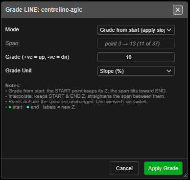

# Grade Line

Sets a constant slope along part of a line — for haul roads, drains and ramps. Only the heights
change; the line stays where it is in plan.

---

## Grade a span

1. Click **Grade Line (set constant slope)** on the **Modify** toolbar. The status line reads
   *"Grade Line: click the START point on a line (right-click to exit)"*.
2. Click the start point on a line.
3. Click the end point on the **same** line. It can come before or after the start.
4. **Grade LINE: …** opens, and a preview labels each new height.
5. Set the grade and click **Apply Grade**. The tool stays on for another span.

Polygons cannot be graded — *"click the START point on a LINE (closed polygons not supported)."*

---

## The fields

| Field | Default | What it does |
|---|---|---|
| **Mode** | **Grade from start (apply slope)** | The start keeps its height and the span slopes towards the end. **Interpolate start → end** keeps both ends and straightens the span between them |
| **Span** | — | Read only, for example *point 3 → 13 (11 of 37)* |
| **Grade (+ve = up, -ve = dn)** | 10 | The slope. Greyed out in **Interpolate**, where it shows the slope worked out |
| **Grade Unit** | **Slope (%)** | **Degrees (°)**, **Slope (%)** or **Ratio (1:N)**. Changing it converts the value |

The slope is measured along the horizontal distance from the start. Points outside the span are
not changed. The dialog remembers its settings for the session.

---

## Other ways to use it

| Method | Result |
|---|---|
| **Right-click** with nothing picked | Ends the tool |
| **Right-click** after the start point | Steps back to picking the start |
| **Cancel** or **Escape** in the dialog | Drops the pick; the tool stays on |
| Works in 3D | A dashed cyan line previews the new slope |

---

## Undo

Each **Apply Grade** is one **Ctrl+Z** step.

---

## Related

- [Roads and Ramps](roads-and-ramps.md)
- [Snap Objects to Surface](snap-to-surface.md)
- [Modify Toolbar](modify-tools.md)
