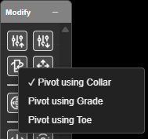

# Hole Bearing

Changes the bearing of holes by dragging — the hole swings to point at the cursor.

---

## Re-aim holes

1. Click **Hole Bearing** on the **Modify** toolbar. The status line reads *"Bearing Tool
   Activated — Select a hole and drag to rotate — Hold 'F' for focus mode"*.
2. Press on a hole (or anywhere, if holes are already selected) and drag. The holes point
   towards the cursor.
3. Release to set the bearing. The selection clears, ready for the next hole.

Works in 2D and 3D. In 2D the cursor snaps, so you can aim a hole at a point exactly.

---

## Choose the pivot

**Right-click** the **Hole Bearing** button to choose which point stays put while the hole swings.

| Option | Stays in place | Button colour while on |
|---|---|---|
| **Pivot using Collar** (default) | The collar | Red |
| **Pivot using Grade** | The grade point | Green |
| **Pivot using Toe** | The toe | Amber |

The choice is remembered and travels in KAP projects, and each re-aimed hole keeps the pivot it
was turned about. The tooltip reads, for example, *"Hole Bearing — pivot on grade (right-click to
change)"*.

> **Tip:** Pivot on the toe or grade for presplit, trim or wall-control holes, where the surveyed
> point is at the bottom.

---

## Other ways to use it

| Method | Result |
|---|---|
| Several holes selected | All take the same bearing — from the first hole's pivot to the cursor |
| Hold **F** (focus mode) | Each hole points at the cursor from its own pivot |
| Right-click the button | Choose the pivot |
| Snap on (2D) | Aim at a hole, vertex or surface point |

---

## Undo

Each drag is one **Ctrl+Z** step, covering bearing and pivot together.

---

## Related

- [Move](move.md)
- [Hole Section View](../reference/section-views.md#hole-section-view)
- [Modify Toolbar](modify-tools.md)
