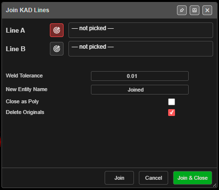
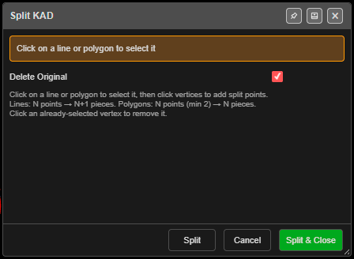

# Join and Split KAD Lines

**KAD Join Lines** joins two lines end to end. **KAD Split Lines** cuts a line or polygon into
pieces at chosen vertices.

---

## Join

1. Click **KAD Join Lines** on the **Modify** toolbar. **Join KAD Lines** opens, ready to pick.
2. Click near the end of the first line — *"Click on or near a line to select its nearest
   endpoint"*. The nearer end is used.
3. Click near the end of a different line.
4. The dialog shows the gap, for example *"Distance between endpoints: 0.004 m (will weld)"* or
   *"… (gap — no weld)"*.
5. Click **Join** (the dialog stays open for the next join) or **Join & Close**.

| Field | Default | What it does |
|---|---|---|
| **Weld Tolerance** | 0.01 | Ends closer than this merge into one point. Lines further apart are still joined, with a connecting segment |
| **New Entity Name** | `<Line A>_joined` | If the name is taken, Kirra adds `_1`, `_2`… |
| **Close as Poly** | Off | Make the result a closed polygon |
| **Delete Originals** | On | Remove the two lines after joining |

The joined line takes Line A's colour, width and layer. One **Ctrl+Z** undoes the join.

Join works on lines only. The target buttons beside **Line A** and **Line B** re-pick an end.

---

## Split

1. Click **KAD Split Lines** on the **Modify** toolbar. **Split KAD** opens.
2. Click a line or polygon to choose it.
3. Click the vertices to split at. Click one again to remove it.
4. Click **Split** (ready for the next drawing) or **Split & Close**.

From the dialog: *"Lines: N points → N+1 pieces. Polygons: N points (min 2) → N pieces."* A line
needs at least 3 points and a polygon 4. The first and last points of a line cannot be split
points.

| Field | Default | What it does |
|---|---|---|
| **Delete Original** | On | Remove the original after splitting |

The pieces are open lines named `Name_A`, `Name_B`… on the original's layer. One **Ctrl+Z** undoes
the split.

---

## Other ways to use them

| Method | Result |
|---|---|
| Click the button again | Cancels the tool |
| **Escape** | Cancels the tool |
| **Right-click** (Split) | Removes the last split point |
| **Join** / **Split** buttons | Keep the tool open for the next one |
| Works in 3D | Pick in either view |

---

## Related

- [Clip-KAD](clip-kad.md)
- [Extend Line to Boundary](extend-line.md)
- [Modify Toolbar](modify-tools.md)
