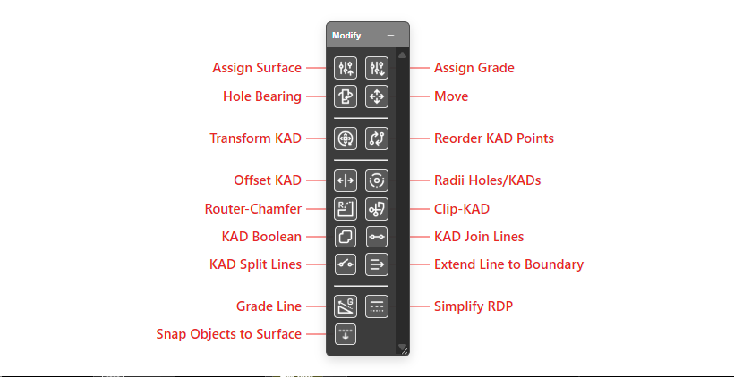

# Modify Toolbar

The **Modify** toolbar edits holes and KAD drawings — moving, re-aiming, setting heights, and
reshaping, combining and cleaning up lines and polygons. Open it from its tab on the right edge of
the window.

---

## Hole tools

| Button | What it does | Other ways to use it | Guide |
|---|---|---|---|
| **Assign Surface** | Moves the collars of selected holes onto a surface | Typed elevation when no surface shows | [Assign Surface and Assign Grade](assign-surface-grade.md) |
| **Assign Grade** | Sets grade or toe from a surface, four ways | Typed elevation when no surface shows | [Assign Surface and Assign Grade](assign-surface-grade.md#assign-grade) |
| **Hole Bearing** | Re-aims holes by dragging | **Right-click** the button for the pivot; hold **F** for focus mode | [Hole Bearing](hole-bearing.md) |
| **Move** | Drags holes, drawings or vertices | **H / K / V** decides what; **Shift**, hold **S**, **Alt** in 3D | [Move](move.md) |

## Shape tools

| Button | What it does | Other ways to use it | Guide |
|---|---|---|---|
| **Transform KAD** | Moves, rotates and scales drawings by exact amounts | **Escape** restores; live preview | [Transform KAD](transform.md) |
| **Reorder KAD Points** | Sets a drawing's start point and direction | **Right-click** clears; twice exits | [Reorder KAD Points](reorder-points.md) |
| **Offset KAD** | Offsets lines and polygons in or out, with a slope | Stays on; **right-click** exits; up to 10 copies | [Offset KAD](offset.md) |
| **Radii Holes/KADs** | Circles or stars around holes and points | Toe location; union; starburst | [Radii](radii.md) |
| **Router-Chamfer** | Rounds or bevels corners | **Right-click** clears; twice exits | [Router-Chamfer](router-chamfer.md) |

## Cutting and combining

| Button | What it does | Other ways to use it | Guide |
|---|---|---|---|
| **Clip-KAD** | Cuts drawings with a polygon — keep inside, outside or both | Dialog stays open while you select | [Clip-KAD](clip-kad.md) |
| **KAD Boolean** | Union, intersect, difference or XOR of polygons | **All selected polygons** mode | [KAD Boolean](boolean.md) |
| **KAD Join Lines** | Joins two lines end to end | **Join** keeps the tool open | [Join and Split](join-split.md#join) |
| **KAD Split Lines** | Splits a line or polygon at vertices | **Right-click** removes the last split point | [Join and Split](join-split.md#split) |

## Line editing

| Button | What it does | Other ways to use it | Guide |
|---|---|---|---|
| **Extend Line to Boundary** | Moves a line end to where it meets another line | **Right-click** resets; twice exits | [Extend Line to Boundary](extend-line.md) |
| **Grade Line (set constant slope)** | Sets a constant slope along a span | **Right-click** steps back; with nothing picked, exits | [Grade Line](grade-line.md) |
| **Simplify RDP** | Removes unneeded points | **Create Copy** keeps the original | [Simplify RDP](simplify.md) |
| **Snap Objects to Surface** | Drapes drawings onto a surface | Adds points where lines cross the surface | [Snap Objects to Surface](snap-to-surface.md) |

---

## Undo

Every Modify tool's change is one **Ctrl+Z** step.

---

## Related topics

- [KAD Toolbar](kad-toolbar.md)
- [Drawing Basics](drawing-basics.md)
- [Extrude, Boolean, and Section Plane](advanced-tools.md)
- [Layer Organisation](layer-organisation.md)
- [Keyboard Shortcuts & Mouse Controls](../reference/keyboard-shortcuts.md)
