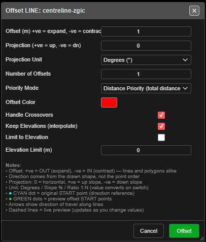

# Offset KAD

Draws copies of a line or polygon at a set distance — outwards or inwards — optionally rising or
falling as it goes. Use it for offset crests, toes, buffer lines and stand-off boundaries.

---

## Offset a line or polygon

1. Click **Offset KAD** on the **Modify** toolbar. The status line reads *"Offset Tool: click a
   line or polygon to offset (right-click to exit)"*.
2. Click a line or polygon. **Offset LINE: …** or **Offset POLY: …** opens, and a dashed preview
   shows the result.
3. Set the distance and options, then click **Offset**.
4. The tool stays on — click the next line, or **right-click** the canvas to finish.

Points cannot be offset. A click on empty space reads *"Offset: click on a line or polygon"*.

---

## The fields

| Field | Default | What it does |
|---|---|---|
| **Offset (m) +ve = expand, -ve = contract** | 1.0 | Distance. Positive goes **out**, negative **in** — for lines and polygons alike (−100 to 100) |
| **Projection (+ve = up, -ve = dn)** | 0 | Rise or fall as the offset moves out |
| **Projection Unit** | **Degrees (°)** | **Degrees (°)**, **Slope (%)** or **Ratio (1:N)**. Changing it converts the value |
| **Number of Offsets** | 1 | Up to 10 copies, each a further step out |
| **Priority Mode** | **Distance Priority (total distance)** | Or **Vertical Priority (vertical distance)** |
| **Offset Color** | Red | Colour of the new lines |
| **Handle Crossovers** | On | Cleans up where the offset folds over itself |
| **Keep Elevations (interpolate)** | On | New points take heights interpolated from the original |
| **Limit to Elevation** | Off | Stop the offset at an elevation |
| **Elevation Limit (m)** | 0.0 | The elevation used by **Limit to Elevation** |

From the dialog: *"Direction comes from the drawn shape, not the point order."* The cyan dot marks
the original start point; green dots mark the preview start points.

The dialog remembers your settings for the session.

---

## What you get

New lines named after the original and the distance, for example `Crest_Offset_5m_ab12`, on the
**Design / Offsets** layer — or your active layer. Kirra reports *"Created … offset(s)
successfully"*. Several offsets are one undo step.

With a [section plane](../reference/section-views.md#section-plane) active in 3D, the offset is
made in that plane.

---

## Other ways to use it

| Method | Result |
|---|---|
| Stays on after each offset | Offset one line after another |
| **Right-click** the canvas | Ends the tool |
| **Cancel** in the dialog | Closes the dialog and ends the tool |
| **Number of Offsets** | A set of evenly spaced copies in one go |

---

## Related

- [Radii](radii.md) — circles around points
- [Layer Organisation](layer-organisation.md)
- [Modify Toolbar](modify-tools.md)
