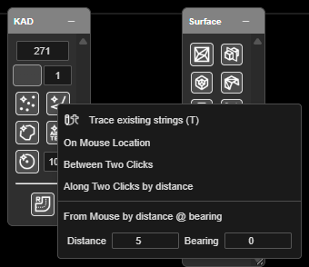

# Points, Lines, Polygons and Circles

The four basic KAD drawing tools on the **KAD** toolbar. Everything they share — finishing,
undo, layers, height and snapping — is in [Drawing Basics](drawing-basics.md).

| Button | Draws |
|---|---|
| **Add KAD Point** | A set of points |
| **Add KAD Line** | An open polyline |
| **Add KAD Polygon** | A closed shape |
| **Add KAD Circle** | A set of circles at **Circle Radius (m)** |

---

## Draw points, a line or a polygon

1. Set **Elevation Z**, **KAD Color** and **Point and Line Size** on the KAD toolbar.
2. Click **Add KAD Point**, **Add KAD Line** or **Add KAD Polygon**.
3. Click on the canvas for each point or vertex. In 3D, click in the 3D view.
4. **Right-click** (or **Escape**) to finish. The tool stays on — click again to start the next one.
5. **Right-click** again to turn the tool off.

A polygon is closed from its first vertex: you do not need to click back on the start.

## Draw circles

1. Set **Circle Radius (m)** on the KAD toolbar.
2. Click **Add KAD Circle** and click each centre. A ghost circle shows the size before you
   click. Change the radius between clicks if you need different sizes.
3. **Right-click** to finish.

---

## Placement modes

**Right-click** the **Add KAD Point**, **Add KAD Line** or **Add KAD Polygon** button to choose
how each click places a point.

| Mode | Each point goes | Button colour while on |
|---|---|---|
| **Trace existing strings (T)** | Along an existing KAD line or polygon — see [Trace](#trace-an-existing-line-or-polygon) | Purple |
| **On Mouse Location** | Where you click (normal) | Red |
| **Between Two Clicks** | Half-way between two clicks | Blue |
| **Along Two Clicks by distance** | **Distance** metres from the first click towards the second. Its height follows the slope between them | Amber |
| **From Mouse by distance @ bearing** | **Distance** metres from the click at **Bearing** (0 = north, clockwise). It keeps the click's height | Green |

- **Distance** (default 5) and **Bearing** (default 0) are set in the row under **From Mouse by
  distance @ bearing**.
- Picking a mode also switches the tool on, and the status line confirms it, for example
  *"Draw placement: Along two clicks by 5 m"*.
- The button's tooltip names the mode in use, for example *"Add KAD Line — On mouse location
  (right-click for placement modes)"*.
- In the two-click modes, the first click places nothing — *"Click the second point."*
- In 2D a marker previews where the next point will land.
- Each of the three tools keeps its own mode. The mode goes back to **On Mouse Location** each
  time you switch the tool on.

> **Tip:** **Along Two Clicks by distance** places a point a set distance along a line between
> two snapped points — for example 5 m in from a crest along a toe line.

### Trace an existing line or polygon

Trace copies part of a KAD line or polygon you already have into the one you are drawing, vertex
for vertex — for example to follow a crest string, then carry on by hand.

1. Switch on **Add KAD Point**, **Add KAD Line** or **Add KAD Polygon**, then press **T** — or
   right-click the button and choose **Trace existing strings (T)**. The button turns purple and
   the status line reads *"Trace on: click a KAD line or polygon to start a run (T turns it off)."*
2. Click the string where the run should start. That point is added straight away, and the status
   line reads *"Trace: click the same string again to end the run. Space goes the other way round;
   Escape cancels."*
3. Move along the string. The section that will be added is drawn purple, in 2D and 3D.
4. Click the same string where the run should end. Every vertex between the two clicks, and the end
   point, is added in order — *"Traced n points."*
5. Carry on: click off any string to place a point where you click, as **On Mouse Location** does,
   or click a string to start another run.

| Do this | Result |
|---|---|
| Click within the snap radius of a vertex | The run starts or ends exactly on that vertex |
| Click on a segment, away from its vertices | The run starts or ends on the segment, at the point nearest the cursor, with its height interpolated |
| **Space** (closed polygon) | The run goes the other way round the polygon |
| Click a different string | Starts a new run on that string |
| Click off any string with a run open | Drops the run — *"Trace run dropped - that click was not on a string."* The start point stays |
| **Escape** with a run open | Cancels the run only — *"Trace run cancelled."* What you have drawn stays |
| **T** again | Back to the mode you had before |
| **Ctrl+Z** | Undoes a whole traced section in one step |

The string you trace is never changed, and the drawing you are making is never offered as a
string to trace.

---

## Other ways to use them

| Method | Result |
|---|---|
| Right-click the button | Placement modes, including Trace (Point, Line and Polygon only) |
| **T** while drawing | Trace on or off |
| Snap on | Points land exactly on holes, vertices, lines and surfaces |
| Section plane in 3D | Points are drawn on the plane |
| **Backspace** | Removes the last point |
| **Ctrl+Z** | Undoes one point at a time |

---

## Select stray points

Points imported from a survey or a scan often include a few strays: a point far off in the air,
or a scatter of dust. **Select Stray Points…** finds them so you can delete them in one go.

1. In the [Data Explorer](../working-in-kirra/data-explorer.md), select one or more point
   drawings (Ctrl+click for more).
2. Right-click one of them and choose **Select Stray Points…**.
3. In **Select stray KAD points**, choose **Select by** and set its fields (below).
4. Click **Select**. The status bar says, for example, *14 KAD points selected. Press Delete to
   remove them.*
5. Press **Delete**. **Undo** (Ctrl+Z) brings them all back in one step.

| Select by | Field | Default | What it does |
|---|---|---|---|
| **Stray points** | **Neighbours** | 8 | How many nearest neighbours each point's distance is averaged over |
| | **Spread** | 2 | How many standard deviations above the average distance a point must be to count as stray. **Lower** selects more points |
| **Sparse points** | **Radius (m)** | 0.5 | Selects points with fewer than **Min neighbours** other points within this radius, in 3D |
| | **Min neighbours** | 1 | 1 keeps thin features, such as a line of points along a scanned blasthole |

**Stray points** works best when the points are evenly spaced. For a handheld scan, or for dust,
use **Sparse points**.

**Selection** chooses **Replace**, **Add** or **Remove**. **Replace** also clears any selected
holes or drawings, so **Delete** removes only the stray points. Hidden and locked drawings are
not searched.

The same selection works on point clouds — see
[Point Clouds](../surfaces/point-clouds.md#select-points).

---

## Troubleshooting

**Every click starts a new drawing.**
You are right-clicking between points, or pressing **Escape**. Each one finishes the drawing.

**The points are at the wrong height.**
Snap gave them the height of what they snapped to. Turn **Snap** off, or check **Elevation Z**.

**Kirra asks to convert my line to a point.**
A line needs at least 2 points and a polygon 3 — see [Too few points](drawing-basics.md#too-few-points).

---

## Related

- [Drawing Basics](drawing-basics.md)
- [KAD Text](text.md)
- [Modify Toolbar](modify-tools.md) — offset, join, split, simplify and more
