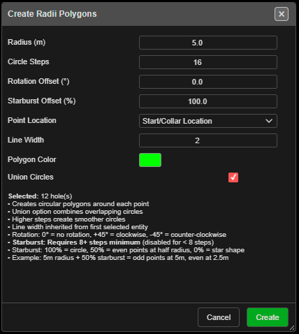

# Radii

Draws a circle (or star) of a set radius around each selected hole or drawing point, and can merge
overlapping circles into one outline. Use it for stand-off zones, clearance radii and exclusion
outlines.

---

## Draw radii

1. Select holes, or drawings — points, lines and polygons (each vertex), text, circles, or
   vertices in **V** mode.
2. Click **Radii Holes/KADs** on the **Modify** toolbar. **Create Radii Polygons** opens and lists
   what is selected, for example *"Selected: 12 hole(s)"*.
3. Set the radius and options, then click **Create**.

With nothing selected Kirra says *"Please select holes or KAD entities first, then activate the
Radii tool."*

---

## The fields

| Field | Default | What it does |
|---|---|---|
| **Radius (m)** | 5.0 | Circle radius. Must be more than 0 |
| **Circle Steps** | 16 | Points around each circle (3 – 100). More is smoother |
| **Rotation Offset (°)** | 0.0 | Turns each circle (−360 to 360; positive is clockwise) |
| **Starburst Offset (%)** | 100 | 100 % is a circle; lower pulls every second point in to make a star. Needs 8 or more steps |
| **Point Location** | **Start/Collar Location** | Or **End/Toe Location** — circles around the toes |
| **Line Width** | From the first selection, else 2 | |
| **Polygon Color** | From the first selection, else green | |
| **Union Circles** | On | Merges overlapping circles into one outline |

Example from the dialog: *"5m radius + 50% starburst = odd points at 5m, even at 2.5m"*.

---

## What you get

Closed polygons named after the blast or drawing they came from and the radius — for example
`BLAST-01_Radii_5m_ab12`, or `…_RadiiUnion_…` when merged and `…_RadiiToe_…` around toes. They go
on the **Boundaries / Radii** layer, or your active layer. The whole set is one undo step, and
the tool switches off afterwards.

---

## Troubleshooting

**"Please enter a valid radius > 0".**
A circle cannot have a negative radius. To shrink an outline, use [Offset KAD](offset.md) with a
negative distance.

**"Starburst offset" is greyed out.**
Set **Circle Steps** to 8 or more.

---

## Related

- [Offset KAD](offset.md)
- [Layer Organisation](layer-organisation.md)
- [Modify Toolbar](modify-tools.md)
