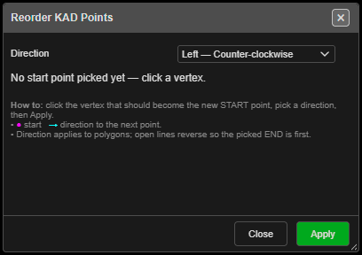

# Reorder KAD Points

Chooses which vertex a line, polygon or point set starts from, and which way round it runs. Point
order matters for exports, labels and tools that follow a line from its start.

---

## Set a new start point

1. Click **Reorder KAD Points** on the **Modify** toolbar. The palette opens and point IDs are
   switched on so you can see the order.
2. Click the vertex that should become the new **START** (marked in magenta, with a cyan arrow
   for the direction).
3. Choose **Direction**: **Left — Counter-clockwise** (default) or **Right — Clockwise**.
4. Click **Apply**. The points are renumbered from 1. The palette stays open for another drawing.
5. **Close** the palette, or **right-click twice** quickly, to finish. Point IDs go back to how
   they were.

- On an **open line** only one of its two ends can be the start — picking it reverses the line.
- Polygons and point sets accept any vertex.

---

## Other ways to use it

| Method | Result |
|---|---|
| **Right-click** the canvas | Clears the pick |
| **Right-click** twice quickly | Ends the tool |
| **Escape** | Ends the tool |
| Works in 3D | Pick vertices in either view |

---

## Undo

Each **Apply** is one **Ctrl+Z** step.

> **Note:** Offset direction comes from the drawn shape, not the point order — reordering does
> not change which way [Offset KAD](offset.md) goes.

---

## Related

- [Modify Toolbar](modify-tools.md)
