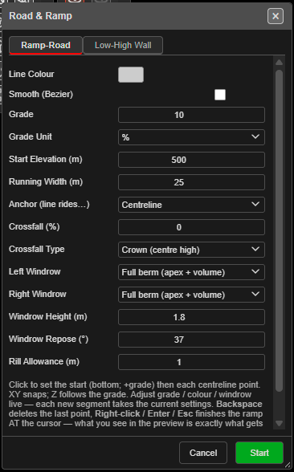
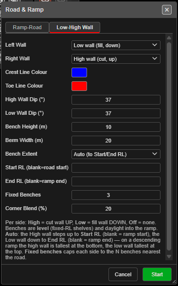

# Roads and Ramps

Digitises a graded road or ramp centreline and builds its strings — road edges, windrows,
cross-lines and, if you want them, cut and fill walls with benches. The start of a haul-ramp
design.

> **Work in progress:** this tool is still being developed. Its options may change.

---

## Draw a ramp

1. Click **Roads and Ramps** on the **KAD** toolbar. The **Road & Ramp** dialog opens.
2. Set the road on the **Ramp-Road** tab, and the walls on the **Low-High Wall** tab if you want
   them.
3. Click **Start**. The dialog stays open — changes apply as you draw.
4. Click the start point (the bottom of the ramp for a positive grade), then each centreline
   point. Before the first click, rings show the running and windrow widths.
5. **Right-click**, **Enter** or **Escape** to finish. The ramp is built exactly as previewed.

Kirra reports *"Road & Ramp: created … strings on layer …"*, naming the layer the strings went
to — **Design / Ramps**, or your active layer.

---

## While drawing

| Key | Does |
|---|---|
| Hold **Space** | Snaps the point to a whole-metre elevation |
| **Backspace** / **Delete** | Removes the last point |
| **Right-click**, **Enter**, **Escape** | Finishes the ramp |
| **Cancel** in the dialog | Discards the ramp — *"Road & Ramp: cancelled."* |

- The status line shows points, length, Z and grade as you go, and a readout shows **Plan Dist**,
  **Segment Dist**, **Total Dist** and **Elevation**.
- Heights come from **Start Elevation (m)** and the grade, not from **Elevation Z**.
- Points snap in plan (2D) or to drawing vertices (3D).
- Finishing with fewer than 2 points cancels.

---

## Ramp-Road tab

| Field | Default | Notes |
|-------|---------|-------|
| **Line Colour** | Cyan | Colour of the road strings |
| **Smooth (Bezier)** | Off | Smooths the centreline |
| **Grade** | 10 | 0 gives a flat road; a negative grade digitises downhill from the top |
| **Grade Unit** | % | **%**, **degrees** or **1:N** |
| **Start Elevation (m)** | 0 | Elevation of the first point |
| **Running Width (m)** | 25 | Trafficable width |
| **Anchor (line rides…)** | Centreline | Whether your line is the **Centreline**, **Left edge** or **Right edge** |
| **Crossfall (%)** | 0 | Cross slope of the running surface |
| **Crossfall Type** | Crown (centre high) | **None**, **Crown (centre high)**, **Fall left** or **Fall right** |
| **Left Windrow** / **Right Windrow** | Off | **Off**, **Space allowance (flat)** or **Full berm (apex + volume)** |
| **Windrow Height (m)** | 1.8 | |
| **Windrow Repose (°)** | 37 | |
| **Rill Allowance (m)** | 1.0 | |

## Low-High Wall tab

| Field | Default | Notes |
|-------|---------|-------|
| **Left Wall** / **Right Wall** | Off | **High wall (cut, up)**, **Low wall (fill, down)** or **Off** |
| **Crest Line Colour** / **Toe Line Colour** | Yellow / light blue | |
| **High Wall Dip (°)** | 65 | Batter angle of a high wall |
| **Low Wall Dip (°)** | 37 | Batter angle of a low wall |
| **Bench Height (m)** | 10 | |
| **Berm Width (m)** | 10 | |
| **Bench Extent** | Auto (to Start/End RL) | **Auto** steps the high wall up to **Start RL** and the low wall down to **End RL**; **Fixed benches** caps each side to the benches nearest the road |
| **Start RL (blank=road start)** / **End RL (blank=ramp end)** | Blank | |
| **Fixed Benches** | 3 | Used with **Fixed benches** |
| **Corner Blend (%)** | 35 | |

Benches are level shelves that daylight into the ramp. The dialog remembers your settings.

---

## What you get

- One line per string. Wall crests and toes are named by level, for example `470RL-C-a4jd`
  (crest) and `470RL-T-…` (toe); other strings by role, for example `crossLine-…`.
- One **Ctrl+Z** removes the whole ramp.

---

## Related

- [Drawing Basics](drawing-basics.md)
- [Layer Organisation](layer-organisation.md)
- [KAD Toolbar](kad-toolbar.md)
