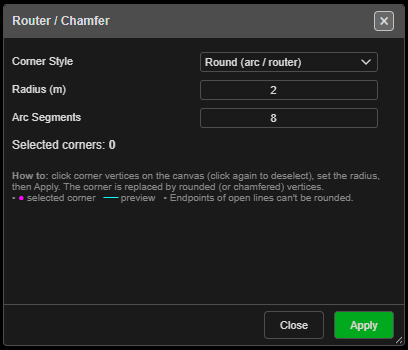

# Router-Chamfer

Rounds off (router) or cuts across (chamfer) chosen corners of a line or polygon.

---

## Round or bevel corners

1. Click **Router-Chamfer** on the **Modify** toolbar. The **Router / Chamfer** palette opens.
2. Click the corner vertices to change. Click one again to drop it. Selected corners are marked
   in magenta and counted under **Selected corners:**.
3. Choose the style and radius — a preview shows the result.
4. Click **Apply**. The palette stays open for more corners.
5. **Close** the palette, or **right-click twice** quickly on the canvas, to finish.

The end points of an open line cannot be rounded — *"endpoints can't be rounded — pick an
interior corner."*

---

## The fields

| Field | Default | What it does |
|---|---|---|
| **Corner Style** | **Round (arc / router)** | Or **Chamfer (straight bevel)** |
| **Radius (m)** | 2 | Size of the round or bevel |
| **Arc Segments** | 8 | Smoothness of a round corner (1 – 64). Greyed out for chamfer |

If a corner is too tight for the radius, the palette warns *"Radius clamped to fit on … corner(s)
— max here ≈ … m"* and uses the largest radius that fits.

The palette remembers its settings for the session.

---

## Other ways to use it

| Method | Result |
|---|---|
| **Right-click** the canvas | Clears the selected corners |
| **Right-click** twice quickly | Ends the tool |
| Works in 3D | Pick corners in either view |

---

## Undo

Each **Apply** is one **Ctrl+Z** step. The line is changed in place.

---

## Related

- [Simplify RDP](simplify.md)
- [Modify Toolbar](modify-tools.md)
