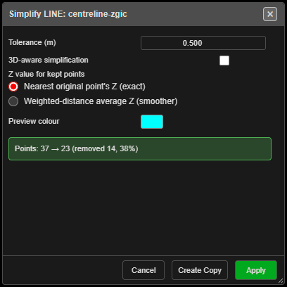

# Simplify RDP

Removes unneeded points from a line or polygon while keeping its shape within a tolerance
(Ramer–Douglas–Peucker). Use it to thin dense survey strings and imported drawings.

---

## Simplify a line or polygon

1. Click **Simplify RDP** on the **Modify** toolbar. The status line reads *"Simplify Tool: click a
   line or polygon to simplify (right-click to exit)"*.
2. Click a line or polygon. **Simplify LINE: …** or **Simplify POLY: …** opens with a preview
   and a count, for example *"Points: 37 → 23 (removed 14, 38%)"*.
3. Adjust the tolerance until the preview looks right.
4. Click **Apply** to change the drawing, or **Create Copy** to keep the original and add a
   simplified copy. Either way the tool stays on.

Points cannot be simplified, and a drawing needs at least 3 points.

---

## The fields

| Field | Default | What it does |
|---|---|---|
| **Tolerance (m)** | 0.5 | How far a removed point may be from the simplified line. Larger removes more |
| **3D-aware simplification** | Off | Takes height into account as well as plan position |
| **Z value for kept points** | **Nearest original point's Z (exact)** | Or **Weighted-distance average Z (smoother)** |
| **Preview colour** | Cyan | |

The dialog remembers its settings for the session.

---

## What you get

- **Apply** — the drawing is simplified in place. *"Simplified …: 37 → 23 points (removed 14)"*.
- **Create Copy** — a new drawing named `Name_simplified_…` in a **Simplified** sub-layer.

Each is one **Ctrl+Z** step. If nothing can be removed: *"Simplify: no points removed (try a larger
tolerance)"*.

---

## Other ways to use it

| Method | Result |
|---|---|
| **Right-click** the canvas | Ends the tool |
| **Cancel**, **×** or **Escape** | Closes the dialog and ends the tool |
| Works in 3D | Pick in either view |

---

## Related

- [Router-Chamfer](router-chamfer.md)
- [Modify Toolbar](modify-tools.md)
