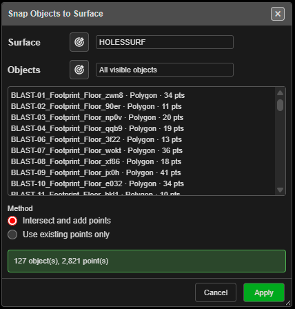

# Snap Objects to Surface

Drapes drawings onto a surface so their heights follow the ground — for example to put a design
outline onto a pickup surface.

---

## Drape drawings on a surface

1. Show the surface to drape onto. Optionally select the drawings first.
2. Click **Snap Objects to Surface** on the **Modify** toolbar.
3. Choose the **Surface**, and which **Objects**: **Selected objects** (the default when something
   is selected) or **All visible objects**.
4. Choose the **Method** and click **Apply**.

With no surface showing: *"Show the surface to snap to, then open Snap Objects to Surface again."*

---

## The fields

| Field | What it does |
|---|---|
| **Surface** | The surface to drape onto. The target button picks it on the canvas (switches to 3D) |
| **Objects** | **Selected objects** or **All visible objects**. The target button adds an object by picking it |
| Object list | Each object with its type and point count. In **Selected** mode the bin button removes one from the list |
| **Method** | **Intersect and add points** (default) adds points wherever the drawing crosses a surface edge, so it follows the ground closely. **Use existing points only** just moves the points it has |

The status line under the list counts the objects and points.

---

## What you get

Kirra reports, for example, *"12 object(s) snapped, 340 point(s) set, 85 added."* Points off the
edge of the surface keep their height, and Kirra says how many. The whole operation is one
**Ctrl+Z** step. Hidden objects are never changed.

---

## Related

- [Grade Line](grade-line.md)
- [Assign Surface and Assign Grade](assign-surface-grade.md) — the same idea for holes
- [Modify Toolbar](modify-tools.md)
