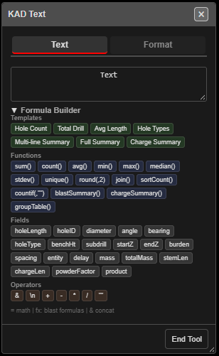
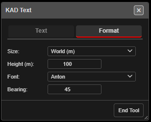

# KAD Text

Places text on the plan — plain labels, or values worked out from the blast with a formula.

---

## Place text

1. Click **Add KAD Text** on the **KAD** toolbar. The **KAD Text** dialog opens and stays open.
2. Type the text in the box on the **Text** tab.
3. Click on the canvas. Each click places the current text — change the text between clicks to
   place different labels.
4. **Right-click** to finish the drawing; click **End Tool** to close the dialog and stop.

> **Note:** Type first, then click. The text is not asked for after you click.

---

## Formulas

Text that starts with a marker is worked out when you place it:

| Starts with | Means | Example | Places |
|---|---|---|---|
| `fx:` | A blast formula — the same engine as print templates | `fx:sum(holeLength[i])` | the total drilled length |
| | | `fx:"Holes: "&count(holeID[i])` | *Holes: 120* |
| `=` | Basic maths | `=5+3` | 8 |
| | | `=sqrt(16)` | 4 |

Aggregate functions take any number of values: `fx:sum(2,2)` is 4, and
`fx:sum(holeLength[i], 5)` adds 5 to the field total.

### Formula Builder

Click **Formula Builder** to open a palette of ready-made pieces. Click one to add it to the text.

- **Templates** — Hole Count, Total Drill, Avg Length, Hole Types, Multi-line Summary,
  Full Summary, Charge Summary
- **Functions** — `sum()`, `count()`, `avg()`, `min()`, `max()`, `median()`, `stdev()`,
  `unique()`, `round(,2)`, `join()`, `sortCount()`, `countif(,"")`, `blastSummary()`,
  `chargeSummary()`, `groupTable()`
- **Fields** — holeLength, holeID, diameter, angle, bearing, holeType, benchHt, subdrill,
  startZ, endZ, burden, spacing, entity, delay, mass, totalMass, stemLen, chargeLen,
  powderFactor, product
- **Operators** — `&` (join text), `\n` (new line), `+ - * /`, `""`

### When a formula fails

**Calculation Error** shows the formula, the reason and examples:

| Button | Result |
|---|---|
| **Fix It** | Places nothing, so you can correct the text |
| **Cancel** | Places nothing |
| **As Text** | Places the text literally, without the `=` or `fx:` marker |

Pictures (maps, legends, north arrows) only work in print templates, not in KAD text.

---

## Format

*Format tab, showing one user's saved settings.*

| Setting | Default | What it does |
|---|---|---|
| **Size:** | **World (m)** | **World (m)** text is a real size on the ground and scales with zoom. **Fixed (px)** stays the same size on screen |
| **Height (m):** | 1 | Text height in metres (World). In Fixed mode this is **Font Size (px):**, default 12 |
| **Font:** | Anton | **Anton**, **Hershey Simplex** or **Roboto** |
| **Bearing:** | 0 | *"Rotation in plan, degrees clockwise from horizontal. 0 = horizontal."* |

Kirra remembers these in this browser, and new text uses them after a reload.

---

## Other ways to use it

| Method | Result |
|---|---|
| Snap on | Text anchors on a hole, vertex or line |
| Change the text between clicks | Several different labels in one session |
| `fx:` formula | Live blast figures placed as text |
| **Backspace** / **Ctrl+Z** | Removes or undoes the last text placed |

---

## Troubleshooting

**"No Text Entered".**
The text box is empty — type something before clicking.

**My label shows the formula, not the result.**
It was placed with **As Text**, or it does not start with `fx:` or `=`.

---

## Related

- [Drawing Basics](drawing-basics.md)
- [Print Formula Reference](../printing/pdf-print.md)
- [Formula Engine](../formula-help/formula-engine.md)
